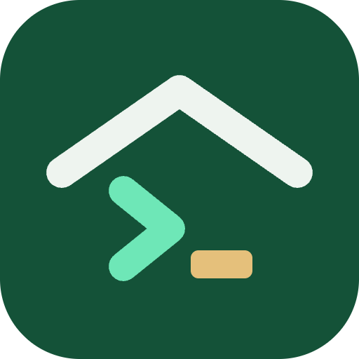
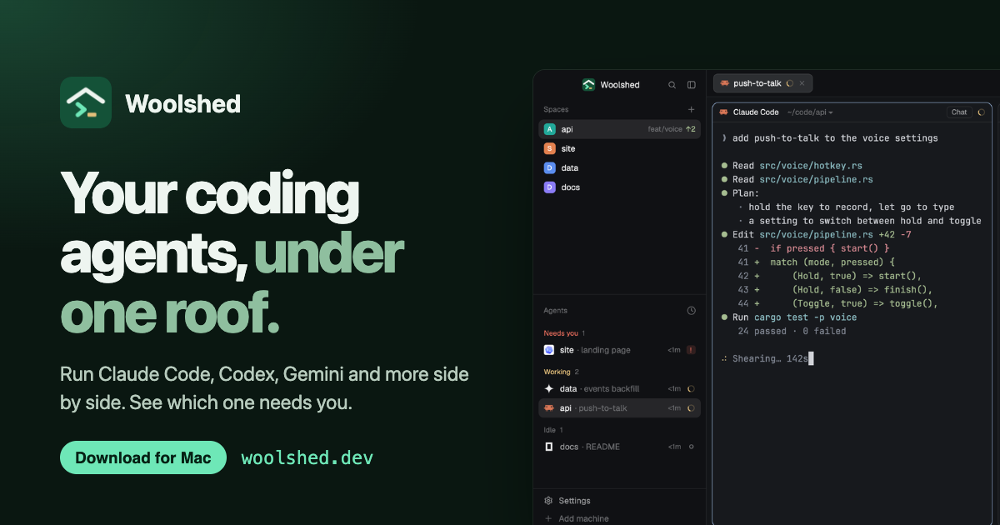

<p align="center">
  
</p>

<h1 align="center">Woolshed</h1>

<p align="center">
  <strong>Your coding agents, under one roof.</strong><br>
  Claude Code, Codex, Gemini and every other agent, side by side in one fast, native window.<br>
  It shows which one needs you, and keeps them all working when you close the window.
</p>

<p align="center">
  <a href="https://woolshed.dev/download/"><strong>Download</strong></a> ·
  <a href="https://woolshed.dev/start/">Get started</a> ·
  <a href="https://woolshed.dev/changelog/">What's new</a> ·
  <a href="https://woolshed.dev/roadmap/">Roadmap</a> ·
  <a href="https://woolshed.dev/gallery/">Gallery</a> ·
  <a href="https://github.com/woolshed-dev/woolshed/discussions">Discussions</a>
</p>

<p align="center">
  <a href="https://github.com/woolshed-dev/woolshed/releases/latest"></a>
  
</p>

<p align="center">
  <a href="https://woolshed.dev/"></a>
</p>

This repository is where Woolshed's releases, bug reports, feature requests and roadmap live.
The app is made by [Hatchify](https://woolshed.dev/press/); its source isn't public.

## Install

**Mac** (Apple silicon): [download Woolshed](https://woolshed.dev/releases/app/Woolshed.dmg), open it and drag Woolshed to Applications. It's signed and notarised by Apple.

**Linux** (x86-64 and ARM64):

```sh
curl -fsSL https://woolshed.dev/releases/app/install.sh | sh
```

**Windows** (x64), in PowerShell:

```powershell
irm https://woolshed.dev/releases/app/install.ps1 | iex
```

Or ask the agent you already use: `Install Woolshed for me: woolshed.dev/install.txt`

Woolshed updates itself, and your terminals keep running through every update.
Every release is also on the [Releases](https://github.com/woolshed-dev/woolshed/releases) page, with its notes and checksums.

## What it does

- **Every agent, one window.** Spaces for each project, with tabs and split panes, for Claude Code, Codex, Gemini, Cursor, OpenCode, Copilot and any terminal program, signed in with your own accounts.
- **Know who needs you.** Every agent on every machine in one list: working, needs you, done or idle. The one waiting on an answer is never buried in a tab.
- **Close the window, keep the work.** Terminals run in Woolshed Core, the service inside the app, so agents keep going when you close the window, quit or update.
- **Terminal or chat.** Open your agents as a chat as well as a terminal.
- **Your servers too.** Add a machine over SSH; its agents join the same list and keep working when your laptop is shut.
- **Agents drive it.** Agents start helpers, hand them work and wait on the result with `hc run`, `hc send` and `hc wait`.
- **Make it yours.** Layouts and mods change the whole window; ask your agent for one, or take one from the [gallery](https://woolshed.dev/gallery/).
- **Woolshed Voice.** Hold a key, speak, and the words appear in any app.
- **Private by design.** Your code, terminals and prompts never reach us. Your agents talk to their makers directly. [What leaves your machine](https://woolshed.dev/privacy/).

Native Rust, drawn on the GPU, with the Ghostty terminal engine inside. No Electron.

## Help and feedback

- **Something broken?** [Report a bug](https://github.com/woolshed-dev/woolshed/issues/new?template=bug.yml). The version is in Settings › Updates.
- **An idea?** [Request a feature](https://github.com/woolshed-dev/woolshed/issues/new?template=feature.yml), or start a [discussion](https://github.com/woolshed-dev/woolshed/discussions).
- **A question?** Ask in [Discussions](https://github.com/woolshed-dev/woolshed/discussions/categories/q-a), or read the [docs](https://woolshed.dev/developers/) and [FAQ](https://woolshed.dev/#faq).
- **A security issue?** Please don't open an issue: see [SECURITY.md](SECURITY.md).

What to expect when you write in: [SUPPORT.md](SUPPORT.md). Ways to help, including mods and layouts for the gallery: [CONTRIBUTING.md](CONTRIBUTING.md).

## Roadmap

What's planned and what's shipped: [ROADMAP.md](ROADMAP.md), the [roadmap page](https://woolshed.dev/roadmap/) and issues labelled [`roadmap`](https://github.com/woolshed-dev/woolshed/issues?q=label%3Aroadmap).

---

<p align="center">
  <sub>© 2026 Hatchify Pty Ltd. Woolshed includes software licensed under the Apache License 2.0 and other open-source components; their notices ship inside the app.</sub>
</p>
