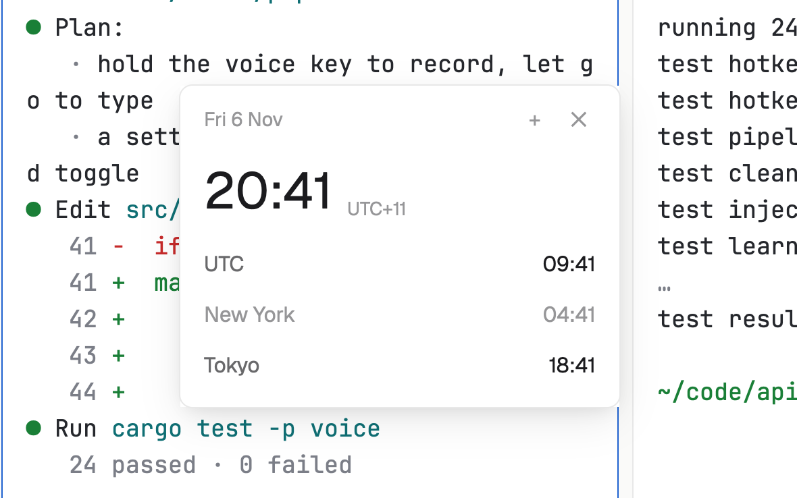

# Clock strip

The date and time along the bottom of the window, with the clocks of the places your team or your servers live in. Hours when a place is probably asleep are dimmer.

**What it shows you:**

- `mod.json` with `"place": "bottom"`: the strip docks along the bottom of your own layouts, and also opens as a window (`ctrl-shift-h`, from `keys.json`).
- `shared` / `setShared`: the chosen places and the 12/24-hour choice, kept for every copy of the mod.
- `openOverlay` / `closeOverlay`: the places popup.
- A timer that redraws once a minute, on the minute, and at no other time.
- `zones.js`: a second module the mod imports, holding time zones and daylight-saving rules.

Files: [`mods/clock-strip/main.js`](mods/clock-strip/main.js), [`mods/clock-strip/zones.js`](mods/clock-strip/zones.js), [`mods/clock-strip/mod.json`](mods/clock-strip/mod.json), [`keys.json`](keys.json). [RECIPE.md](RECIPE.md) describes exactly how it looks and behaves.
