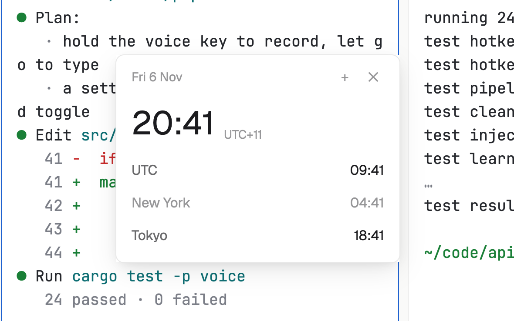

# Clock strip

The date and time along the bottom of the window, with the clocks of the places your team (or your servers) live in. Hours when a place is probably asleep are drawn dimmer, so you know who might answer.

## What you see

- **The strip**, 26 px, the theme's `chrome`, 12 px text: the date ("Thu 5 Nov") in `dim`, your own time in semibold, then each place you chose: its name in `dim` and its time in `muted`, dimmer between 22:00 and 07:00 there, with "+1" or "−1" when it's already tomorrow or still yesterday. A "+" at the right end.
- **The places popup** (from "+"), 240 px: "Places to show (up to 6)" and all 48 places, each with its current time; the chosen ones have a check mark in the `accent` color.
- **As a window** (`ctrl-shift-h`), 260 px: the date, your time in 30 px with your offset ("UTC+11"), and a row per place.

## How it behaves

- Click your own time to switch between 24-hour ("14:32") and 12-hour ("2:32 pm") clocks, for every clock it shows.
- In the popup, click a place to add or remove it; the oldest drops off past six.
- It redraws once a minute, right on the minute, and at no other time.
- Starts with UTC, New York and Tokyo.

## Built from

- `mods/clock-strip/zones.js`: the mod runtime has no time-zone database, so the 48 places carry their standard offsets and one of four daylight-saving rules: Europe (last Sunday of March to last Sunday of October, 01:00 UTC), US and Canada (second Sunday of March to first Sunday of November, 02:00 local), south-east Australia (first Sunday of October to first Sunday of April) and New Zealand (last Sunday of September to first Sunday of April). Places without daylight saving keep their offset (Phoenix, Mexico City, São Paulo, India, Tokyo, Brisbane, Perth and others).
- `mods/clock-strip/main.js`: choices in shared `clock-strip` (`zones`, `h12`); `woolshed` functions `shared`, `setShared`, `theme`, `props`, `openOverlay`, `closeOverlay`. Your own time comes from this computer's clock.
- `mod.json`: `{ "place": "bottom", "size": 26, "overlay": { "kind": "window", "key": "clock-strip", "keep": true } }`: the first time one of your own layouts shows, the strip docks along the bottom; `mod.open clock-strip` opens the window anywhere. `keys.json`: `"ctrl-shift-h": "mod.open:clock-strip"`.

## Watch out

- The rules were checked minute by minute against the system's time-zone database for 2024 to 2030. Should a country change its rules, its entry in `zones.js` needs the change.
- Woolshed's own layouts are read-only, so the strip docks only in your own; there, use the window.
- `preview.png` is a screenshot of Woolshed in light mode, running example agents.

## Done when

- `woolshed check` passes on this folder.
- The strip's own time matches the system clock and each place matches a world clock, including across a daylight-saving change.
- Adding Berlin in the popup shows it on the strip at once.
- Clicking your own time switches every clock to 12 hours and back.
