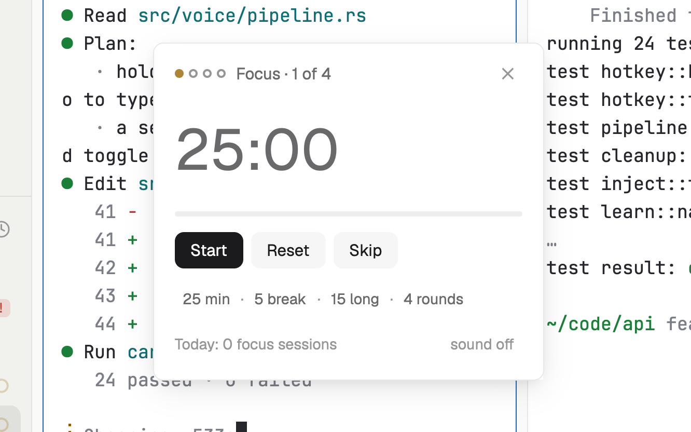

# Pomodoro

A focus timer that knows you have agents: when a focus ends, it tells you how many agents are waiting, so you can pick them up on the break.

**What it shows you:**

- `shared` / `setShared`: one timer shared by every copy (a window and a strip show the same one), surviving restarts.
- `notify` with an `action`: a toast that starts the next focus when clicked.
- `playSound("done")`: the theme's done sound at the end of a phase.
- `nextCommand()`: key commands for the mod (`pomodoro.start`, `pomodoro.pause`, `pomodoro.toggle`, `pomodoro.reset`, `pomodoro.skip`).
- A one-second tick that runs only while the timer runs.

Files: [`mods/pomodoro/main.js`](mods/pomodoro/main.js), [`mods/pomodoro/mod.json`](mods/pomodoro/mod.json), [`keys.json`](keys.json). [RECIPE.md](RECIPE.md) describes exactly how it looks and behaves.
