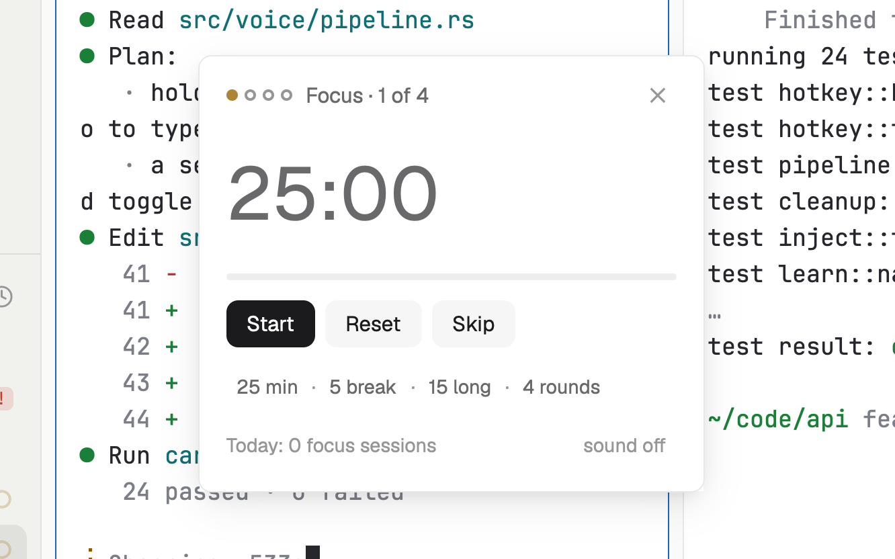

# Pomodoro

A focus timer that knows you have agents: focus for 25 minutes, take a break, repeat. When a focus ends it tells you how many agents are waiting, so you can pick them up on the break.

## What you see

A window 300 px wide (`ctrl-shift-m`) on the `popover` color:

- A row of round dots, one per round (done rounds filled with the `done` color, the current focus in the `working` color, the rest rings), "Focus · 2 of 4" (or "Short break", "Long break") in `muted`, and ✕.
- The time left, "18:42", in 44 px semibold (`muted` while paused).
- A 4 px progress bar: `working` color during a focus, `done` color during a break.
- Buttons, 28 px: a solid Start (Resume, Pause), Reset and Skip.
- The lengths in 11.5 px: "25 min · 5 break · 15 long · 4 rounds", each a button.
- "Today: 3 focus sessions" and, at the right, "sound off" or "sound on".

In a layout block it's a strip: a play or pause mark, the time and the phase.

## How it behaves

- Start runs the focus; Pause keeps the time left; Reset puts the phase back to its full length; Skip moves to the next phase, stopped, without counting the one skipped.
- When a focus ends a break starts by itself (a long one after the last round) and a toast says so, with "2 agents waiting on you" when that's so. When a break ends, a toast asks "Break over. Ready to focus?"; clicking it starts the next focus.
- Click a length to cycle it: focus 15, 20, 25, 30, 45, 50 or 60 minutes; break 3, 5 or 10; long break 10, 15, 20 or 30; rounds 2, 3, 4 or 6.
- "sound on" also plays the done sound at the end of each phase.
- The timer is shared: a window and a strip show the same one, and it keeps going across restarts.
- Key commands for a shown copy: `pomodoro.start`, `pomodoro.pause`, `pomodoro.toggle`, `pomodoro.reset`, `pomodoro.skip`.

## Built from

- `mods/pomodoro/main.js`: state in shared `pomodoro.state` (`phase`, `running`, `endsAt`, `left`, `round`, `done`, `day`) and `pomodoro.settings`; `woolshed` functions `agents`, `shared`, `setShared`, `notify`, `playSound`, `theme`, `props`, `closeOverlay`, `nextCommand`. A one-second tick redraws only while the timer runs; the first copy to see a phase end moves the shared state on, so the others don't repeat it.
- `mod.json`: a kept window (`key: "pomodoro"`, `keep: true`). `keys.json`: `"ctrl-shift-m": "mod.open:pomodoro"`.
- Art: `play.svg`, `pause.svg`.

## Watch out

- The count of focus sessions is per day and resets at midnight (by this computer's clock).
- A toast's Start reaches a copy that's on screen; with the window closed, open it and press Start.
- `preview.png` is a screenshot of Woolshed in light mode, running example agents.

## Done when

- `woolshed check` passes on this folder and `ctrl-shift-m` opens the timer.
- Start counts down every second; Pause stops it and Resume carries on from there.
- At the end of a focus a toast appears and the break starts by itself.
- Changing "25 min" to "30 min" while stopped shows 30:00.
