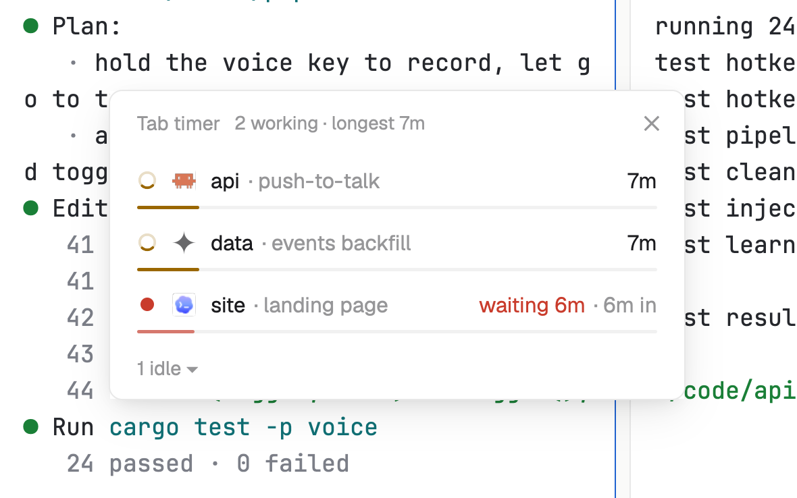

# Tab timer

How long each agent has been at it. Working agents show a running time and a bar that fills in an hour; finished ones show how long their last run took.

**What it shows you:**

- `agents()` and `spaces()`: live data. `render` runs again whenever an agent's status changes, so nothing polls.
- `localStorage`: each agent's run times, kept per mod copy so they survive a restart.
- `run("pane.focus", ...)`: clicking a row goes to that agent.
- `.spin(...)` on an SVG: a native spinner, with no timer redrawing the window.
- `mod.json` with an `overlay` window, `key` and `keep: true`: `mod.open tab-timer` (or `ctrl-shift-u`) opens a window that remembers its spot and comes back on the next start.

Files: [`mods/tab-timer/main.js`](mods/tab-timer/main.js), [`mods/tab-timer/mod.json`](mods/tab-timer/mod.json), [`keys.json`](keys.json). [RECIPE.md](RECIPE.md) describes exactly how it looks and behaves.
