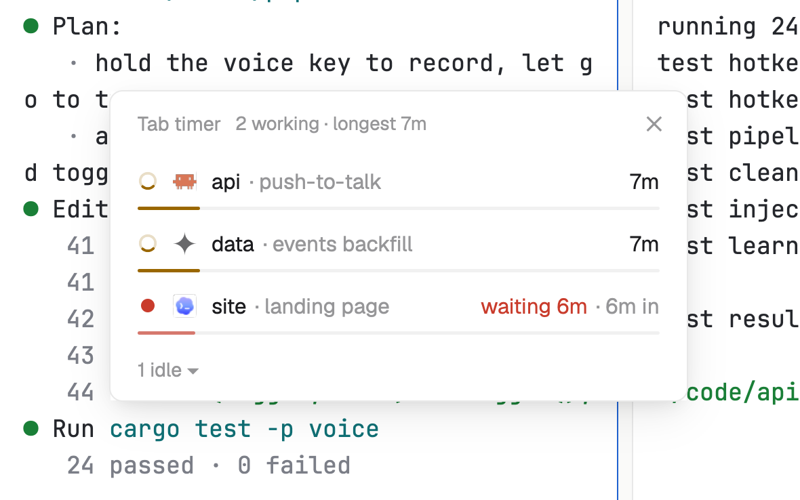

# Tab timer

How long each agent has been at it. Working agents show a running time and a thin bar that fills in an hour; finished ones show how long their last run took. Spot the one that's been going suspiciously long.

## What you see

A window 340 px wide (`ctrl-shift-u`), or a panel in a layout block, on the `popover` (window) or `chrome` (block) color:

- **Header**, 38 px: "Tab timer" in 11.5 px `dim`, a summary ("3 working · longest 47m", or "Nothing running"), and ✕ in a window.
- **Rows**, 30 px, 12.5 px text: a status mark (spinner for working, a dot for waiting and done, a ring for idle), the program's 14 px icon, the space name, then "· what it's about" in `dim`. At the right:
  - working: the run's time in semibold ("47m"), and under the row a 2 px bar in the `working` color that is full at one hour; past an hour, the time and the bar turn the `blocked` color;
  - waiting: "waiting 4m" in the `blocked` color, then "· 31m in" (the run so far), with the bar in a softer red;
  - finished: "ran 22m" (`done` color) "· 6m ago";
  - idle agents fold into "2 idle ▾" at the bottom; click to show them ("ran 14m · 2h ago", or "idle 3h").
- Order: working (longest first), waiting (longest first), finished (newest first), then idle.

## How it behaves

- A run starts when an agent starts working and ends when it finishes; time spent waiting on you stays inside the run.
- Click a row to go to that agent (`pane.focus`).
- Times move every 20 seconds (they show minutes).

## Built from

- `mods/tab-timer/main.js`: `woolshed` functions `agents`, `spaces` (each tab's `working_since`, for runs already going when it starts), `run`, `theme`, `props`, `closeOverlay`. Per agent it keeps `{ status, since, start, last }` in the mod's local storage, so times survive a restart.
- `mod.json`: `{ "place": "none", "overlay": { "kind": "window", "key": "tab-timer", "keep": true } }`: `mod.open tab-timer` opens a window that remembers its spot and comes back on the next start.
- `keys.json`: `"ctrl-shift-u": "mod.open:tab-timer"`.
- Art: `spinner.svg`.

## Watch out

- It counts while a copy runs. A run already going when it starts takes its start from the tab's `working_since` (when the app saw that tab start working), which is per tab, not per agent.
- Two copies (a window and a block) keep their own records and can differ by the time one wasn't open.
- `preview.png` is a screenshot of Woolshed in light mode, running example agents.

## Done when

- `woolshed check` passes on this folder and `ctrl-shift-u` opens the window.
- A working agent shows a time that grows each minute and a bar that grows with it.
- When it finishes, its row reads "ran <time> · <time> ago".
- Clicking a row opens that agent's tab.
