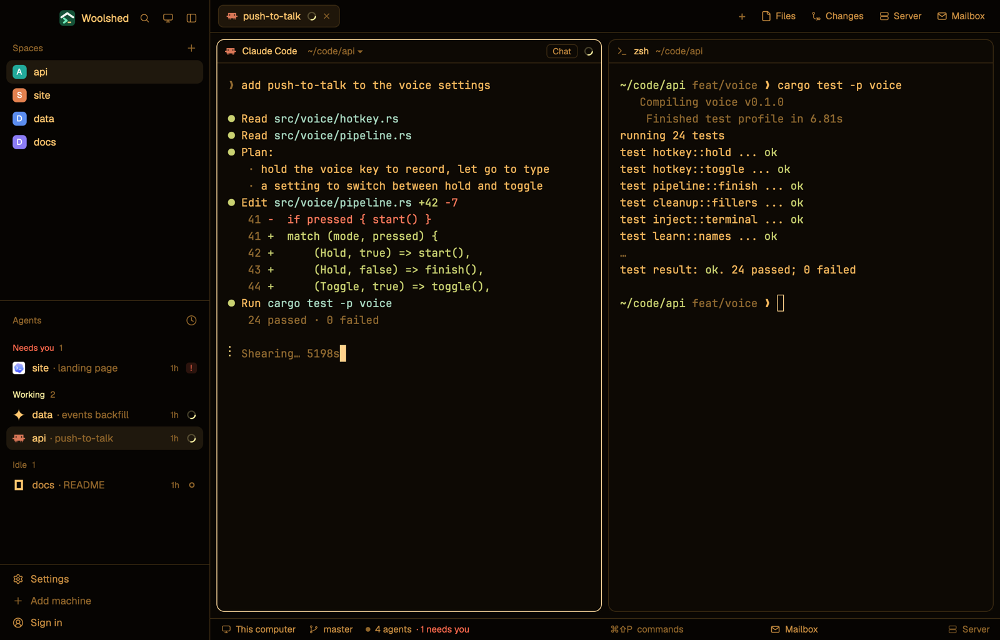

# Amber CRT

Woolshed's own window as an amber monochrome terminal: near-black glass, warm amber text in three brightnesses and a pale-amber accent and cursor. Easy on the eyes at night, and working, needs you and done keep their own colors (pale yellow, red-orange, sky blue) so status is never lost.

## What you see

- **The look**: the `graphite` theme with the layout's own colors over every theme color, so it looks the same in light and dark mode (a dark theme by design).
  - **Backgrounds**: terminals (`background`, also `surface`) `#0d0904`, behind the cards (`canvas`) `#0a0703`, sidebar and bars (`chrome`) `#060402`, menus (`popover`) `#171007`, `raised` (the shown tab, buttons) `#1f160a`; `border` `#3a2a12`, `input` `#56411d`, `hover` `#ffc66e0f`, `selected` `#ffc66e1a`, terminal `selection` `#4b3511`.
  - **Text**: `foreground` `#ffc66e`, terminal text (`terminal_foreground`) `#f2b65c`, `muted` `#c88d40`, `dim` `#90652a`; `ring` `#c88d40`.
  - **Accent**: pale amber `#ffdb9e` with `accent_foreground` `#0d0904` on it (the focused pane's border, primary buttons, links); `solid` `#ffc66e` with `solid_foreground` `#0d0904`; cursor `#ffd28c`.
  - **Agents**: working `#fff3a3`, needs you (`blocked`) `#ff6a4d`, done `#9ad1ff`, idle and unknown `#90652a`.
  - **Terminal colors** (normal/bright): black `#2c1f0d`/`#916a30`, red `#ff7a5c`/`#ff9b82`, green `#c9d171`/`#dee595`, yellow `#ffd47c`/`#ffe3a2`, blue `#90b9e9`/`#b1d0f3`, magenta `#e9a1c9`/`#f5bdda`, cyan `#a9d9c1`/`#c5e9d7`, white `#f2b65c`/`#ffe7c1`.
- **Contrast** (WCAG, measured): text 11.51:1 (lowest on any panel), terminal text 10.98:1, `muted` 6.23:1, `dim` 3.47:1, the accent 15.01:1 against the background and its text 15.01:1 on it, working/needs you/done at least 7.01:1, terminal colors at least 7.74:1 (bright black 4.07:1), terminal text on the selection 6.40:1.
- **The window** is Woolshed's own layout, unchanged: the sidebar, 268 px on `chrome` (Woolshed's header, 46 px; Spaces, Agents and History; the sidebar's foot, 97 px); the tab bar, 42 px; panes as cards 8 px apart with 10 px corners on `background`, a 1 px `border` and the focused pane in `accent`, with the 30 px pane header; the start screen while no space is open; the side panel (Files, Changes, Server, Mailbox), 368 px, hidden until opened; and the 28 px status bar (the branch and repo, the mailbox, the project's site).

## How it behaves

- Everything works as in the Woolshed layout: spaces, agents, history, tabs, the + menu, Files, Changes, Server and Mailbox, pane headers, splitting and dragging panes. The side panel remembers per space whether it was open, the same as there.
- Agent status shows in the sidebar and tab bar in the colors above: working `#fff3a3`, needs you `#ff6a4d`, done `#9ad1ff`, idle `#90652a`.
- It looks the same in light and dark mode: the layout's colors cover every theme color.
- `ctrl-shift-l` (`layout.switch`) moves on to your next layout; nothing else changes.

## Built from

- `layouts/amber-crt.json`: Woolshed's shipped `main.json` (0.1.5) unchanged, plus at the root `theme: "graphite"`, `colors` with all 42 theme colors (`background`, `surface`, `canvas`, `chrome`, `popover`, `raised`, `hover`, `selected`, `border`, `input`, `selection`, `accent`, `accent_foreground`, `solid`, `solid_foreground`, `foreground`, `terminal_foreground`, `muted`, `dim`, `cursor`, `ring`, `working`, `blocked`, `done`, `idle`, `unknown`, `ansi0`, `ansi1`, `ansi2`, `ansi3`, `ansi4`, `ansi5`, `ansi6`, `ansi7`, `ansi8`, `ansi9`, `ansi10`, `ansi11`, `ansi12`, `ansi13`, `ansi14`, `ansi15`) and `preview: "layouts/amber-crt.svg"`.
- `layouts/amber-crt.svg`: the 224×124 picture the settings screen shows, a small window in the palette.
- No mods of its own: it uses Woolshed's shipped `workspace-chrome`, `spaces`, `agents`, `history`, `tabs`, `new-session`, `pane`, `files`, `changes`, `server`, `mailbox`, `workspace-status`. It runs no programs and fetches nothing.

## Watch out

- `preview.png` is a screenshot of Woolshed in light mode, running example agents.
- The terminal colors are kept as faint hues, not all amber, so errors, diffs and prompts still read.
- The layout's colors cover every theme color, so picking another theme while in it changes almost nothing. To leave the look, switch layouts.
- It's a copy of Woolshed's own layout as of 0.1.5: when Woolshed's layout gains something later, this copy doesn't. To refresh it, copy the newer `main.json` and put this layout's root `theme`, `colors` and `preview` back on it.
- Colors in a layout are `#rrggbb` or `#rrggbbaa` only, not theme names.

## Done when

- `woolshed check` passes on this folder, and `woolshed do layout.switch --name amber-crt` shows the Woolshed window in these colors.
- Every contrast above measures as stated: text 7:1 or more, `muted` 4.5:1 or more and `dim` 3:1 or more on every panel.
- A working, a waiting and a done agent show three clearly different status colors in the sidebar.
- Files and Changes open the side panel, and the status bar shows the branch, as in the Woolshed layout.
