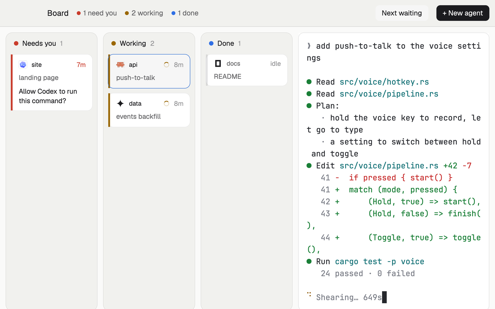

# Board

Every agent as a card on a board with three columns: Needs you, Working and Done. The agent you pick runs live and full size beside the board, so you answer it without leaving the overview.

## What you see

Top to bottom, then left to right:

- **Title bar**, 48 px, the theme's `chrome` with a 1 px `border` line below. "Board" in 14 px semibold, then three counts, each a 7 px dot in the status color and a 12.5 px `muted` label: "2 need you", "3 working", "2 done" (done and idle together). On the right a "Next waiting" button (only while someone waits) and a solid "+ New agent" button, both 28 px tall with 7 px corners. macOS leaves 84 px on the left for the window buttons; Linux and Windows get –, □ and ✕ buttons at the right end.
- **The board**, three equal columns 10 px apart, each a `chrome` card with 12 px corners and a 1 px `border`. A column header (38 px) has an 8 px dot in the status color (`blocked`, `working`, `done`), the name in 12.5 px semibold and the count in `dim`.
- **Cards**, 8 px apart: 10 px corners, the terminal `background`, a 1 px `border` and a 3 px strip down the left edge in the status color (idle cards: the same color at a third strength, and dimmer text). First line: the program's 15 px icon, the space name in 13 px semibold, and on the right how long it has been in this state (a 11 px spinner before the time while working; "idle" for idle ones; red time for blocked). Second line: what it's about in 12 px `muted` (the tab's name if someone named it, else the agent's own title, else the program). Needs-you cards add the question the agent is asking, up to two lines in `foreground`. A parent with helpers (sub-agents) shows "1 helper" with a dot.
- **The stage**, two fifths of the width, a live terminal of the shown agent in a card with 10 px corners and a 1 px `border`.

## How it behaves

- Blocked agents sit in Needs you, longest waiting first. Working agents sit in Working, longest running first. Done holds agents that finished while you looked elsewhere (newest first), then idle ones. Pinned agents go first in their column.
- Click a card to show that agent on the stage (`agent.focus`). The card you're showing has a `raised` background and an `accent` border.
- Hover a card for Peek (`terminal.peek`), Pin or Unpin (`terminal.pin`) and Open tab (shows its tab in the Woolshed layout: `pane.focus`, then `layout.switch` to `main`).
- `agent.next` and `agent.prev` (your usual keys) step through the cards in board order.
- The question on a Needs you card comes from the agent's screen, read every 5 seconds while it waits.
- "Next waiting" shows the agent that has waited longest. "+ New agent" opens Woolshed's own agent menu; the new agent starts in a new tab of the shown space and joins Working when it reports.
- Narrower than about 620 px, the columns stack and the board scrolls as one.

## Built from

- `layouts/board.json`: root column (`titlebar: "none"`, `traffic_lights: [16, 17]`, background `canvas`, `terminal_padding: [14, 12]`, `preview: "mods/board/preview.svg"`). Children: `board-bar` (block, 48 px, `window_drag`, mod `board` with `{ "role": "bar" }`) and `board-body` (row, padding 10, gap 10) holding `lanes` (block, weight 3, min 300, mod `board` with `{ "role": "lanes" }`) and `stage` (block, weight 2, min 320, background `background`, 1 px `border`, radius 10, content `{ "agent": "focused" }`).
- `mods/board/main.js`, one mod in two roles. `woolshed` functions: `agents`, `terminals` (helpers: live terminals whose `parent` is the agent), `spaces` (each tab's `working_since`), `focused` (`agent`: the one on stage), `run`, `hc`, `theme`, `props`, `window`, `openOverlay`, `setAgentOrder`. Commands: `agent.focus`, `terminal.peek`, `terminal.pin`, `pane.focus`, `layout.switch`, `window.minimize|maximize|close`.
- Program: `hc read <address>` for waiting agents only (up to 8, every 5 s). The question is the last line ending in "?" in the bottom 24 lines, with box drawing and prompt marks removed; else the last line.
- Shipped mod: `new-menu` (opened as a 250×512 popup).
- Art: `spinner.svg`, `pin.svg`, and `preview.svg` (the Settings picture).

## Watch out

- There is no tab block: plain shells and editors aren't on screen here. Use Open tab, or switch layouts.
- The stage is an agent block. With nothing chosen it shows the focused pane's agent, else the first one. Looking at a done agent turns it idle, so its card moves to the idle part of Done.
- Each card's time is when this mod saw the agent enter that state (kept in the mod's local storage across restarts); a working agent uses its tab's `working_since`.
- The bar and the board are two copies of the mod with separate state; both are cheap.
- `preview.png` is a screenshot of Woolshed in light mode, running example agents.

## Done when

- `woolshed check` passes on this folder, and `woolshed do layout.switch --name board` shows the board.
- With agents in several states, each card is in the right column, and a waiting agent's question appears on its card within a few seconds.
- Clicking a card shows that agent live on the stage; typing goes to it.
- `agent.next` follows the cards from Needs you down to Done.
- "+ New agent" opens the agent menu, and a started agent appears under Working.
