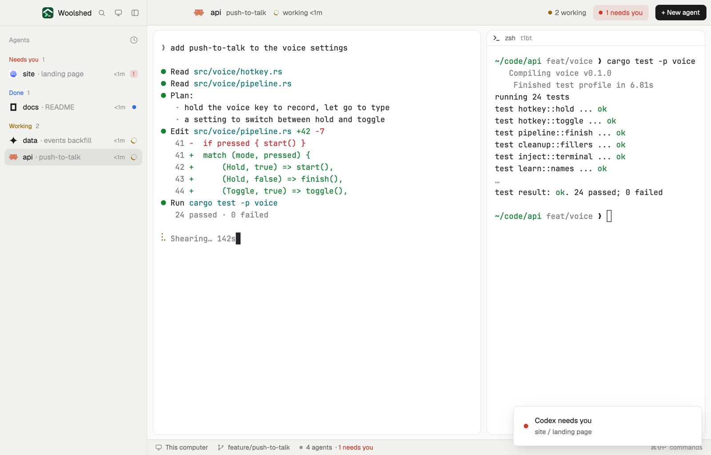

# Cockpit

Fly one agent at a time with everything around it in view: every agent listed on the left, the one you picked full size in the middle, and on the right whatever else runs in its tab (the test run, a dev server, a shell), each live in its own card. Pick another agent and the right side follows it.

## What you see

Left to right:

- **The sidebar**, 264 px on `chrome`: Woolshed's head (icon, name, search, another screen, fold) over Woolshed's Agents list, every agent with its state and how long.
- **The bar**, 46 px on `chrome` with a 1 px `border` line below, across the middle and right: the stage agent's icon (18 px), its space in 14 px semibold, what it's about in `muted` (the tab's name, else the agent's own title), then its state ("working 4m" with a spinner, "needs you" in `blocked` red, "finished", "idle"). On the right "3 working" with a `working` dot, a red-tinted "1 needs you" button while another agent waits, and a solid "+ New agent". Linux and Windows get –, □ and ✕ at the end; if the sidebar is hidden on macOS the bar leaves 84 px for the window buttons.
- **The stage**, three fifths of the rest, 8 px below the bar: the agent, live and full size, in a card with 10 px corners, a 1 px `border` and an `accent` border while you type in it.
- **The side**, two fifths: up to four cards, 10 px apart, one for each other terminal in the shown tab, in pane order. Each card has a 28 px tag (state dot or spinner, the program's icon, its name in semibold, its title or folder in `dim`, and for agents how long in this state and "To stage"; red-tinted while it needs you) over the live terminal. With nothing else in the tab: a `chrome` card saying "Nothing else in this tab" and an "Open a shell beside it" button.
- **The status bar**, 28 px: Woolshed's own (machine, branch, repo, pull request, agents count).

## How it behaves

- Click an agent in the list (or use `agent.next` / `agent.prev`) to put it on the stage: Woolshed shows its tab, and the side fills with that tab's other terminals.
- Type into any side card directly; clicking its tag gives it the keyboard. "To stage" on an agent's tag swaps it onto the stage.
- "Open a shell beside it" splits a shell into the agent's tab (`pane.split` right of the agent); it appears on the side at once. Closing a pane there takes its card away.
- "1 needs you" puts the agent that has waited longest on the stage. "+ New agent" opens Woolshed's agent menu.
- The bar rewrites the layout's side column (`layout.set`) only when the set of terminals there should change, never more than once in 4 s for the same set.

## Built from

- `layouts/cockpit.json`: root row (`titlebar: "none"`, `traffic_lights: [12, 16]`, background `canvas`, `terminal_padding: [14, 12]`, 1 px `border` divider, `preview: "layouts/cockpit.svg"`). `sidebar` (column, 264 px, `chrome`: `brand` 46 px `window_drag` mod `workspace-chrome`, `agents` mod `agents`). `work` (column: `cockpit-bar` 46 px `window_drag` mod `cockpit {role: "bar"}`; `cockpit-body` row, padding `[8, 10]`, gap 10: `stage` (block, weight 3, min 360, background `background`, `border`, `focus` border `accent`, radius 10, content `{ "agent": "focused" }`) and `cockpit-side` (column, weight 2, min 260, gap 10, starting with block `side-empty`, mod `cockpit {role: "empty"}`); `status` 28 px mod `workspace-status`).
- `mods/cockpit/main.js`, one mod in three roles (`bar`, `tag` with `terminal`, `empty`); `mods/cockpit/side.js`, the pure part: who goes on the side (`panes()` of `focused().tab` with a terminal, except `focused().agent`, at most 4) and the nodes for it (a column per card: `tag-<address>` 28 px block, then `term-<address>` with `{ "terminal": address }`).
- `woolshed`: `agents`, `panes`, `spaces` (`working_since`), `focused`, `layout`, `run`, `theme`, `props`, `home`, `window`, `openOverlay`. Commands: `layout.set`, `agent.focus`, `pane.focus`, `pane.split`, `window.minimize|maximize|close`; the shipped `new-menu` as a 250×512 popup.
- Shipped mods: `workspace-chrome`, `agents`, `workspace-status`. Art: `mods/cockpit/spinner.svg`, `layouts/cockpit.svg`.

## Watch out

- The side is not a `{ "tab": "active" }` block: that would show the stage agent twice, since `agent.focus` shows the agent's own tab. It is terminal blocks the bar keeps in step.
- Mod panes (a Files viewer split into the tab) don't get a card; only terminals do. Past four terminals, the first four in pane order show.
- The stage is an agent block: with nothing picked it shows the focused pane's agent, else the first one.
- `layout.set` saves the layout file: a cockpit you leave and come back to shows the last side until the bar catches up.
- `preview.png` is a screenshot of Woolshed in light mode, running example agents.

## Done when

- `woolshed check` passes on this folder; switching in shows the agents list, the stage and the side.
- Picking the agent whose tab also runs a test pane shows the agent on the stage and the test run, live, on the side.
- Picking an agent alone in its tab shows "Nothing else in this tab"; "Open a shell beside it" adds a shell card.
- "To stage" on a side agent puts it on the stage, and the other one moves to the side.
