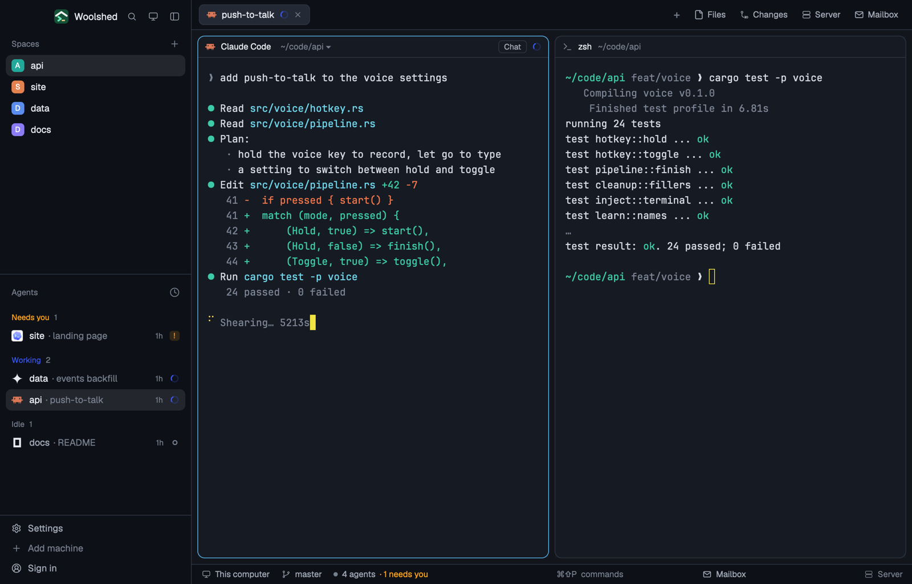

# Colorblind Safe

Woolshed's own window with status colors anyone can tell apart: blue for working, orange for needs you, light purple for done, chosen to stay distinct with deuteranopia, protanopia and tritanopia (red-green and blue-yellow color blindness), on a calm dark blue-grey. Terminal red and green become vermilion and blue-green, so diffs read too.

## What you see

- **The look**: the `graphite` theme with the layout's own colors over every theme color, so it looks the same in light and dark mode (a dark theme by design).
  - **Backgrounds**: terminals (`background`, also `surface`) `#161a22`, behind the cards (`canvas`) `#12151c`, sidebar and bars (`chrome`) `#0d1016`, menus (`popover`) `#1d222c`, `raised` (the shown tab, buttons) `#232935`; `border` `#2d3441`, `input` `#404959`, `hover` `#e7eaf00f`, `selected` `#e7eaf01a`, terminal `selection` `#2f3f5e`.
  - **Text**: `foreground` `#e7eaf0`, terminal text (`terminal_foreground`) `#d5dae3`, `muted` `#a2aab8`, `dim` `#767f8e`; `ring` `#a2aab8`.
  - **Accent**: sky blue `#56b4e9` with `accent_foreground` `#0d1016` on it (the focused pane's border, primary buttons, links); `solid` `#e7eaf0` with `solid_foreground` `#0d1016`; cursor (yellow) `#f0e442`.
  - **Agents**: working `#3858fa`, needs you (`blocked`) `#ffa31a`, done `#cca8f0`, idle and unknown `#767f8e`.
  - **Terminal colors** (normal/bright): black `#2b313c`/`#7c8696`, red `#f2774c`/`#ff9a72`, green `#3ccaa8`/`#72e1c4`, yellow `#f0d660`/`#ffe58c`, blue `#5aa9f0`/`#8dc5f8`, magenta `#d68cc2`/`#e9aad8`, cyan `#6fd5ea`/`#9ce4f2`, white `#d5dae3`/`#f4f6fa`.
- **Contrast** (WCAG, measured): text 12.10:1 (lowest on any panel), terminal text 12.42:1, `muted` 6.23:1, `dim` 3.61:1, the accent 7.55:1 against the background and its text 8.25:1 on it, working/needs you/done at least 3.27:1, terminal colors at least 6.24:1 (bright black 4.74:1), terminal text on the selection 7.51:1.
- **Told apart** (CIEDE2000 between the closest two of working, needs you and done, as each sees them): normal vision 31, deuteranopia 27, protanopia 21, tritanopia 20. Terminal red against green: normal vision 57, deuteranopia 22, protanopia 19, tritanopia 66.
- **The window** is Woolshed's own layout, unchanged: the sidebar, 268 px on `chrome` (Woolshed's header, 46 px; Spaces, Agents and History; the sidebar's foot, 97 px); the tab bar, 42 px; panes as cards 8 px apart with 10 px corners on `background`, a 1 px `border` and the focused pane in `accent`, with the 30 px pane header; the start screen while no space is open; the side panel (Files, Changes, Server, Mailbox), 368 px, hidden until opened; and the 28 px status bar (the branch and repo, the mailbox, the project's site).

## How it behaves

- Everything works as in the Woolshed layout: spaces, agents, history, tabs, the + menu, Files, Changes, Server and Mailbox, pane headers, splitting and dragging panes. The side panel remembers per space whether it was open, the same as there.
- Agent status shows in the sidebar and tab bar in the colors above: working `#3858fa`, needs you `#ffa31a`, done `#cca8f0`, idle `#767f8e`.
- It looks the same in light and dark mode: the layout's colors cover every theme color.
- `ctrl-shift-l` (`layout.switch`) moves on to your next layout; nothing else changes.

## Built from

- `layouts/colorblind-safe.json`: Woolshed's shipped `main.json` (0.1.5) unchanged, plus at the root `theme: "graphite"`, `colors` with all 42 theme colors (`background`, `surface`, `canvas`, `chrome`, `popover`, `raised`, `hover`, `selected`, `border`, `input`, `selection`, `accent`, `accent_foreground`, `solid`, `solid_foreground`, `foreground`, `terminal_foreground`, `muted`, `dim`, `cursor`, `ring`, `working`, `blocked`, `done`, `idle`, `unknown`, `ansi0`, `ansi1`, `ansi2`, `ansi3`, `ansi4`, `ansi5`, `ansi6`, `ansi7`, `ansi8`, `ansi9`, `ansi10`, `ansi11`, `ansi12`, `ansi13`, `ansi14`, `ansi15`) and `preview: "layouts/colorblind-safe.svg"`.
- `layouts/colorblind-safe.svg`: the 224×124 picture the settings screen shows, a small window in the palette.
- No mods of its own: it uses Woolshed's shipped `workspace-chrome`, `spaces`, `agents`, `history`, `tabs`, `new-session`, `pane`, `files`, `changes`, `server`, `mailbox`, `workspace-status`. It runs no programs and fetches nothing.

## Watch out

- `preview.png` is a screenshot of Woolshed in light mode, running example agents.
- The three status colors differ in lightness as well as hue (deep blue, bright orange, pale purple), which is what keeps them apart under every common color blindness. Measured with the Machado 2009 simulation (full severity) and CIEDE2000: the closest pair is at least 20 apart for normal vision, deuteranopia, protanopia and tritanopia.
- Programs that pick their own 24-bit colors (some diff tools) still use their own red and green.
- The layout's colors cover every theme color, so picking another theme while in it changes almost nothing. To leave the look, switch layouts.
- It's a copy of Woolshed's own layout as of 0.1.5: when Woolshed's layout gains something later, this copy doesn't. To refresh it, copy the newer `main.json` and put this layout's root `theme`, `colors` and `preview` back on it.
- Colors in a layout are `#rrggbb` or `#rrggbbaa` only, not theme names.

## Done when

- `woolshed check` passes on this folder, and `woolshed do layout.switch --name colorblind-safe` shows the Woolshed window in these colors.
- Every contrast above measures as stated: text 7:1 or more, `muted` 4.5:1 or more and `dim` 3:1 or more on every panel.
- A working, a waiting and a done agent show three clearly different status colors in the sidebar, also with deuteranopia, protanopia and tritanopia (check in a color-blindness simulator).
- Files and Changes open the side panel, and the status bar shows the branch, as in the Woolshed layout.
