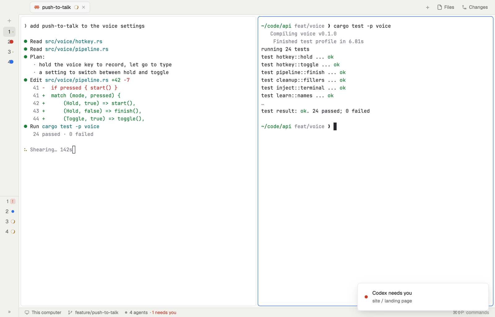

# Compact

Woolshed for a laptop screen: the sidebar shrinks to a 48 px rail of space and agent icons, the tab bar and the status line get slimmer, panes sit 4 px apart with smaller text and margins, so the terminal gets nearly the whole display. Everything is still one click away.

## What you see

- Your theme (the layout sets none), terminal text at 13 px with 8 px side margins and 6 px top and bottom, on `canvas`.
- **The rail**, 48 px on `chrome`, a 1 px `border` on its right: a 38 px top (the macOS window buttons sit over it and the tab bar's start), then Woolshed's Spaces list as a rail (a 32 px cell per space with its color and state, + for a new one), then the Agents list as a rail (each agent's icon with its state), sharing the height 3 : 2.
- **The tab bar**, 38 px: Woolshed's own, tabs from the left (clear of the window buttons), + and the Files and Changes buttons at the right; on Linux and Windows –, □ and ✕ after them.
- **The tab**, 4 px from every edge and 4 px between panes, each pane a card with 6 px corners, a 1 px `border` and an `accent` border on the focused one when split (a lone pane has no frame and no header). The Files or Changes panel (320 px) opens on its right. With no space open, the start screen.
- **The status line**, 24 px: the machine, the branch, the repo and its pull request, the agents count, the palette key.

## How it behaves

- It is Woolshed's shipped parts, smaller: hover a rail cell for its name, click to show it; agents show working (spinner), blocked (red), done (blue dot) and idle as usual, and » on the agents rail unfolds the sidebar to its full width (the same button folds it back).
- The tab bar's Files and Changes open the side panel and remember it per space.
- `ctrl-shift-b` (`cmd-b` on macOS) hides the rail as in the usual layout.

## Built from

- `layouts/compact.json`: root row (`titlebar: "none"`, `traffic_lights: [12, 12]`, background `canvas`, `font_size: 13`, `terminal_padding: [8, 6]`, 1 px `border` divider, `preview: "layouts/compact.svg"`). `sidebar` (column, 48 px, min 44, max 480, `chrome`, `resizable: false`: `brand` 38 px `window_drag` mod `workspace-chrome`; `sidebar-lists` with `spaces` weight 3 and `agents` weight 2, min 90 each). `work` (column: `tabs` 38 px `window_drag` mod `tabs`; `work-body` row, padding 4, gap 4: `main` `{ "tab": "active", "empty": { "mod": "new-session", "props": { "page": true } }, "pane": { "gap": 4, "radius": 6, "background": "background", "border": { "width": 1, "color": "border" }, "focus": { "width": 1, "color": "accent" } } }` and `panel` (hidden, 320 px, stack `panel-body` of `files` and `changes`); `status` 24 px mod `workspace-status`).
- No mod of its own: `spaces`, `agents` and `workspace-chrome` draw their rail because the `sidebar` node is narrower than 160 px; `tabs` leaves the macOS window buttons room past the rail.
- Art: `layouts/compact.svg`.

## Watch out

- The rail is the shipped lists' narrow mode, which they choose from the `sidebar` node's width: keep that id and a width under 160 px.
- Unfolding the sidebar (») makes it full width in this layout too, until folded back.
- `preview.png` is a screenshot of Woolshed in light mode, running example agents.

## Done when

- `woolshed check` passes on this folder; switching in shows the 48 px rail, a 38 px tab bar and a 24 px status line.
- On macOS the first tab starts clear of the window buttons.
- Clicking a rail cell shows that space; the agents rail shows a spinner on a working agent.
- Files opens the 320 px panel beside the tab.
