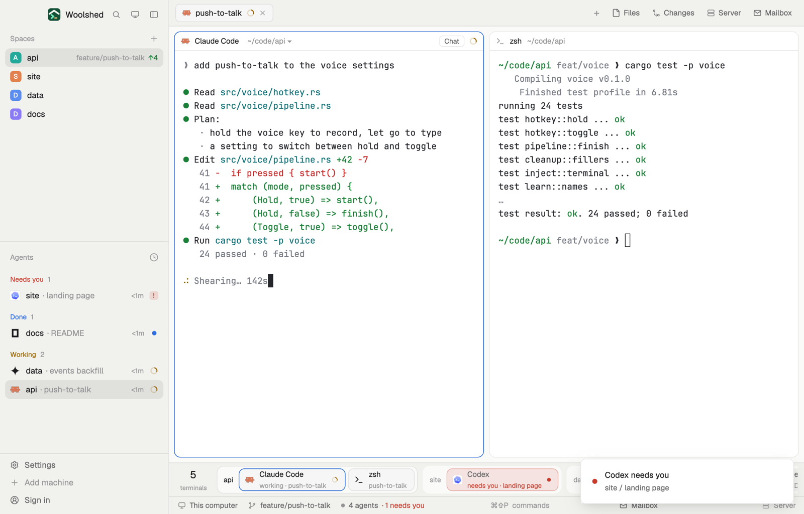

# Dock

The usual Woolshed window with a dock along the bottom: every running terminal as a chip, grouped by space, agents and plain terminals alike (the test run, the dev server, the helpers agents start on their own). One click shows any of them, wherever it lives.

## What you see

- Woolshed's own window above it, unchanged: the sidebar (Spaces, Agents, History, footer), the tab bar, the tab, the Files / Changes / Server / Mailbox panel, and the status bar at the very bottom.
- **The dock**, 54 px on `chrome`, a 1 px `border` line above, just over the status bar:
  - On the left, the count in 16 px semibold over "terminals" in 10 px `dim`.
  - Then a group per space with something running, in space order: a 44 px tray on `canvas` with 11 px corners (outlined with `border` for the shown space), the space's name in 11 px semibold, then its chips in tab and pane order.
  - A **chip**, 36 px, 9 px corners: the program's icon (15 px), its name on top in 12 px (an agent by its program, "Claude Code"; a program Woolshed doesn't list by its title, "pytest -x"; a shell by its name, "zsh"), and below in 10.5 px `dim` its state and tab ("working · push-to-talk", "needs you · landing page" in red) or just the tab ("tab 2"), then a state dot or spinner. Chips of the tab on screen are `raised` with a `border`; the terminal you're typing in has an `accent` border; a waiting agent's chip is tinted red. Helpers an agent started without a pane follow their parent with "↳".
  - With nothing running: "Nothing running. New terminals and agents show up here as you start them."

## How it behaves

- Click a chip to show that terminal: its tab opens and it gets the keyboard (`pane.focus`). A helper without a pane opens as a peek over the tab (`terminal.peek`), with Woolshed's keep-as-tab and close.
- Click a space's name in the dock to show that space.
- Hover a chip for its space, tab and folder.
- The dock scrolls sideways when the chips don't fit. It redraws only when Woolshed's data changes; it runs nothing and polls nothing.
- Agent states: working (spinner in `working`), blocked (red dot, red tint, "needs you"), done (`done` dot), idle (hollow ring).

## Built from

- `layouts/dock.json`: Woolshed's `main` as shipped, with one more block in the `work` column between `work-body` and `status-bar`: `dock` (54 px, mod `dock`). `preview: "layouts/dock.svg"`.
- `mods/dock/main.js`, and `mods/dock/chips.js` (pure: the groups and chips from `spaces()`, `panes()`, `terminals()` (helpers: live terminals whose `parent` is a shown terminal and that have no pane) and `agents()`). `woolshed`: those four, `focused`, `run`, `theme`, `home`. Commands: `pane.focus`, `terminal.peek`, `space.select`.
- Shipped mods: everything `main` uses. Art: `mods/dock/spinner.svg`, `layouts/dock.svg`.

## Watch out

- Terminals another app started without Woolshed's labels aren't in Woolshed's spaces, so they aren't in the dock either.
- A pane that holds a mod (a Files viewer split into a tab) has no terminal and no chip.
- `preview.png` is a screenshot of Woolshed in light mode, running example agents.

## Done when

- `woolshed check` passes on this folder; switching in shows Woolshed's window with the dock above the status bar.
- With an agent and a test run split beside it, both have chips in their space's group, and the test run goes by its title.
- Clicking a chip in another space shows that space's tab with that terminal focused, and its chip gets the `accent` border.
- Splitting a new shell adds a chip; closing it removes it.
