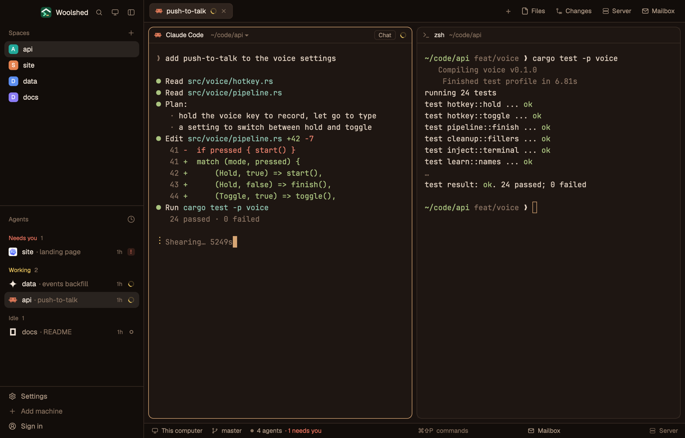

# Espresso

Woolshed's own window in dark roast brown: coffee-black panels, creamy text and a crema-tan accent and cursor. Cosy and warm but brighter than a dim theme, with golden working, red needs-you and blue done, and soft terminal colors that read on the brown.

## What you see

- **The look**: the `graphite` theme with the layout's own colors over every theme color, so it looks the same in light and dark mode (a dark theme by design).
  - **Backgrounds**: terminals (`background`, also `surface`) `#1e1612`, behind the cards (`canvas`) `#18110e`, sidebar and bars (`chrome`) `#120d0a`, menus (`popover`) `#281e19`, `raised` (the shown tab, buttons) `#2f241e`; `border` `#3a2d25`, `input` `#513f34`, `hover` `#f1e5d90f`, `selected` `#f1e5d91a`, terminal `selection` `#4c3629`.
  - **Text**: `foreground` `#f1e5d9`, terminal text (`terminal_foreground`) `#e1d1c1`, `muted` `#b29c88`, `dim` `#86705e`; `ring` `#b29c88`.
  - **Accent**: crema `#d6a574` with `accent_foreground` `#18110e` on it (the focused pane's border, primary buttons, links); `solid` `#f1e5d9` with `solid_foreground` `#18110e`; cursor `#d6a574`.
  - **Agents**: working `#e7c25d`, needs you (`blocked`) `#f17661`, done `#90b4da`, idle and unknown `#86705e`.
  - **Terminal colors** (normal/bright): black `#3a2d25`/`#8a7362`, red `#e9816d`/`#f69d89`, green `#aac37f`/`#c1d898`, yellow `#e3be6b`/`#f1d287`, blue `#90aed1`/`#aac5e3`, magenta `#ca9bb9`/`#dcb3cd`, cyan `#90c3b1`/`#a9d7c7`, white `#e1d1c1`/`#fbf3eb`.
- **Contrast** (WCAG, measured): text 12.18:1 (lowest on any panel), terminal text 11.96:1, `muted` 5.75:1, `dim` 3.23:1, the accent 8.05:1 against the background and its text 8.44:1 on it, working/needs you/done at least 6.37:1, terminal colors at least 6.64:1 (bright black 4.00:1), terminal text on the selection 7.55:1.
- **The window** is Woolshed's own layout, unchanged: the sidebar, 268 px on `chrome` (Woolshed's header, 46 px; Spaces, Agents and History; the sidebar's foot, 97 px); the tab bar, 42 px; panes as cards 8 px apart with 10 px corners on `background`, a 1 px `border` and the focused pane in `accent`, with the 30 px pane header; the start screen while no space is open; the side panel (Files, Changes, Server, Mailbox), 368 px, hidden until opened; and the 28 px status bar (the branch and repo, the mailbox, the project's site).

## How it behaves

- Everything works as in the Woolshed layout: spaces, agents, history, tabs, the + menu, Files, Changes, Server and Mailbox, pane headers, splitting and dragging panes. The side panel remembers per space whether it was open, the same as there.
- Agent status shows in the sidebar and tab bar in the colors above: working `#e7c25d`, needs you `#f17661`, done `#90b4da`, idle `#86705e`.
- It looks the same in light and dark mode: the layout's colors cover every theme color.
- `ctrl-shift-l` (`layout.switch`) moves on to your next layout; nothing else changes.

## Built from

- `layouts/espresso.json`: Woolshed's shipped `main.json` (0.1.5) unchanged, plus at the root `theme: "graphite"`, `colors` with all 42 theme colors (`background`, `surface`, `canvas`, `chrome`, `popover`, `raised`, `hover`, `selected`, `border`, `input`, `selection`, `accent`, `accent_foreground`, `solid`, `solid_foreground`, `foreground`, `terminal_foreground`, `muted`, `dim`, `cursor`, `ring`, `working`, `blocked`, `done`, `idle`, `unknown`, `ansi0`, `ansi1`, `ansi2`, `ansi3`, `ansi4`, `ansi5`, `ansi6`, `ansi7`, `ansi8`, `ansi9`, `ansi10`, `ansi11`, `ansi12`, `ansi13`, `ansi14`, `ansi15`) and `preview: "layouts/espresso.svg"`.
- `layouts/espresso.svg`: the 224×124 picture the settings screen shows, a small window in the palette.
- No mods of its own: it uses Woolshed's shipped `workspace-chrome`, `spaces`, `agents`, `history`, `tabs`, `new-session`, `pane`, `files`, `changes`, `server`, `mailbox`, `workspace-status`. It runs no programs and fetches nothing.

## Watch out

- `preview.png` is a screenshot of Woolshed in light mode, running example agents.
- The layout's colors cover every theme color, so picking another theme while in it changes almost nothing. To leave the look, switch layouts.
- It's a copy of Woolshed's own layout as of 0.1.5: when Woolshed's layout gains something later, this copy doesn't. To refresh it, copy the newer `main.json` and put this layout's root `theme`, `colors` and `preview` back on it.
- Colors in a layout are `#rrggbb` or `#rrggbbaa` only, not theme names.

## Done when

- `woolshed check` passes on this folder, and `woolshed do layout.switch --name espresso` shows the Woolshed window in these colors.
- Every contrast above measures as stated: text 7:1 or more, `muted` 4.5:1 or more and `dim` 3:1 or more on every panel.
- A working, a waiting and a done agent show three clearly different status colors in the sidebar.
- Files and Changes open the side panel, and the status bar shows the branch, as in the Woolshed layout.
