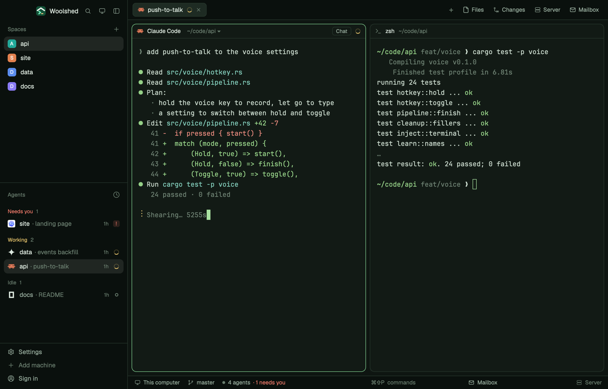

# Fern

Woolshed's own window in deep forest green: dark green panels, pale sage text and a fresh fern-green accent and cursor. Restful for long sessions, with golden working, coral needs-you and sky-blue done dots, and soft, readable terminal colors.

## What you see

- **The look**: the `moss` theme with the layout's own colors over every theme color, so it looks the same in light and dark mode (a dark theme by design).
  - **Backgrounds**: terminals (`background`, also `surface`) `#121a15`, behind the cards (`canvas`) `#0e1511`, sidebar and bars (`chrome`) `#0a100d`, menus (`popover`) `#18221c`, `raised` (the shown tab, buttons) `#1e2b23`; `border` `#26362c`, `input` `#364c3e`, `hover` `#dde9df0f`, `selected` `#dde9df1a`, terminal `selection` `#2c4c38`.
  - **Text**: `foreground` `#dde9df`, terminal text (`terminal_foreground`) `#c9d9cc`, `muted` `#96ab9c`, `dim` `#6a7e6f`; `ring` `#96ab9c`.
  - **Accent**: fern green `#80d090` with `accent_foreground` `#0e1511` on it (the focused pane's border, primary buttons, links); `solid` `#dde9df` with `solid_foreground` `#0e1511`; cursor `#a9e2a1`.
  - **Agents**: working `#e3c16a`, needs you (`blocked`) `#f17b6b`, done `#80b5ea`, idle and unknown `#6a7e6f`.
  - **Terminal colors** (normal/bright): black `#25342b`/`#6e8273`, red `#ea8b7f`/`#f7a497`, green `#95d087`/`#aee3a0`, yellow `#ddc274`/`#edd490`, blue `#85b5dd`/`#a1c9eb`, magenta `#c3a1d7`/`#d5b8e5`, cyan `#80c9b7`/`#9bdcca`, white `#c9d9cc`/`#eff7f0`.
- **Contrast** (WCAG, measured): text 11.79:1 (lowest on any panel), terminal text 12.06:1, `muted` 6.04:1, `dim` 3.39:1, the accent 9.58:1 against the background and its text 10.00:1 on it, working/needs you/done at least 6.57:1, terminal colors at least 7.18:1 (bright black 4.31:1), terminal text on the selection 6.50:1.
- **The window** is Woolshed's own layout, unchanged: the sidebar, 268 px on `chrome` (Woolshed's header, 46 px; Spaces, Agents and History; the sidebar's foot, 97 px); the tab bar, 42 px; panes as cards 8 px apart with 10 px corners on `background`, a 1 px `border` and the focused pane in `accent`, with the 30 px pane header; the start screen while no space is open; the side panel (Files, Changes, Server, Mailbox), 368 px, hidden until opened; and the 28 px status bar (the branch and repo, the mailbox, the project's site).

## How it behaves

- Everything works as in the Woolshed layout: spaces, agents, history, tabs, the + menu, Files, Changes, Server and Mailbox, pane headers, splitting and dragging panes. The side panel remembers per space whether it was open, the same as there.
- Agent status shows in the sidebar and tab bar in the colors above: working `#e3c16a`, needs you `#f17b6b`, done `#80b5ea`, idle `#6a7e6f`.
- It looks the same in light and dark mode: the layout's colors cover every theme color.
- `ctrl-shift-l` (`layout.switch`) moves on to your next layout; nothing else changes.

## Built from

- `layouts/fern.json`: Woolshed's shipped `main.json` (0.1.5) unchanged, plus at the root `theme: "moss"`, `colors` with all 42 theme colors (`background`, `surface`, `canvas`, `chrome`, `popover`, `raised`, `hover`, `selected`, `border`, `input`, `selection`, `accent`, `accent_foreground`, `solid`, `solid_foreground`, `foreground`, `terminal_foreground`, `muted`, `dim`, `cursor`, `ring`, `working`, `blocked`, `done`, `idle`, `unknown`, `ansi0`, `ansi1`, `ansi2`, `ansi3`, `ansi4`, `ansi5`, `ansi6`, `ansi7`, `ansi8`, `ansi9`, `ansi10`, `ansi11`, `ansi12`, `ansi13`, `ansi14`, `ansi15`) and `preview: "layouts/fern.svg"`.
- `layouts/fern.svg`: the 224×124 picture the settings screen shows, a small window in the palette.
- No mods of its own: it uses Woolshed's shipped `workspace-chrome`, `spaces`, `agents`, `history`, `tabs`, `new-session`, `pane`, `files`, `changes`, `server`, `mailbox`, `workspace-status`. It runs no programs and fetches nothing.

## Watch out

- `preview.png` is a screenshot of Woolshed in light mode, running example agents.
- The accent is green, so the shell's green (`ansi2`) and the focused pane's border are the same family; the cursor is a lighter green to stay findable.
- The layout's colors cover every theme color, so picking another theme while in it changes almost nothing. To leave the look, switch layouts.
- It's a copy of Woolshed's own layout as of 0.1.5: when Woolshed's layout gains something later, this copy doesn't. To refresh it, copy the newer `main.json` and put this layout's root `theme`, `colors` and `preview` back on it.
- Colors in a layout are `#rrggbb` or `#rrggbbaa` only, not theme names.

## Done when

- `woolshed check` passes on this folder, and `woolshed do layout.switch --name fern` shows the Woolshed window in these colors.
- Every contrast above measures as stated: text 7:1 or more, `muted` 4.5:1 or more and `dim` 3:1 or more on every panel.
- A working, a waiting and a done agent show three clearly different status colors in the sidebar.
- Files and Changes open the side panel, and the status bar shows the branch, as in the Woolshed layout.
