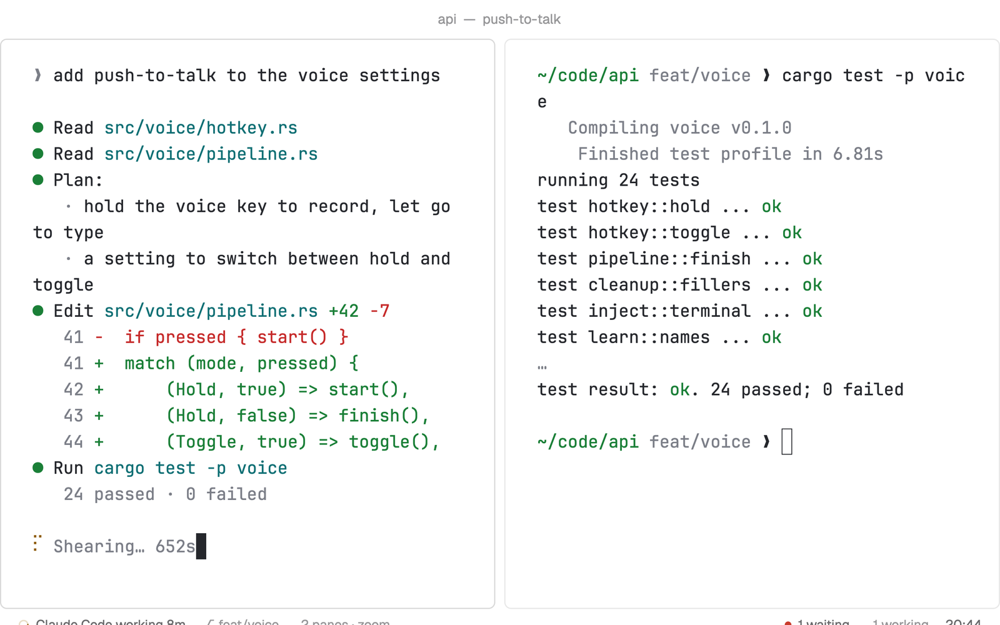

# Focus

One terminal and as little else as possible: a quiet title on top, your work in the middle with roomy margins, and a single quiet line at the bottom that only speaks up when another agent waits on you.

## What you see

- The **Ink** theme in dark mode and **Paper** in light mode (it follows the system, or your `appearance`), terminal text at 15 px with 28 px side margins and 14 px top and bottom.
- **Title**, 34 px, no bar: "webapp — fix login" centered in 12 px `dim` (the space, then the tab's name if someone named it, else what runs in the focused pane). Linux and Windows get small –, □ and ✕ buttons at its right end.
- **The tab** you're in, as it's split. A lone pane has no frame at all; split panes get 6 px corners, a 1 px `border` and 8 px between them, with a slightly stronger border (`input`) on the one you're typing in.
- **The line**, 28 px, 11.5 px text, no background of its own: on the left, the focused agent's state ("Claude Code needs you 4m" in red, "Codex working 12m" with a small spinner) or the program's name, then the branch (`⎇ main`), and "2 panes · zoom" when the tab is split. On the right, only when it's so, "● 1 waiting" and "3 working" for the other agents, then the time.

## How it behaves

- Click "● 1 waiting" to go to the agent that has waited longest (its tab opens). The line never pops up anything by itself; Woolshed's own sounds and toasts still announce agents as usual.
- Click "2 panes · zoom" to zoom the focused pane (and again, "unzoom", to come back).
- Switch tabs and spaces with your keys or the picker (`mod.open picker`); this layout has no tab bar.
- The time moves on the minute; nothing else redraws on a timer.

## Built from

- `layouts/focus.json`: root column (`titlebar: "none"`, `traffic_lights: [14, 10]`, `theme: { "light": "paper", "dark": "ink" }`, background `background`, `font_size: 15`, `terminal_padding: [28, 14]`, `preview: "mods/focus-line/preview.svg"`). Children: `focus-top` (34 px, `window_drag`, mod `focus-line` `{ "role": "top" }`), `main` (content `{ "tab": "active", "pane": { "gap": 8, "radius": 6, "border": { "width": 1, "color": "border" }, "focus": { "width": 1, "color": "input" } } }`) and `focus-line` (28 px, mod `focus-line` `{ "role": "line" }`).
- `mods/focus-line/main.js`: `agents`, `spaces` (the shown tab's name, panes, `working_since`), `panes` (program, branch), `focused`, `run`, `theme`, `props`, `window`. Commands: `pane.focus`, `pane.zoom`, window commands.
- Art: `spinner.svg`, `preview.svg`.

## Watch out

- No sidebar and no tab bar on purpose; keep your tab and space keys handy (`app.help` lists them).
- The layout's theme is its own: the theme picker can still override it while you're in it.
- The waiting count leaves out the agent you're looking at.
- `preview.png` is a screenshot of Woolshed in light mode, running example agents.

## Done when

- `woolshed check` passes on this folder; switching in shows only the title, the tab and the line, in Ink (or Paper in light mode).
- A single pane has no frame; splitting it frames both panes.
- Another agent asking for you makes "● 1 waiting" appear, and clicking it opens that agent's tab.
- The time on the line matches the clock.
