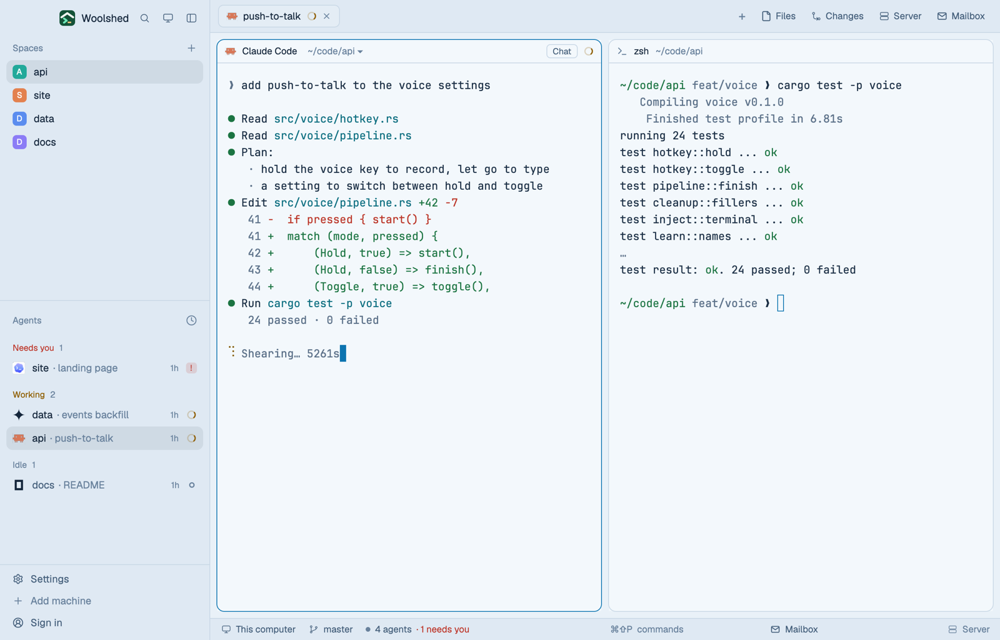

# Glacier

Woolshed's own window in icy light blue: pale blue-white panels, deep navy text and a crisp glacier-blue accent. Cool, calm and bright, with terminal colors deep enough to read on the ice and clear amber, red and indigo for working, needs you and done.

## What you see

- **The look**: the `paper` theme with the layout's own colors over every theme color, so it looks the same in light and dark mode (a light theme by design).
  - **Backgrounds**: terminals (`background`, also `surface`) `#f3f8fc`, behind the cards (`canvas`) `#e9f1f8`, sidebar and bars (`chrome`) `#dfe9f3`, menus (`popover`) `#ffffff`, `raised` (the shown tab, buttons) `#e4edf5`; `border` `#c9d8e6`, `input` `#a9bfd5`, `hover` `#13253a0c`, `selected` `#13253a14`, terminal `selection` `#c6ddf3`.
  - **Text**: `foreground` `#13253a`, terminal text (`terminal_foreground`) `#1b2f45`, `muted` `#425d79`, `dim` `#68819c`; `ring` `#425d79`.
  - **Accent**: glacier blue `#0c74b0` with `accent_foreground` `#ffffff` on it (the focused pane's border, primary buttons, links); `solid` `#13253a` with `solid_foreground` `#f3f8fc`; cursor `#0c74b0`.
  - **Agents**: working `#8f5e00`, needs you (`blocked`) `#bd3528`, done `#3b57cc`, idle and unknown `#68819c`.
  - **Terminal colors** (normal/bright): black `#13253a`/`#5c7189`, red `#bb3427`/`#c93d33`, green `#1b7442`/`#1e7d4b`, yellow `#845b00`/`#8d6300`, blue `#1e5bb8`/`#1963c8`, magenta `#7647bb`/`#844fc8`, cyan `#0a6d7f`/`#0b778b`, white `#4c6075`/`#0a1622`.
- **Contrast** (WCAG, measured): text 12.63:1 (lowest on any panel), terminal text 12.76:1, `muted` 5.56:1, `dim` 3.28:1, the accent 4.13:1 against the background and its text 5.07:1 on it, working/needs you/done at least 4.53:1, terminal colors at least 4.68:1 (bright black 4.70:1), terminal text on the selection 9.77:1.
- **The window** is Woolshed's own layout, unchanged: the sidebar, 268 px on `chrome` (Woolshed's header, 46 px; Spaces, Agents and History; the sidebar's foot, 97 px); the tab bar, 42 px; panes as cards 8 px apart with 10 px corners on `background`, a 1 px `border` and the focused pane in `accent`, with the 30 px pane header; the start screen while no space is open; the side panel (Files, Changes, Server, Mailbox), 368 px, hidden until opened; and the 28 px status bar (the branch and repo, the mailbox, the project's site).

## How it behaves

- Everything works as in the Woolshed layout: spaces, agents, history, tabs, the + menu, Files, Changes, Server and Mailbox, pane headers, splitting and dragging panes. The side panel remembers per space whether it was open, the same as there.
- Agent status shows in the sidebar and tab bar in the colors above: working `#8f5e00`, needs you `#bd3528`, done `#3b57cc`, idle `#68819c`.
- It looks the same in light and dark mode: the layout's colors cover every theme color.
- `ctrl-shift-l` (`layout.switch`) moves on to your next layout; nothing else changes.

## Built from

- `layouts/glacier.json`: Woolshed's shipped `main.json` (0.1.5) unchanged, plus at the root `theme: "paper"`, `colors` with all 42 theme colors (`background`, `surface`, `canvas`, `chrome`, `popover`, `raised`, `hover`, `selected`, `border`, `input`, `selection`, `accent`, `accent_foreground`, `solid`, `solid_foreground`, `foreground`, `terminal_foreground`, `muted`, `dim`, `cursor`, `ring`, `working`, `blocked`, `done`, `idle`, `unknown`, `ansi0`, `ansi1`, `ansi2`, `ansi3`, `ansi4`, `ansi5`, `ansi6`, `ansi7`, `ansi8`, `ansi9`, `ansi10`, `ansi11`, `ansi12`, `ansi13`, `ansi14`, `ansi15`) and `preview: "layouts/glacier.svg"`.
- `layouts/glacier.svg`: the 224×124 picture the settings screen shows, a small window in the palette.
- No mods of its own: it uses Woolshed's shipped `workspace-chrome`, `spaces`, `agents`, `history`, `tabs`, `new-session`, `pane`, `files`, `changes`, `server`, `mailbox`, `workspace-status`. It runs no programs and fetches nothing.

## Watch out

- `preview.png` is a screenshot of Woolshed in light mode, running example agents.
- Done is indigo (`#3b57cc`) and the accent a greener blue (`#0c74b0`) so they stay apart; side by side they are close cousins.
- Ochre and red for working and needs you look alike under red-green color blindness; Colorblind Safe is the layout for that.
- The layout's colors cover every theme color, so picking another theme while in it changes almost nothing. To leave the look, switch layouts.
- It's a copy of Woolshed's own layout as of 0.1.5: when Woolshed's layout gains something later, this copy doesn't. To refresh it, copy the newer `main.json` and put this layout's root `theme`, `colors` and `preview` back on it.
- Colors in a layout are `#rrggbb` or `#rrggbbaa` only, not theme names.

## Done when

- `woolshed check` passes on this folder, and `woolshed do layout.switch --name glacier` shows the Woolshed window in these colors.
- Every contrast above measures as stated: text 7:1 or more, `muted` 4.5:1 or more and `dim` 3:1 or more on every panel.
- A working, a waiting and a done agent show three clearly different status colors in the sidebar.
- Files and Changes open the side panel, and the status bar shows the branch, as in the Woolshed layout.
