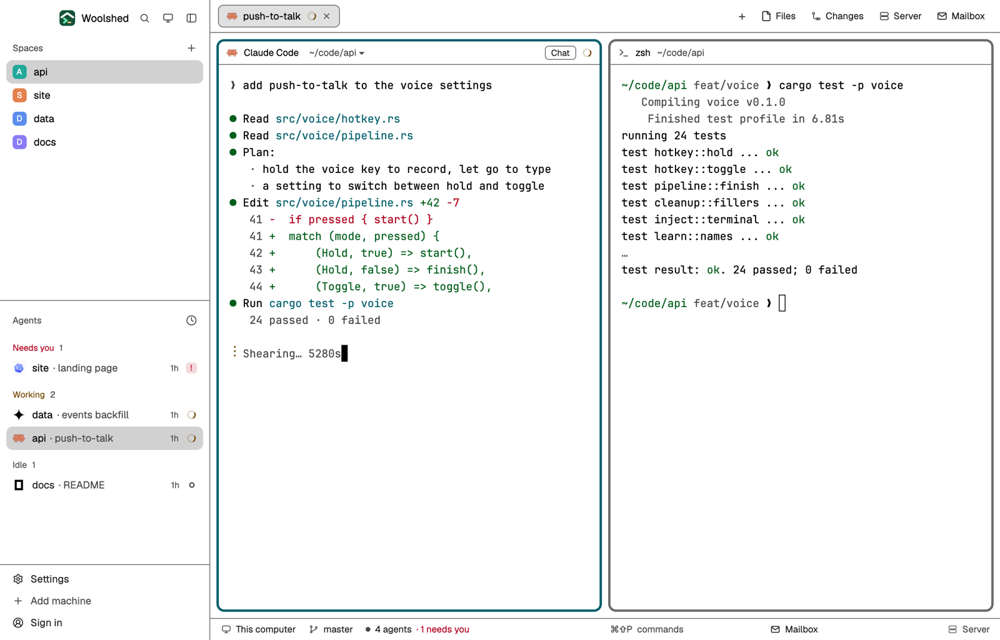

# High Contrast Light

Woolshed's own window at the highest contrast, in light: pure white, pure black text, AAA everywhere (secondary text and all 16 terminal colors reach 7:1 or more), strong grey borders and a thick deep-teal border on the pane you're typing in. For low vision or bright rooms.

## What you see

- **The look**: the `paper` theme with the layout's own colors over every theme color, so it looks the same in light and dark mode (a light theme by design).
  - **Backgrounds**: terminals (`background`, also `surface`) `#ffffff`, behind the cards (`canvas`) `#ffffff`, sidebar and bars (`chrome`) `#ffffff`, menus (`popover`) `#ffffff`, `raised` (the shown tab, buttons) `#e0e0e0`; `border` `#6b6b6b`, `input` `#000000`, `hover` `#0000001a`, `selected` `#0000002e`, terminal `selection` `#b3d4ff`.
  - **Text**: `foreground` `#000000`, terminal text (`terminal_foreground`) `#000000`, `muted` `#1f1f1f`, `dim` `#474747`; `ring` `#005f6b`.
  - **Accent**: deep teal `#005f6b` with `accent_foreground` `#ffffff` on it (the focused pane's border, primary buttons, links); `solid` `#000000` with `solid_foreground` `#ffffff`; cursor `#000000`.
  - **Agents**: working `#734900`, needs you (`blocked`) `#b0001e`, done `#2b3fd1`, idle and unknown `#474747`.
  - **Terminal colors** (normal/bright): black `#000000`/`#474747`, red `#b0001e`/`#a3002a`, green `#005e1b`/`#00611f`, yellow `#734900`/`#7a4f00`, blue `#0033b0`/`#003fcc`, magenta `#8a008a`/`#960096`, cyan `#005f6b`/`#005866`, white `#3d3d3d`/`#000000`.
- **Contrast** (WCAG, measured): text 15.91:1 (lowest on any panel), terminal text 21.00:1, `muted` 12.49:1, `dim` 7.04:1, the accent 7.37:1 against the background and its text 7.37:1 on it, working/needs you/done at least 7.33:1, terminal colors at least 7.13:1 (bright black 9.29:1), terminal text on the selection 13.78:1.
- **The window** is Woolshed's own layout: the sidebar, 268 px on `chrome` (Woolshed's header, 46 px; Spaces, Agents and History; the sidebar's foot, 97 px); the tab bar, 42 px; panes as cards 8 px apart with 10 px corners on `background`, a 3 px `border` and the focused pane in `accent` (3 px too), with the 30 px pane header; the start screen while no space is open; the side panel (Files, Changes, Server, Mailbox), 368 px, hidden until opened; and the 28 px status bar (the branch and repo, the mailbox, the project's site).

## How it behaves

- Everything works as in the Woolshed layout: spaces, agents, history, tabs, the + menu, Files, Changes, Server and Mailbox, pane headers, splitting and dragging panes. The side panel remembers per space whether it was open, the same as there.
- Agent status shows in the sidebar and tab bar in the colors above: working `#734900`, needs you `#b0001e`, done `#2b3fd1`, idle `#474747`.
- It looks the same in light and dark mode: the layout's colors cover every theme color.
- `ctrl-shift-l` (`layout.switch`) moves on to your next layout; nothing else changes.

## Built from

- `layouts/high-contrast-light.json`: Woolshed's shipped `main.json` (0.1.5), with the tab block's pane `border` and `focus` widths set to 3, plus at the root `theme: "paper"`, `colors` with all 42 theme colors (`background`, `surface`, `canvas`, `chrome`, `popover`, `raised`, `hover`, `selected`, `border`, `input`, `selection`, `accent`, `accent_foreground`, `solid`, `solid_foreground`, `foreground`, `terminal_foreground`, `muted`, `dim`, `cursor`, `ring`, `working`, `blocked`, `done`, `idle`, `unknown`, `ansi0`, `ansi1`, `ansi2`, `ansi3`, `ansi4`, `ansi5`, `ansi6`, `ansi7`, `ansi8`, `ansi9`, `ansi10`, `ansi11`, `ansi12`, `ansi13`, `ansi14`, `ansi15`) and `preview: "layouts/high-contrast-light.svg"`.
- `layouts/high-contrast-light.svg`: the 224×124 picture the settings screen shows, a small window in the palette.
- No mods of its own: it uses Woolshed's shipped `workspace-chrome`, `spaces`, `agents`, `history`, `tabs`, `new-session`, `pane`, `files`, `changes`, `server`, `mailbox`, `workspace-status`. It runs no programs and fetches nothing.

## Watch out

- `preview.png` is a screenshot of Woolshed in light mode, running example agents.
- Pane borders are 3 px (grey, deep teal when focused) instead of Woolshed's 1 px: the one change to the layout besides its colors. Both widths match so a terminal doesn't resize when the focus moves.
- The sidebar, bars and cards are all white; the 1 px dividers and borders (`#6b6b6b`) separate them.
- Program colors that a terminal app picks itself (24-bit colors) are shown as the program asks; turn up `minimum_contrast` in settings.json to lift those too.
- The layout's colors cover every theme color, so picking another theme while in it changes almost nothing. To leave the look, switch layouts.
- It's a copy of Woolshed's own layout as of 0.1.5: when Woolshed's layout gains something later, this copy doesn't. To refresh it, copy the newer `main.json` and put this layout's root `theme`, `colors` and `preview` back on it (and the 3 px pane widths).
- Colors in a layout are `#rrggbb` or `#rrggbbaa` only, not theme names.

## Done when

- `woolshed check` passes on this folder, and `woolshed do layout.switch --name high-contrast-light` shows the Woolshed window in these colors.
- Every contrast above measures as stated: text 7:1 or more, `muted` 4.5:1 or more and `dim` 3:1 or more on every panel.
- Every text color and terminal color reaches 7:1; the focused pane has a 3 px `accent` border and the terminal keeps its size when focus moves.
- A working, a waiting and a done agent show three clearly different status colors in the sidebar.
- Files and Changes open the side panel, and the status bar shows the branch, as in the Woolshed layout.
