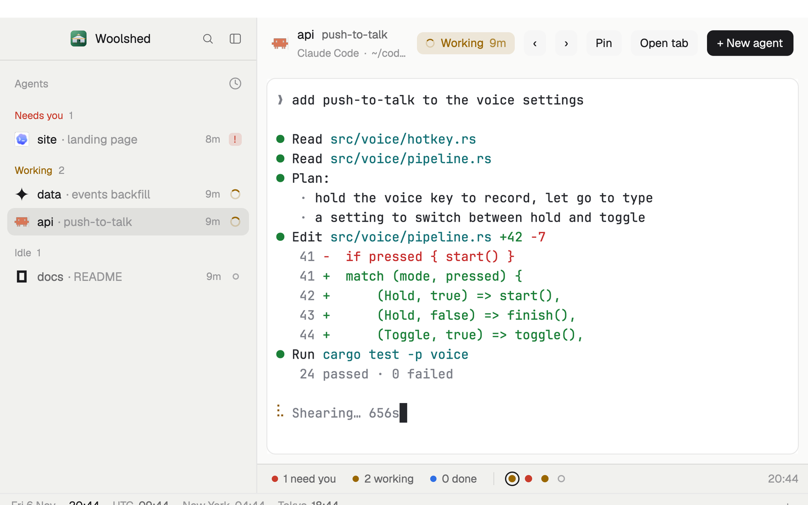

# Mission

One agent on the big screen, the list of every agent beside it, and a strip along the bottom with everyone's state at a glance. For when you drive one agent at a time and want to know the moment another needs you.

## What you see

- **Left column**, 280 px, the theme's `chrome`: Woolshed's own brand bar (46 px, with the sidebar fold button) above Woolshed's agents list, grouped by what each needs: Needs you, Done, Working, Idle. Folding the column turns the list into a narrow rail of numbered dots.
- **Head**, 56 px over the stage on the `canvas` color: the shown agent's 18 px program icon, its space name (13.5 px semibold) and what it's about (`muted`), and below in 11.5 px `dim` the program, folder and branch. To the right a status pill (the status color at low strength, a dot or spinner, "Needs you", "Working", "Finished" or "Idle" and how long), then buttons ‹ and › (previous and next agent), Pin, Open tab, and a solid "+ New agent". Linux and Windows get window buttons at the end.
- **Stage**: the shown agent's live terminal, full size, in a card with 10 px corners and a 1 px `border`, 10 px in from the sides.
- **Strip**, 32 px, `chrome` with a top `border`: counts with 7 px dots ("2 need you", "3 working", "1 done"), a thin divider, then one 8 px dot per agent in list order (an idle one is a ring), and the time on the right.

## How it behaves

- Click an agent in the list, a dot in the strip, or ‹ and › to put it on the stage. The dot of the shown agent has a ring around it.
- Working dots pulse slowly (a native opacity loop); nothing redraws for it.
- Click "2 need you" in the strip to show the first agent waiting; "1 done" shows the first finished one.
- Pin keeps the agent at the top of the list; Open tab shows it with its tab in the Woolshed layout.
- "+ New agent" opens Woolshed's agent menu (a new tab in the shown space).
- The status pill's time is how long the agent has been in that state (working: since its tab started working). The strip's clock moves on the minute.

## Built from

- `layouts/mission.json`: root row (`titlebar: "none"`, `traffic_lights: [12, 16]`, background `canvas`, `terminal_padding: [16, 12]`, 1 px `border` divider, `preview: "mods/mission/preview.svg"`). `sidebar` (column, 280 px, min 44, max 480, `chrome`, not resizable) holds `brand` (46 px, `window_drag`, shipped `workspace-chrome`) and `agents` (shipped `agents`). `work` (column, gap 10) holds `mission-head` (56 px, `window_drag`, mod `mission` `{ "role": "head" }`), `stage-row` (row, padding `[0, 10]`) with `stage` (content `{ "agent": "focused" }`, background `background`, 1 px `border`, radius 10), and `mission-strip` (32 px, mod `mission` `{ "role": "strip" }`).
- `mods/mission/main.js`: `agents`, `panes` (folder and branch), `spaces` (`working_since`), `focused` (`agent`), `run`, `home`, `theme`, `props`, `window`, `openOverlay`. Commands: `agent.focus`, `agent.prev`, `agent.next`, `terminal.pin`, `pane.focus`, `layout.switch`, window commands.
- The list is the shipped `agents` mod, so it keeps up with Woolshed (sub-agents, sorting, pins). It calls `setAgentOrder`, so ‹ and › follow it.
- Art: `spinner.svg`, `preview.svg`.

## Watch out

- No tab block: shells and editors aren't shown. Open tab, or switch layouts.
- The left column's id must stay `sidebar`: the shipped brand bar folds it by that id, and the agents list draws its rail when it's narrower than 160 px.
- Agents on other machines show their machine in the list; the stage shows them like any other.
- `preview.png` is a screenshot of Woolshed in light mode, running example agents.

## Done when

- `woolshed check` passes on this folder and the layout switches in.
- Clicking an agent in the list, or its dot, shows it on the stage, and the head names it with the right status and time.
- ‹ and › walk the list in its order.
- A working agent's dot pulses; a waiting one is red; the counts match the list.
- "+ New agent" starts an agent that appears in the list and the strip.
