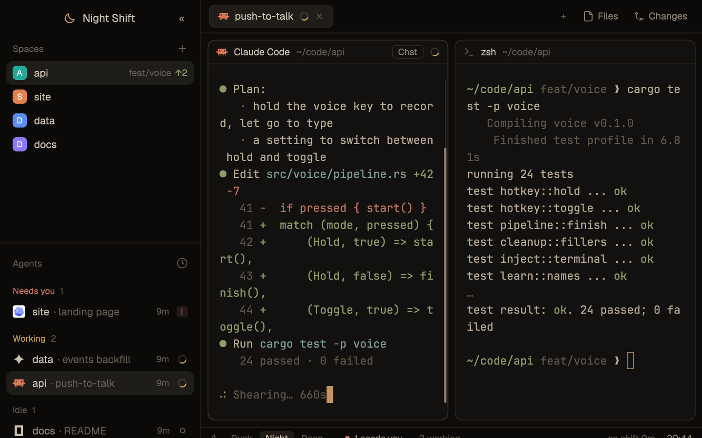

# Night Shift

The usual Woolshed workspace in low, warm light for long sessions: dark browns instead of black, soft amber instead of bright blue, every color turned down. A dimmer on the bottom line takes it from Dusk to Night to Deep, and the line keeps a quiet count of how long you've been on.

## What you see

- **The look**: the `graphite` theme with the layout's own colors over it. Backgrounds: terminals `#13110f`, behind cards (`canvas`) `#0e0c0b`, bars and sidebar (`chrome`) `#0b0a09`, raised `#201c18`, borders `#2b2621`. At the Night level: text `#cbbfae`, terminal text `#b5a893`, `muted` `#8e8373`, `dim` `#645b4f`, `accent` and cursor `#c39563` (amber), working `#b8964f`, needs you `#c2735d`, done `#8399a6`, and a warm, muted set of 16 terminal colors.
- **Sidebar**, 252 px: at the top (46 px) a 16 px moon in amber, "Night Shift" in 13.5 px semibold and a « button that folds the sidebar into a rail (» opens it again); below, Woolshed's own Spaces and Agents lists.
- **Tab bar**: Woolshed's own (tabs as pills, the + menu, and Files and Changes, which open a side panel).
- **Panes**, 8 px apart, as cards with 10 px corners and Woolshed's pane header. The pane you're typing in gets a slightly stronger border (`input`), not a bright one.
- **The night line**, 28 px along the bottom of the work area, 11.5 px text: a small moon and three buttons, Dusk, Night and Deep (the current one `raised`); "● 2 need you" and "3 working" when that's so; on the right "on shift 1h 46m", after 90 minutes "time to stretch" in amber, and the time.

## How it behaves

- Dusk makes everything you read about 14 % brighter than Night; Deep about 22 % darker. Backgrounds stay as they are. The choice is written into the layout itself, so it stays after a restart.
- Click "● 2 need you" to go to the first agent waiting.
- "on shift" counts from when the layout was shown (or Woolshed started). Past 90 minutes it suggests a stretch; click "time to stretch" to start the count again.
- Everything else (spaces, agents, tabs, Files, Changes, pane headers) is Woolshed's own and behaves as in the Woolshed layout; the side panel remembers per space whether it was open, the same as there.

## Built from

- `layouts/night-shift.json`: root row (`titlebar: "none"`, `traffic_lights: [12, 16]`, `theme: "graphite"`, the `colors` above, background `canvas`, `terminal_padding: [14, 12]`, 1 px `border` divider, `preview: "mods/night-shift/preview.svg"`). `sidebar` (column, 252 px, min 44, max 480, `chrome`, not resizable): `brand` (46 px, `window_drag`, mod `night-shift` `{ "role": "brand" }`) and `sidebar-lists` (`spaces` and `agents`, weight 1 each, min 90). `work` (column, not resizable): `tabs` (42 px, `window_drag`, shipped `tabs`), `work-body` (row, padding 8, gap 8) with `main` (tab block: gap 8, radius 10, background `background`, lone, 1 px `border`, focus `input`, header shipped `pane` at 30 px) and `panel` (hidden column, 368 px, min 280, max 900) holding the stack `panel-body` (`files`, `changes`); then `night-line` (28 px, mod `night-shift` `{ "role": "line" }`).
- `mods/night-shift/main.js`: `colorsFor(level)` scales the text colors, accent, status colors and terminal colors by 1.14 (Dusk), 1 (Night) or 0.78 (Deep); the dimmer writes them into the shown layout's `colors` with `layout.set` and remembers the level in shared `night-shift.level`. Also `agents`, `layout`, `run`, `shared`/`setShared` (`sidebar.width`, `sidebar.collapsed`, as Woolshed's own sidebar button keeps them), `theme`, `props`, `window`. Commands: `layout.set`, `layout.resize`, `pane.focus`.
- Shipped mods: `spaces`, `agents`, `tabs`, `pane`, `files`, `changes` (they rely on the ids `sidebar`, `panel` and `panel-body`).
- Art: `moon.svg`, `preview.svg`.

## Watch out

- The dimmer edits this layout's file with `layout.set`, which works because a gallery layout is yours.
- The layout's colors cover nearly every theme color, so picking another theme while in it changes little. For more light, use Dusk.
- The shift count lives in the line's copy: switching layouts or restarting starts it again.
- `preview.png` is a screenshot of Woolshed running example agents (Night Shift is dark by design).

## Done when

- `woolshed check` passes on this folder; switching in shows the warm, dim look with the moon in the sidebar and the night line at the bottom.
- Deep visibly darkens text and terminal colors; Dusk brightens them; the choice survives a restart.
- Files and Changes open the side panel; the sidebar folds with « and opens with ».
- An agent waiting makes "● 1 needs you" appear, and clicking it opens that agent.
