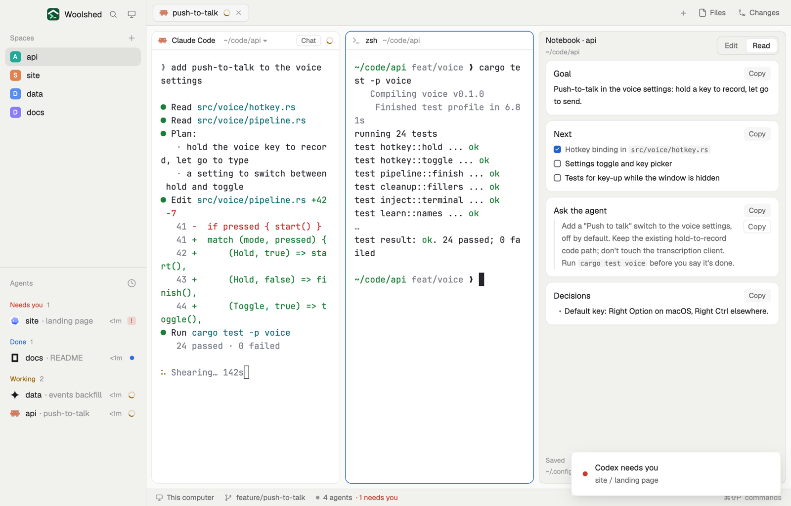

# Notebook

Your tab with a page of notes beside it, one page per project. Write the goal, what's next and the instructions you keep giving your agents; read it back as formatted sections, each with a Copy button, so a ready-made instruction is on the clipboard in one click. Nothing is typed into an agent for you: you paste.



## What you see

Left to right:

- **The sidebar**, 236 px on `chrome`: Woolshed's head, then Spaces and Agents.
- **The work area**: Woolshed's tab bar (42 px), the shown tab with every pane a card (10 px corners, `border`, `accent` on the focused one, the shipped pane header), the Files or Changes panel (340 px, hidden until opened), and the status bar (28 px).
- **The notebook**, 400 px (280 to 760), a card with 10 px corners and a 1 px `border` on `chrome`:
  - A head: "Notebook · api" in 12.5 px semibold over the space's folder in 11 px `dim` (`~` for your home, "this space" without a folder), and an Edit | Read switch.
  - **Read** (the default): the page cut at each `#`, `##` or `###` heading into cards on the terminals' `background` with 10 px corners. Each card has its heading (15 px for `#`, 13.5 px otherwise) and a Copy button, then the markdown below it in 12.5 px, selectable, with a Copy button beside each quote block. Text before the first heading is a card of its own without a title.
  - **Edit**: the whole page in a text box, 13 px, on `background`.
  - With nothing written yet: "No notes for api yet", a line on what to keep, and two buttons: "Start from a template" (solid) and "Blank page".
  - A foot: "Saved 14:31" (or "New", "Loading…", "Saving…", "Unsaved" in `working`) over the file's path in 11 px `dim`, and a solid "Copy to agent" button.
- With no space open: "Open a space to keep its notes here."

## How it behaves

- It follows the shown space. Switching saves what you typed, then shows that space's page.
- It saves 800 ms after you stop typing, when you leave the text box, and when you switch to Read. An empty new page makes no file.
- Copy (on a card) puts that part on the clipboard, heading included; the card's border turns `accent` and the button says "Copied" for 2.4 s. "Copy to agent" copies the whole page and says "Copied: paste it in". Neither sends anything anywhere: click the agent and paste.
- The template has Goal, Next (two empty `- [ ]` tasks), Ask the agent and Decisions; it opens in Edit.
- An agent or editor changing the file shows up at once when you have nothing unsaved. If it changed while you were typing, "The file changed somewhere else." in `working`, with "Use theirs" and "Keep mine". Read and write errors are said in `blocked` red, and your text stays.

## Built from

- `layouts/notebook.json`: Woolshed's own window without History and the sidebar footer, plus the notebook: root row (`titlebar: "none"`, `traffic_lights: [12, 16]`, background `canvas`, `terminal_padding: [14, 12]`, 1 px `border` divider, `preview: "layouts/notebook.svg"`). `sidebar` (236 px: `brand` 46 px `workspace-chrome`, `sidebar-lists` with `spaces` and `agents`). `work` (column: `tabs` 42 px; `work-body` row, padding 8, gap 8: `main` (as in `main`), `panel` (hidden, 340 px, stack `panel-body` of `files` and `changes`), `notes` (block, 400 px, min 280, max 760, radius 10, 1 px `border`, mod `notebook`); `status` 28 px `workspace-status`).
- `mods/notebook/main.js`, and `mods/notebook/notes.js` (pure: the file for a space, the sections, the template). `woolshed`: `spaces`, `appHome`, `home`, `readTextFile`, `writeTextFile` (with the text it expects to replace), `watchFolder`, `theme`. From `gpui-base`: `TextareaState` / `Textarea`, `TextView.markdown` (`.copy_quotes(true)`). The clipboard: `cx.write_to_clipboard`. `localStorage` remembers Edit or Read.
- Storage: `data/notebook/<folder name>-<6-character hash>.md` under the app folder, one per folder and machine (the machine's name in front for a remote space; a space without a folder gets a file keyed on the space). No programs, no network.
- Shipped mods: `workspace-chrome`, `spaces`, `agents`, `tabs`, `pane`, `files`, `changes`, `workspace-status`, `new-session`.

## Watch out

- The notes are plain files: anything that can read the app folder can read them, which is the point for agents ("read my notes in ~/.config/woolshed/data/notebook/").
- They are separate from the Space notes mod's files (`data/space-notes/`).
- Headings inside ``` fences don't start a section.
- `preview.png` is a screenshot of Woolshed in light mode, running example agents.

## Done when

- `woolshed check` passes on this folder; switching in shows the notebook beside the tab, with "No notes for …" in a fresh space.
- "Start from a template" fills the page and within a second the foot says "Saved" and the `.md` file exists.
- In Read, Copy on "Ask the agent" puts that section on the clipboard and pastes into a terminal as written.
- Switching spaces switches the page; a line added to the file elsewhere shows up.
