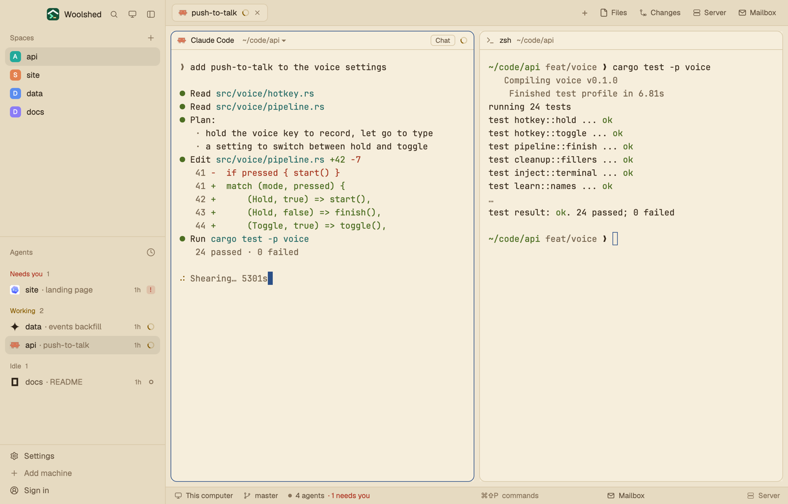

# Paperback

Woolshed's own window as a sepia reading page: warm cream panels, dark brown ink for text and a fountain-pen blue accent. Made for reading long agent output in daylight, with terminal colors deep enough to read on the paper.

## What you see

- **The look**: the `paper` theme with the layout's own colors over every theme color, so it looks the same in light and dark mode (a light theme by design).
  - **Backgrounds**: terminals (`background`, also `surface`) `#f6eedc`, behind the cards (`canvas`) `#eee4cf`, sidebar and bars (`chrome`) `#e6dac1`, menus (`popover`) `#fbf5e8`, `raised` (the shown tab, buttons) `#ece1ca`; `border` `#d8c8a8`, `input` `#c1ad88`, `hover` `#2d23180c`, `selected` `#2d231814`, terminal `selection` `#e9d3a6`.
  - **Text**: `foreground` `#2d2318`, terminal text (`terminal_foreground`) `#382b1d`, `muted` `#62513d`, `dim` `#88745b`; `ring` `#62513d`.
  - **Accent**: fountain-pen blue `#2b4f86` with `accent_foreground` `#fbf6ec` on it (the focused pane's border, primary buttons, links); `solid` `#2d2318` with `solid_foreground` `#f8f0df`; cursor `#2b4f86`.
  - **Agents**: working `#875c00`, needs you (`blocked`) `#ad311f`, done `#256a58`, idle and unknown `#88745b`.
  - **Terminal colors** (normal/bright): black `#2d2318`/`#76654f`, red `#a5351f`/`#b73d24`, green `#4c6e22`/`#4b6e23`, yellow `#865900`/`#8d6108`, blue `#2b5c90`/`#2c63a2`, magenta `#82437c`/`#8f4c88`, cyan `#276b66`/`#2a746e`, white `#5c4e3e`/`#1d160d`.
- **Contrast** (WCAG, measured): text 11.11:1 (lowest on any panel), terminal text 11.87:1, `muted` 5.49:1, `dim` 3.23:1, the accent 5.91:1 against the background and its text 7.60:1 on it, working/needs you/done at least 4.26:1, terminal colors at least 4.73:1 (bright black 4.86:1), terminal text on the selection 9.36:1.
- **The window** is Woolshed's own layout, unchanged: the sidebar, 268 px on `chrome` (Woolshed's header, 46 px; Spaces, Agents and History; the sidebar's foot, 97 px); the tab bar, 42 px; panes as cards 8 px apart with 10 px corners on `background`, a 1 px `border` and the focused pane in `accent`, with the 30 px pane header; the start screen while no space is open; the side panel (Files, Changes, Server, Mailbox), 368 px, hidden until opened; and the 28 px status bar (the branch and repo, the mailbox, the project's site).

## How it behaves

- Everything works as in the Woolshed layout: spaces, agents, history, tabs, the + menu, Files, Changes, Server and Mailbox, pane headers, splitting and dragging panes. The side panel remembers per space whether it was open, the same as there.
- Agent status shows in the sidebar and tab bar in the colors above: working `#875c00`, needs you `#ad311f`, done `#256a58`, idle `#88745b`.
- It looks the same in light and dark mode: the layout's colors cover every theme color.
- `ctrl-shift-l` (`layout.switch`) moves on to your next layout; nothing else changes.

## Built from

- `layouts/paperback.json`: Woolshed's shipped `main.json` (0.1.5) unchanged, plus at the root `theme: "paper"`, `colors` with all 42 theme colors (`background`, `surface`, `canvas`, `chrome`, `popover`, `raised`, `hover`, `selected`, `border`, `input`, `selection`, `accent`, `accent_foreground`, `solid`, `solid_foreground`, `foreground`, `terminal_foreground`, `muted`, `dim`, `cursor`, `ring`, `working`, `blocked`, `done`, `idle`, `unknown`, `ansi0`, `ansi1`, `ansi2`, `ansi3`, `ansi4`, `ansi5`, `ansi6`, `ansi7`, `ansi8`, `ansi9`, `ansi10`, `ansi11`, `ansi12`, `ansi13`, `ansi14`, `ansi15`) and `preview: "layouts/paperback.svg"`.
- `layouts/paperback.svg`: the 224×124 picture the settings screen shows, a small window in the palette.
- No mods of its own: it uses Woolshed's shipped `workspace-chrome`, `spaces`, `agents`, `history`, `tabs`, `new-session`, `pane`, `files`, `changes`, `server`, `mailbox`, `workspace-status`. It runs no programs and fetches nothing.

## Watch out

- `preview.png` is a screenshot of Woolshed in light mode, running example agents.
- Done is a bookcloth green (`#256a58`), not blue, so it stays apart from the blue accent.
- Ochre and red for working and needs you look alike under red-green color blindness; Colorblind Safe is the layout for that.
- The layout's colors cover every theme color, so picking another theme while in it changes almost nothing. To leave the look, switch layouts.
- It's a copy of Woolshed's own layout as of 0.1.5: when Woolshed's layout gains something later, this copy doesn't. To refresh it, copy the newer `main.json` and put this layout's root `theme`, `colors` and `preview` back on it.
- Colors in a layout are `#rrggbb` or `#rrggbbaa` only, not theme names.

## Done when

- `woolshed check` passes on this folder, and `woolshed do layout.switch --name paperback` shows the Woolshed window in these colors.
- Every contrast above measures as stated: text 7:1 or more, `muted` 4.5:1 or more and `dim` 3:1 or more on every panel.
- A working, a waiting and a done agent show three clearly different status colors in the sidebar.
- Files and Changes open the side panel, and the status bar shows the branch, as in the Woolshed layout.
