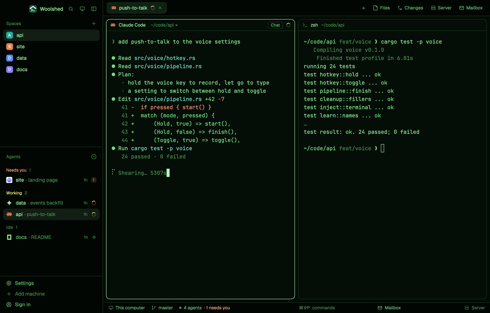

# Phosphor

Woolshed's own window as a green-phosphor terminal: near-black glass, glowing green text in three brightnesses, a pale-green accent and a bright block of a cursor. Mostly monochrome, but working, needs you and done keep their own colors (yellow, amber, cyan) so status is never lost.

## What you see

- **The look**: the `moss` theme with the layout's own colors over every theme color, so it looks the same in light and dark mode (a dark theme by design).
  - **Backgrounds**: terminals (`background`, also `surface`) `#050d07`, behind the cards (`canvas`) `#040a05`, sidebar and bars (`chrome`) `#020603`, menus (`popover`) `#0a170d`, `raised` (the shown tab, buttons) `#0f2113`; `border` `#173a1f`, `input` `#22552b`, `hover` `#9cf5a60f`, `selected` `#9cf5a61a`, terminal `selection` `#1b4d27`.
  - **Text**: `foreground` `#9cf5a6`, terminal text (`terminal_foreground`) `#86e894`, `muted` `#62c070`, `dim` `#42904d`; `ring` `#62c070`.
  - **Accent**: bright phosphor `#c4ffc8` with `accent_foreground` `#050d07` on it (the focused pane's border, primary buttons, links); `solid` `#9cf5a6` with `solid_foreground` `#050d07`; cursor `#b4ffbc`.
  - **Agents**: working `#eef27a`, needs you (`blocked`) `#ffa46e`, done `#7ad6ff`, idle and unknown `#42904d`.
  - **Terminal colors** (normal/bright): black `#11281a`/`#45914f`, red `#ff8f73`/`#ffab94`, green `#6fe07f`/`#a2ffa8`, yellow `#d6e86b`/`#eaff94`, blue `#74c7e0`/`#9ad9ee`, magenta `#c7a8f2`/`#dcc3ff`, cyan `#6fe0c4`/`#9cf5df`, white `#86e894`/`#ccffd0`.
- **Contrast** (WCAG, measured): text 12.85:1 (lowest on any panel), terminal text 13.10:1, `muted` 7.45:1, `dim` 4.27:1, the accent 17.32:1 against the background and its text 17.32:1 on it, working/needs you/done at least 10.11:1, terminal colors at least 8.84:1 (bright black 5.08:1), terminal text on the selection 6.54:1.
- **The window** is Woolshed's own layout, unchanged: the sidebar, 268 px on `chrome` (Woolshed's header, 46 px; Spaces, Agents and History; the sidebar's foot, 97 px); the tab bar, 42 px; panes as cards 8 px apart with 10 px corners on `background`, a 1 px `border` and the focused pane in `accent`, with the 30 px pane header; the start screen while no space is open; the side panel (Files, Changes, Server, Mailbox), 368 px, hidden until opened; and the 28 px status bar (the branch and repo, the mailbox, the project's site).

## How it behaves

- Everything works as in the Woolshed layout: spaces, agents, history, tabs, the + menu, Files, Changes, Server and Mailbox, pane headers, splitting and dragging panes. The side panel remembers per space whether it was open, the same as there.
- Agent status shows in the sidebar and tab bar in the colors above: working `#eef27a`, needs you `#ffa46e`, done `#7ad6ff`, idle `#42904d`.
- It looks the same in light and dark mode: the layout's colors cover every theme color.
- `ctrl-shift-l` (`layout.switch`) moves on to your next layout; nothing else changes.

## Built from

- `layouts/phosphor.json`: Woolshed's shipped `main.json` (0.1.5) unchanged, plus at the root `theme: "moss"`, `colors` with all 42 theme colors (`background`, `surface`, `canvas`, `chrome`, `popover`, `raised`, `hover`, `selected`, `border`, `input`, `selection`, `accent`, `accent_foreground`, `solid`, `solid_foreground`, `foreground`, `terminal_foreground`, `muted`, `dim`, `cursor`, `ring`, `working`, `blocked`, `done`, `idle`, `unknown`, `ansi0`, `ansi1`, `ansi2`, `ansi3`, `ansi4`, `ansi5`, `ansi6`, `ansi7`, `ansi8`, `ansi9`, `ansi10`, `ansi11`, `ansi12`, `ansi13`, `ansi14`, `ansi15`) and `preview: "layouts/phosphor.svg"`.
- `layouts/phosphor.svg`: the 224×124 picture the settings screen shows, a small window in the palette.
- No mods of its own: it uses Woolshed's shipped `workspace-chrome`, `spaces`, `agents`, `history`, `tabs`, `new-session`, `pane`, `files`, `changes`, `server`, `mailbox`, `workspace-status`. It runs no programs and fetches nothing.

## Watch out

- `preview.png` is a screenshot of Woolshed in light mode, running example agents.
- The terminal colors are kept as faint hues, not all green, so errors, diffs and prompts still read; a program that only uses the default text color looks fully monochrome.
- The layout's colors cover every theme color, so picking another theme while in it changes almost nothing. To leave the look, switch layouts.
- It's a copy of Woolshed's own layout as of 0.1.5: when Woolshed's layout gains something later, this copy doesn't. To refresh it, copy the newer `main.json` and put this layout's root `theme`, `colors` and `preview` back on it.
- Colors in a layout are `#rrggbb` or `#rrggbbaa` only, not theme names.

## Done when

- `woolshed check` passes on this folder, and `woolshed do layout.switch --name phosphor` shows the Woolshed window in these colors.
- Every contrast above measures as stated: text 7:1 or more, `muted` 4.5:1 or more and `dim` 3:1 or more on every panel.
- A working, a waiting and a done agent show three clearly different status colors in the sidebar.
- Files and Changes open the side panel, and the status bar shows the branch, as in the Woolshed layout.
