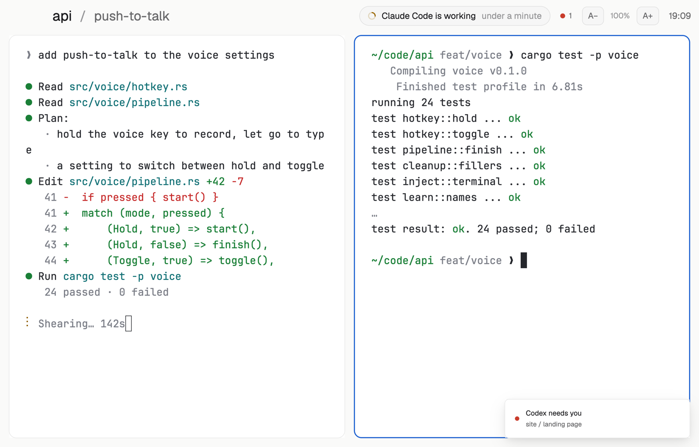

# Presenter

For sharing your screen in a call or on a projector: big terminal text, roomy margins, and a bar that names the space and the tab in large type and says in plain words what the agent is doing. No sidebar, no history, no folder paths and no other spaces' names, so nothing private slips onto the screen. A text-size control sits in the corner.

## What you see

- Your theme (the layout sets none), terminal text at 19 px with 30 px side margins and 20 px top and bottom, on the `canvas` color.
- **The bar**, 58 px, no background of its own. On the left the space's name in 26 px semibold `foreground`, a `dim` "/", and the tab's name in 24 px `muted` (its name if someone named it, else the focused pane's title or program). When the space has more than one tab: ‹ "2 of 3" › to step through them. With no space open: "Woolshed" and "Start an agent to begin".
- On the right, a rounded pill, 36 px tall, 16 px text: what the agent in this tab is doing, "Claude Code is working" with a spinner in `working` and how long ("4 min"), "Codex needs you" in `blocked` red on a light red fill, "is done", or "is waiting for a prompt" with a hollow ring. Then a `blocked` dot with a number when agents elsewhere wait on you (only the count), the text size control "A−  100%  A+", and the time in 16 px. Linux and Windows get –, □ and ✕ at the end; macOS leaves 96 px on the left for its window buttons.
- **The stage**: the shown tab with 16 px around it and between panes, every pane a card with 14 px corners, a 1 px `border`, and a 2 px `accent` border on the one you're typing in (a lone pane is framed too). With no space open, Woolshed's start screen fills it.

## How it behaves

- ‹ and › run `tab.prev` and `tab.next`. A− and A+ run `app.zoom_out` and `app.zoom_in` (the whole window, terminals and bar alike); clicking the percentage runs `app.zoom_reset`.
- The pill follows the agent in the shown tab: the focused pane's agent first, else the one that most needs you. It changes as the agent's state changes; Woolshed's own toasts and sounds still announce other agents.
- Narrower than 1040 px the clock goes, under 900 px the text size control, under 720 px the pill; the names truncate last.
- The clock moves on the minute; nothing else redraws on a timer.

## Built from

- `layouts/presenter.json`: root column (`titlebar: "none"`, `traffic_lights: [18, 21]`, background `canvas`, `font_size: 19`, `terminal_padding: [30, 20]`, `preview: "layouts/presenter.svg"`). Children: `presenter-bar` (block, 58 px, `window_drag`, mod `presenter`), `stage` (row, padding `[6, 16]`) holding `main` (content `{ "tab": "active", "empty": { "mod": "new-session", "props": { "page": true } }, "pane": { "gap": 16, "radius": 14, "background": "background", "lone": true, "border": { "width": 1, "color": "border" }, "focus": { "width": 2, "color": "accent" } } }`), and `presenter-foot` (block, 10 px, mod `presenter` with `{ "role": "foot" }`, an empty spacer).
- `mods/presenter/main.js`: `agents`, `spaces`, `panes`, `focused`, `settings` (`zoom`), `run`, `theme`, `props`, `window`. Commands: `tab.prev`, `tab.next`, `app.zoom_out`, `app.zoom_in`, `app.zoom_reset`, `window.minimize|maximize|close`.
- Shipped mod: `new-session`. Art: `mods/presenter/spinner.svg`, `layouts/presenter.svg`.

## Watch out

- Zoom is the person's own setting and stays when they switch layouts; tell them to reset it (click the percentage) when the call is over.
- The terminal text size (19 px) is the layout's look; the person's settings.json font size applies in other layouts.
- The terminals themselves can still show folders and output: the bar only avoids adding any.
- `preview.png` is a screenshot of Woolshed in light mode, running example agents.

## Done when

- `woolshed check` passes on this folder; switching in shows the large bar and the big framed tab, with no sidebar.
- The pill says "Claude Code is working" with a spinner while the shown agent works, and "needs you" in red when it asks.
- A+ makes everything larger and the percentage goes up; clicking the percentage goes back to 100%.
- In a space with three tabs, › moves to the next one and the counter reads "2 of 3".
