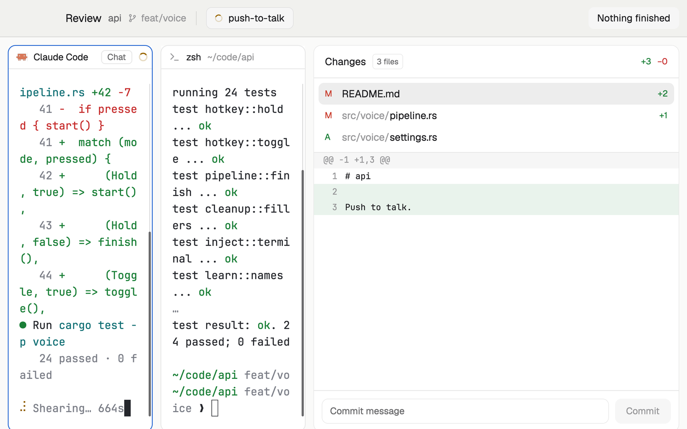

# Review

For going through what your agents did: the agent and a shell side by side on the left, Woolshed's Changes panel with the diff on the right, and a bar that steps you through every agent that finished.

## What you see

- **Bar**, 48 px, the theme's `chrome` with a 1 px `border` below: "Review" in 14 px semibold, the space's name (`muted`) and its branch with a small branch icon (`dim`); a thin divider; then the space's tabs as pills, 28 px tall with 7 px corners, each with its status mark (spinner, dot or ring) and its name (the tab's name if someone named it, else its agent's program). The shown tab's pill is `raised` with a `border`. On the right "Next finished · 2" and, when the shown tab has one pane, a solid "+ Shell beside". Linux and Windows get window buttons.
- **Panes**, left, 10 px from the edges: the shown tab's panes as cards with 10 px corners, the terminal `background`, a 1 px `border` (`accent` on the focused one) and Woolshed's pane header (30 px: program, folder, status, and split/zoom/close on hover). Every pane is framed, even a lone one.
- **Changes**, right, 470 px (320 to 960 when dragged): Woolshed's Changes panel for the focused pane's repository: the changed files with their +/− counts, the selected file's diff, and a commit box.

## How it behaves

- "Next finished" goes to an agent that finished while you looked elsewhere (its space and tab open); each click takes the next one. The count is how many are left; looking at one turns it idle, so the count drops.
- "+ Shell beside" opens a shell to the right of the focused pane, in its folder (`pane.split`); it's only offered while the tab has a single pane.
- Click a pill to show that tab. The Changes panel follows the focused pane: click the shell or the agent and it shows that folder's repository.
- The Changes panel is Woolshed's own: pick a file to read its diff; its Commit button stages everything and commits, only when you click it.

## Built from

- `layouts/review.json`: root column (`titlebar: "none"`, `traffic_lights: [16, 17]`, background `canvas`, `terminal_padding: [14, 12]`, `preview: "mods/review-bar/preview.svg"`). Children: `review-bar` (48 px, `window_drag`, mod `review-bar`) and `review-body` (row, padding 10, gap 10) with `main` (min 360, content `{ "tab": "active", "pane": { "gap": 10, "radius": 10, "background": "background", "lone": true, "border": { "width": 1, "color": "border" }, "focus": { "width": 1, "color": "accent" }, "header": { "content": { "mod": "pane" }, "height": 30, "position": "top", "reveal": "always" } } }`) and `review-changes` (470 px, min 320, max 960, shipped mod `changes`).
- `mods/review-bar/main.js`: `agents` (the finished ones), `spaces` (the shown space, its tabs and branch), `panes` (a tab's agent program), `focused`, `run`, `theme`, `window`. Commands: `tab.select`, `pane.focus`, `pane.split`, window commands.
- Shipped mods: `pane` (pane headers) and `changes`.
- Art: `spinner.svg`, `branch.svg`, `preview.svg`.

## Watch out

- The branch in the bar is the space's (its first terminal's); the Changes panel follows the focused pane, which may be another repository.
- The Changes panel reads git every 10 seconds and when files change; it writes to git only through its Commit button.
- `preview.png` is a screenshot of Woolshed in light mode, running example agents.

## Done when

- `woolshed check` passes on this folder; switching in shows the bar, the panes and the Changes panel.
- With a one-pane tab, "+ Shell beside" opens a shell on the right in the same folder, and the button goes away.
- With finished agents elsewhere, "Next finished" opens each of them in turn and the count goes down.
- Picking a file in Changes shows its diff.
