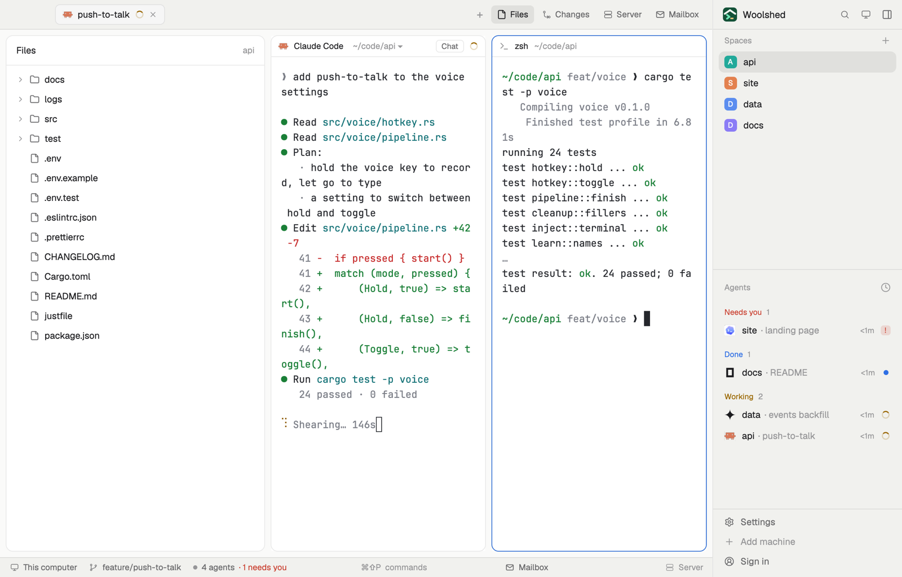

# Right-hand

The usual Woolshed window, mirrored: spaces, agents and past sessions on the right, the Files and Changes panels opening on the left, the tab in the middle. For people who keep their eyes and mouse on the right, or a window parked on the left of a wide screen.

## What you see

Left to right:

- **The work area**: Woolshed's tab bar (42 px) across the top, with the macOS window buttons over its left end (it leaves them room); on Linux and Windows the tab bar draws –, □ and ✕ at its right end as in the usual layout. Below it, 8 px in, the Files, Changes, Server or Mailbox panel (368 px, hidden until you open one) on the **left**, then the shown tab with every pane a card: 10 px corners, a 1 px `border`, the `accent` border on the focused one, the shipped pane header (30 px). With no space open, the start screen. Along the bottom the usual status bar (28 px): the machine, branch, repo and pull request, the Mailbox and the project's site.
- **The sidebar on the right**, 268 px on `chrome`, a 1 px `border` between: a 42 px head with Woolshed's icon and name in 13.5 px semibold, then search, another screen, and a button that puts the sidebar away; then Spaces, Agents and History (sharing the height 1 : 1 : 2), and the usual footer (Settings, Add machine, your account).

## How it behaves

- Everything is Woolshed's own: click a space or agent to show it, the tab bar's Files and Changes buttons open their panel on the left, drag tabs between windows, right-click for menus. Every agent state shows as in the usual layout (spinner while working, red when it needs you, blue dot when done).
- The head's search opens the picker; the screen button opens Woolshed on another display (right-click it for spread, gather and the window list); the sidebar button hides the sidebar.
- `ctrl-shift-b` (`cmd-b` on macOS) shows and hides the sidebar here, through this item's `keys.json`.
- The sidebar can be dragged between 220 and 480 px wide; it stays a full list (it doesn't fold to a rail).

## Built from

- `layouts/right-hand.json`: Woolshed's own window (`main`) with the root's two children swapped: root row (`titlebar: "none"`, `traffic_lights: [14, 15]`, background `canvas`, `terminal_padding: [14, 12]`, 1 px `border` divider, `preview: "layouts/right-hand.svg"`). `work` (column: `tabs` 42 px `window_drag` mod `tabs`; `work-body` row, padding 8, gap 8, with `panel` (hidden, 368 px, stack `panel-body` of `files`, `changes`, `server`, `mailbox`) **before** `main`; `status-bar` row of `workspace-status`, `mailbox {part: "status"}` 170 px and `server {part: "status"}` 220 px), then `side` (column, 268 px, min 220, max 480, `chrome`: `brand` 42 px `window_drag` mod `right-hand`, `sidebar-lists` with `spaces`, `agents`, `history`, and `sidebar-footer` 97 px `workspace-chrome {footer: true}`).
- `mods/right-hand/main.js`: the head. `theme`, `run`, `keys`, `openOverlay`. Commands: `mod.open {name: "picker"}`, `window.new`, `layout.hide {id: "side"}`; right-click opens the shipped `menu` with `{tab: "screens"}`. Icons from the shipped `mods/workspace-chrome/`.
- `keys.json`: `"layout:right-hand": { "ctrl-shift-b": "layout.toggle:side", "cmd-b": "layout.toggle:side" }`.
- Shipped mods: `tabs`, `files`, `changes`, `server`, `mailbox`, `workspace-status`, `spaces`, `agents`, `history`, `workspace-chrome`, `pane`, `new-session`.

## Watch out

- The sidebar's node is called `side`, not `sidebar`, on purpose: the shipped tab bar measures a node named `sidebar` to decide how much room the macOS window buttons need, and assumes it is on the left. Named `side`, the tab bar always leaves them room. The cost is that Woolshed's own sidebar key targets `sidebar`, hence the layout's own `keys.json`, and the shipped lists don't fold to a rail here.
- The tab bar's panel buttons sit at its right end while the panel opens on the left.
- `preview.png` is a screenshot of Woolshed in light mode, running example agents.

## Done when

- `woolshed check` passes on this folder; switching in shows the sidebar on the right and the tab bar's first tab clear of the macOS window buttons.
- Files opens its panel on the left of the tab, and Changes swaps it.
- `ctrl-shift-b` (`cmd-b`) hides and shows the sidebar; the head's sidebar button hides it.
- Clicking a space or an agent in the right sidebar shows it, as in the usual layout.
