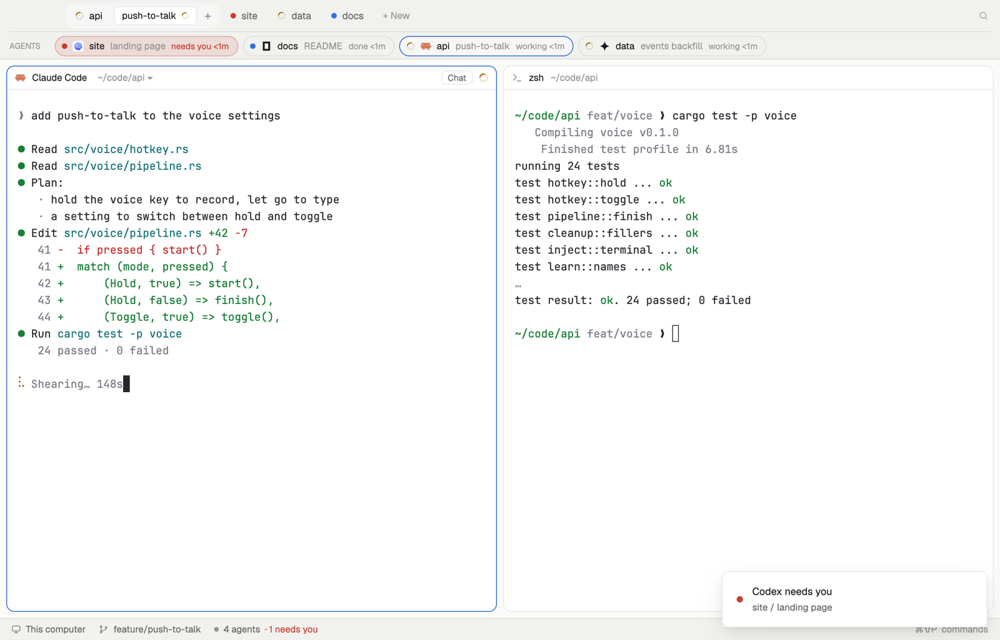

# Stacked

Everything a sidebar holds, laid along the top in two slim rows, so your tab gets the window's whole width: your spaces, the shown one opened up to its tabs, and every agent with the ones that need you first. Made for ultra-wide screens, where a sidebar eats the middle, and portrait ones, where it squeezes the terminal.

## What you see

Top to bottom:

- **The strip**, 76 px on `chrome`, a 1 px `border` line below, two rows split by a 1 px `border` line inset 12 px.
  - **Spaces** (40 px): a 28 px chip per space with its state (a spinner while working, a red dot when it needs you, a blue one when done, a faint dot when idle), its name in 12.5 px semibold, its machine for a remote space and how many tabs when it has more than one. The shown space is a `raised` tray holding its chip, then its tabs as 24 px chips (the shown one on the terminals' `background` with a `border`; a dot or spinner by state; unnamed tabs go by their agent's name, a zoomed one ends in "Z"), then +. After the spaces "+ New", then search; Linux and Windows get –, □ and ✕ at the end. macOS leaves 84 px for its window buttons.
  - **Agents** (36 px): "AGENTS" in 10.5 px `dim`, then a 26 px pill per agent: state, the program's icon, its space, what it's about in `dim`, and "working 4m" / "needs you 2m" / "done 1m" / "idle". Waiting ones have a red tint and border, the agent on screen an `accent` border. With more than one waiting, "3 need you" in red at the end.
- **The tab**, full width, 8 px in: every pane a card with 10 px corners, a 1 px `border`, an `accent` border on the focused one, and Woolshed's 30 px pane header. With no space open, the start screen.
- **The status bar**, 28 px: Woolshed's own.

## How it behaves

- Click a space to show it, a tab chip to show that tab (right-click it for Woolshed's tab menu: rename, close, move), + or "+ New" for the start screen, the search button for the picker.
- Click an agent to show it (`agent.focus` opens its tab and gives it the keyboard). `agent.next` and `agent.prev` follow the agents row: needs you, then done, working, idle, pinned first in each.
- Both rows scroll sideways when they're longer than the window.
- Times come from when this layout saw each agent change; they redraw every 30 s.

## Built from

- `layouts/stacked.json`: root column (`titlebar: "none"`, `traffic_lights: [14, 13]`, background `canvas`, `terminal_padding: [14, 12]`, `preview: "layouts/stacked.svg"`). Children: `strip` (block, 76 px, `window_drag`, mod `stacked`), `work-body` (row, padding 8) with `main` `{ "tab": "active", "empty": { "mod": "new-session", "props": { "page": true } }, "pane": { "gap": 8, "radius": 10, "background": "background", "lone": true, "border": ..., "focus": ..., "header": { "content": { "mod": "pane" }, "height": 30, "position": "top", "reveal": "always" } } }`, and `status` (28 px, mod `workspace-status`).
- `mods/stacked/main.js`: `agents`, `spaces`, `panes`, `focused`, `run`, `theme`, `window`, `openOverlay`, `setAgentOrder`. Commands: `space.select`, `tab.select`, `agent.focus`, `mod.open {name: "picker"}`, `window.minimize|maximize|close`; the shipped `menu` (`{tab: "tab"}`) and `new-session` as overlays.
- Shipped mods: `pane`, `workspace-status`, `new-session`, `menu`, `picker`. Icon: `mods/workspace-chrome/search.svg`. Art: `mods/stacked/spinner.svg`, `layouts/stacked.svg`.

## Watch out

- There is no Files or Changes panel here; use another layout for them.
- Tabs can't be dragged in the strip (the shipped tab bar does that).
- `preview.png` is a screenshot of Woolshed in light mode, running example agents.

## Done when

- `woolshed check` passes on this folder; switching in shows the two-row strip and the tab at full width.
- The shown space's chip opens up to its tabs; clicking another space moves that tray to it.
- The agents row starts with the one that needs you, in red; clicking it shows its tab.
- In a window 900 px wide both rows scroll sideways instead of wrapping.
