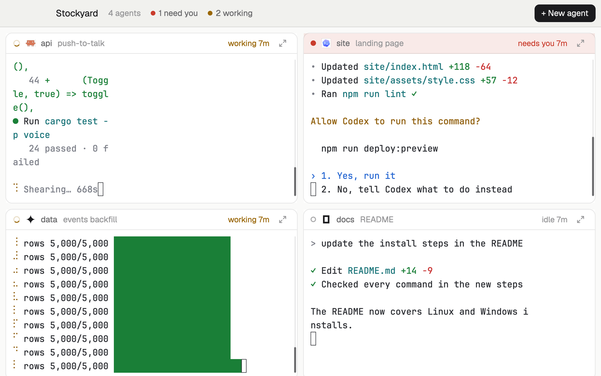

# Stockyard

Every agent's live terminal at once, each in its own pen, in a grid that grows as agents start. Type into any pen; zoom one to give it the whole yard. For watching a crew of agents work side by side.

## What you see

- **Bar**, 40 px, the theme's `chrome` with a 1 px `border` below: "Stockyard" in 13.5 px semibold, "6 agents" in `dim`, then (only when there are any) "2 need you" and "3 working" with 7 px status dots. Past twelve agents it adds "12 shown, 3 more". On the right a solid "+ New agent" button (26 px tall). macOS leaves 82 px for the window buttons; Linux and Windows get –, □ and ✕.
- **The yard**, 8 px from the edges, pens 8 px apart. Each pen is a card with 10 px corners, the terminal `background` and a 1 px `border` (an `accent` border while you type in it). Its 30 px tag shows a status mark (spinner while working, a dot when waiting or done, a ring when idle), the program's 14 px icon, the space name in 12 px semibold, what it's about in `dim`, the status word and time ("needs you 4m", "working 47m") in the status color, and a zoom button. A waiting pen's tag is tinted with the `blocked` color. Below the tag, the agent's live terminal at 13 px text.
- With no agents, one card in the middle: "No agents yet", a line about pens, and "+ New agent".

## How it behaves

- Pens follow the agents: one starts, a pen appears; one ends, its pen goes. Shapes stay wide: 1, 2 or 3 in a row; 4 as 2×2; 5–6 as 3×2; 7–8 as 4×2; 9 as 3×3; 10–12 as 4×3. A short last row keeps its columns with blank pens.
- Pens are in list order (space, tab, pane) with pinned agents first. Past twelve, the ones that need you most get pens (pinned, then waiting, working, done, idle).
- Click a pen's terminal or its tag to type into it (`pane.focus` with the terminal). Everything else about the terminal is as anywhere: select, scroll, copy.
- The zoom button gives that agent the whole yard; "Show all" in the bar (or the button again) brings every pen back.
- Every agent is on screen, so an agent that finishes shows as idle rather than done (you're looking at it).
- "+ New agent" opens Woolshed's agent menu; the new agent starts in a new tab of the shown space and gets a pen when it appears.

## Built from

- `layouts/stockyard.json`: root column (`titlebar: "none"`, `traffic_lights: [14, 13]`, background `canvas`, `font_size: 13`, `terminal_padding: [10, 8]`, `preview: "mods/stockyard/preview.svg"`) with `stockyard-bar` (40 px, `window_drag`, mod `stockyard` `{ "role": "bar" }`) and `yard` (column, padding 8, gap 8), which ships holding one block: `yard-empty` (mod `stockyard` `{ "role": "empty" }`).
- `mods/stockyard/main.js`. The bar copy keeps the yard in step: when the set of agents (or the zoom) changes it rebuilds the `yard` node's children and runs `layout.set` with the whole layout, at most once per change. The yard is rows (`yard-row-N`, gap 8) of pens: a column `pen-<address>` (background `background`, 1 px `border`, radius 10, `focus` border `accent`, not resizable) holding `tag-<address>` (30 px, mod `stockyard` `{ "role": "tag", "terminal": "<address>" }`) and `term-<address>` (content `{ "terminal": "<address>" }`); blanks are mod blocks with `{ "role": "filler" }`. In ids, characters other than letters, digits, `-` and `_` become `-` (`vps/t7` → `pen-vps-t7`).
- `woolshed` functions: `agents`, `focused` (a pen is focused when `terminal` is its address and `pane` is null), `layout`, `run`, `shared`/`setShared` (`stockyard.zoom`: the zoomed address), `theme`, `props`, `window`, `openOverlay`, `setAgentOrder`. Commands: `layout.set`, `pane.focus`, window commands. Shipped mod: `new-menu`.
- Art: `spinner.svg`, `zoom.svg`, `unzoom.svg`, `preview.svg`.

## Watch out

- A pen is a real terminal block, so the agent's terminal takes the pen's size; other layouts give it back its own size when you switch (agents redraw).
- The bar rewrites this layout's file through `layout.set`; that works on your own layouts (a gallery layout is yours), not on Woolshed's shipped ones. Change anything around the `yard` node freely, but not its children: they are replaced.
- `agent.next` and `agent.prev` choose the agent but don't move the keyboard between pens; click a pen instead.
- Agents on other machines get pens too (their address carries the machine).
- Twelve pens at most, so each stays readable.
- `preview.png` is a screenshot of Woolshed in light mode, running example agents.

## Done when

- `woolshed check` passes on this folder; switching in with no agents shows the "No agents yet" card.
- Starting an agent adds a pen within a second; with five agents the yard is 3 + 2 with a blank pen.
- Typing in a pen reaches that agent, and its pen has the accent border.
- Zoom gives one pen the whole yard; Show all brings the others back.
- A waiting agent's tag turns red-tinted and says "needs you".
