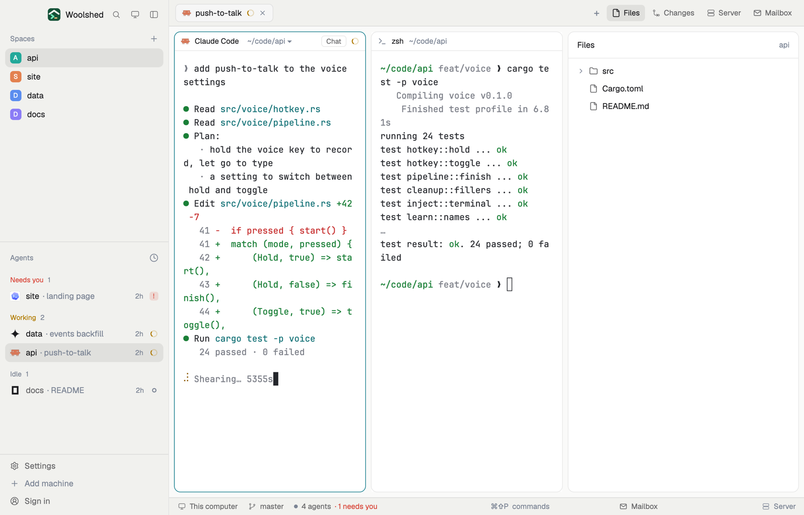

# Tide

Woolshed's own window that follows the tide of the day: light Paper when your system is light, dark Ink when it's dark, with one tide-teal accent and status colors chosen to read on both. Switch your system's appearance and Woolshed follows it.

## What you see

- **The look**: `theme: { "light": "paper", "dark": "ink" }`, so Woolshed's own Paper when the system (or your `appearance`) is light and Ink when it's dark, with the layout's own colors over both:
  - **Accent**: tide teal `#1a7f8e` with white `accent_foreground` `#ffffff` on it (the focused pane's border, primary buttons, links).
  - **Agents**: working `#b07a00`, needs you (`blocked`) `#d9473a`, done `#3f7fe0`; idle, unknown and `dim` `#7b8494`.
  - **Paper (light)**: terminals `#ffffff`, behind cards `#fafaf9`, sidebar and bars `#f1f1ee`, text `#1b1b1e`, terminal text `#25272c`, `muted` `#69696a`, Woolshed's own 16 terminal colors and selection `#cfdcf5`.
  - **Ink (dark)**: terminals `#111720`, behind cards `#0e131b`, sidebar and bars `#0c1016`, text `#eeeeef`, terminal text `#cdd6e4`, `muted` `#96989c`, Woolshed's own 16 terminal colors and selection `#344861`.
- **Contrast on Paper** (WCAG, measured): text 15.18:1 (lowest on any panel), terminal text 14.94:1, `muted` 4.85:1, `dim` 3.33:1, the accent 4.15:1 against the background and its text 4.70:1 on it, working/needs you/done at least 3.30:1, terminal colors at least 4.52:1 (bright black 4.06:1), terminal text on the selection 10.82:1.
- **Contrast on Ink** (WCAG, measured): text 12.14:1 (lowest on any panel), terminal text 12.28:1, `muted` 4.87:1, `dim` 3.73:1, the accent 3.83:1 against the background and its text 4.70:1 on it, working/needs you/done at least 4.21:1, terminal colors at least 7.32:1 (bright black 5.58:1), terminal text on the selection 6.38:1.
- **The window** is Woolshed's own layout, unchanged: the sidebar, 268 px on `chrome` (Woolshed's header, 46 px; Spaces, Agents and History; the sidebar's foot, 97 px); the tab bar, 42 px; panes as cards 8 px apart with 10 px corners on `background`, a 1 px `border` and the focused pane in `accent`, with the 30 px pane header; the start screen while no space is open; the side panel (Files, Changes, Server, Mailbox), 368 px, hidden until opened; and the 28 px status bar (the branch and repo, the mailbox, the project's site).

## How it behaves

- Everything works as in the Woolshed layout: spaces, agents, history, tabs, the + menu, Files, Changes, Server and Mailbox, pane headers, splitting and dragging panes. The side panel remembers per space whether it was open, the same as there.
- Agent status shows in the sidebar and tab bar in the colors above: working `#b07a00`, needs you `#d9473a`, done `#3f7fe0`, idle `#7b8494`.
- Change your system's light or dark mode (or `appearance` in settings.json) and the window switches between Paper and Ink at once, keeping the teal accent and status colors.
- `ctrl-shift-l` (`layout.switch`) moves on to your next layout; nothing else changes.

## Built from

- `layouts/tide.json`: Woolshed's shipped `main.json` (0.1.5) unchanged, plus at the root `theme: { "light": "paper", "dark": "ink" }`, `colors` (`accent`, `accent_foreground`, `dim`, `working`, `blocked`, `done`, `idle`, `unknown`) and `preview: "layouts/tide.svg"`.
- `layouts/tide.svg`: the 224×124 picture the settings screen shows, a small window in the palette (Paper on the left half, Ink on the right).
- No mods of its own: it uses Woolshed's shipped `workspace-chrome`, `spaces`, `agents`, `history`, `tabs`, `new-session`, `pane`, `files`, `changes`, `server`, `mailbox`, `workspace-status`. It runs no programs and fetches nothing.

## Watch out

- `preview.png` is a screenshot of Woolshed in light mode, running example agents.
- A layout holds one `colors` map for both appearances (it applies over whichever theme is shown), so Tide can't carry two whole palettes. It uses Woolshed's own `paper` and `ink` themes for everything else and only sets the colors picked to read on both: accent, accent text, working, needs you, done, `dim` and idle.
- `muted` stays the themes' own (4.85:1 on Paper, 4.87:1 on Ink): no single grey can reach 4.5:1 on both white and near-black.
- Your `appearance` setting (`system`, `light` or `dark`) decides which half you see; `app.theme` can change either half.
- It's a copy of Woolshed's own layout as of 0.1.5: when Woolshed's layout gains something later, this copy doesn't. To refresh it, copy the newer `main.json` and put this layout's root `theme`, `colors` and `preview` back on it.
- Colors in a layout are `#rrggbb` or `#rrggbbaa` only, not theme names.

## Done when

- `woolshed check` passes on this folder, and `woolshed do layout.switch --name tide` shows the Woolshed window in these colors, Paper or Ink by the system's appearance.
- Switching the system to dark turns it to Ink, and back to light turns it to Paper, with the teal accent on the focused pane in both.
- Every contrast above measures as stated: text 7:1 or more, `muted` 4.5:1 or more and `dim` 3:1 or more on every panel (`muted` uses the themes' own).
- A working, a waiting and a done agent show three clearly different status colors in the sidebar.
- Files and Changes open the side panel, and the status bar shows the branch, as in the Woolshed layout.
