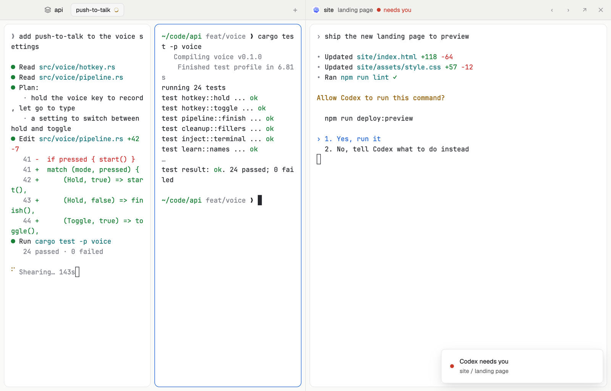

# Two-up

Two stages side by side. The left is the tab you're in, as usual: it follows your tabs and spaces. The right holds one agent you pin there, from any space, and keeps it while you move around on the left: the agent writing the code beside your test run, a reviewer beside the builder, or an agent you're waiting on beside your own work.

## What you see

- Two equal halves on `canvas`, a 1 px `border` line between them, each with a 42 px head on `chrome` (a 1 px `border` line below) over its stage, 8 px in.
- **Left head**: the space as a chip (a layers icon and its name in 13 px semibold), then the space's tabs as 28 px chips (the shown one `raised` with a `border`; a spinner while an agent works there, a red or blue dot when one needs you or finished; unnamed tabs go by their agent's name), then +. macOS leaves 84 px for its window buttons.
- **Left stage**: the shown tab as it's split, every pane a card with 10 px corners, a 1 px `border`, an `accent` border on the focused one (a lone pane too). With no space open, the start screen.
- **Right head**: the pinned agent's icon, its space in semibold, what it's about in `muted`, and its state ("working" with a spinner, "needs you" in `blocked` red, "finished", "idle"), with "· also on the left" when its tab is the one shown left. On the right ‹ and › (pin the previous or next agent), ↗ (show its tab on the left) and ✕ (unpin). Linux and Windows get –, □ and ✕ for the window after a divider.
- **Right stage**: the pinned agent, live, in a card with 10 px corners and a 1 px `border` (`accent` while you type in it). With nothing pinned: "Keep an agent beside you" and every agent as a 40 px row (state, icon, space, what, and its state or "in this tab"), agents outside the shown tab first, a waiting one with a red border. With no agents: "No agents are running." and "+ New agent".

## How it behaves

- Click a row to pin that agent. The pin stays across tab and space switches, layout switches and restarts (it's shared state), until you unpin it or the agent ends; then the list comes back.
- Type into either side; clicking a side gives it the keyboard. The left side's tab chips run `tab.select`, the space chip opens the picker, + opens the start screen as a dialog.
- ‹ › step the pin through every agent in Woolshed's order. ↗ shows the pinned agent's tab on the left (`pane.focus`).
- Mod commands for your own keys (or `woolshed do`): `two-up.pin` pins the agent you're in (the focused terminal's agent, else one in the shown tab), `two-up.unpin`, `two-up.next`, `two-up.prev`. The item binds no keys.
- The right head rewrites the layout's `pair` block (`layout.set`) only when the pin changes.

## Built from

- `layouts/two-up.json`: root row (`titlebar: "none"`, `traffic_lights: [14, 15]`, background `canvas`, `terminal_padding: [14, 12]`, 1 px `border` divider, `preview: "layouts/two-up.svg"`). `left` (column, weight 1, min 360: `left-head` 42 px `window_drag` mod `two-up {role: "left"}`; `left-body` row, padding 8, with `main` `{ "tab": "active", "empty": { "mod": "new-session", "props": { "page": true } }, "pane": { "gap": 8, "radius": 10, "background": "background", "lone": true, "border": ..., "focus": ... } }`). `right` (column, weight 1, min 320: `right-head` 42 px `window_drag` mod `two-up {role: "right"}`; `right-body` row, padding 8, with `pair` (block, background `background`, `border`, `focus` border `accent`, radius 10, content `{ "mod": "two-up", "props": { "role": "pick" } }`, which the mod swaps for `{ "terminal": "<address>" }`)).
- `mods/two-up/main.js`, roles `left`, `right`, `pick`. `woolshed`: `agents`, `spaces`, `panes`, `layout`, `run`, `shared` / `setShared` (`"two-up.pin"`), `focused`, `nextCommand`, `theme`, `props`, `window`, `openOverlay`. Commands: `layout.set`, `tab.select`, `mod.open {name: "picker"}`, `pane.focus`, `window.minimize|maximize|close`.
- Shipped mods: `new-session`, `picker`. Icon: the shipped `mods/workspace-chrome/layers.svg`. Art: `mods/two-up/spinner.svg`, `layouts/two-up.svg`.

## Watch out

- The right stage is a terminal block, not `{ "agent": "focused" }`: focusing an agent shows its tab, which would put it on both sides. Pinning never changes the left side.
- When the pinned agent's tab is the shown one, it is on both sides (the head says so). ↗ does this on purpose.
- There is no shipped tab bar here (its Files and Changes buttons need a panel this layout doesn't have); the left head is its own.
- `preview.png` is a screenshot of Woolshed in light mode, running example agents.

## Done when

- `woolshed check` passes on this folder; switching in shows the tab on the left and the agent list on the right.
- Clicking an agent pins it on the right; switching spaces on the left leaves it there, live.
- ✕ brings the list back; › pins the next agent.
- Ending the pinned agent brings the list back.
