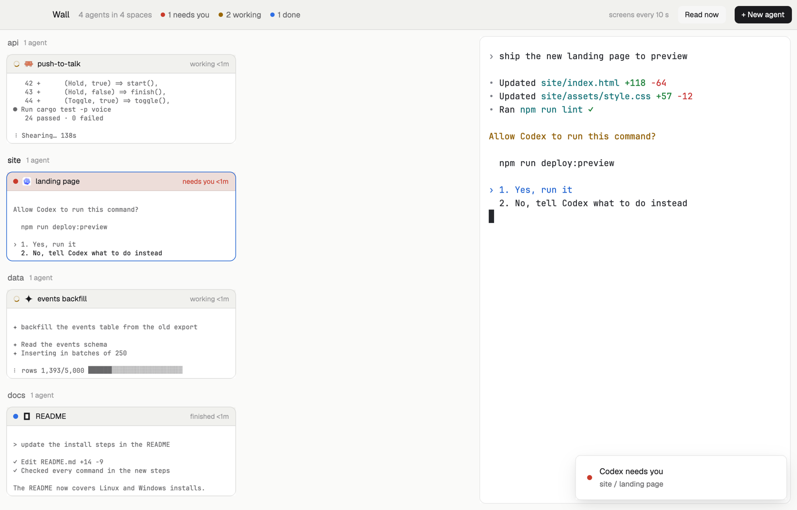

# Wall

Every agent as a small tile showing the bottom of its screen, grouped by space, so you can read what each one is doing (the question it's asking, the test it's on, the line it just wrote) without opening any of them. Click a tile to put that agent live on the stage beside the wall and talk to it there.

## What you see

- **The bar**, 48 px on `chrome`, a 1 px `border` line below: "Wall" in 14 px semibold, "4 agents in 4 spaces" in `dim`, then counts with 7 px dots in the state colors ("1 needs you", "2 working", "1 done"). On the right "screens every 10 s" in 11.5 px `dim`, a "Read now" button and a solid "+ New agent", both 28 px. macOS leaves 84 px for its window buttons; Linux and Windows get –, □ and ✕ at the end.
- **The wall**, three fifths of the width, 10 px in. A section per space with agents, 16 px apart: the space's name in 13 px semibold (`muted` unless it's the shown one), its machine for a remote space, and "2 agents". Then its tiles, 10 px apart, wrapping: as many columns as fit at 280 px each (one to four), equal widths.
- **A tile**: 10 px corners, a 1 px `border` (`accent` for the agent on the stage, red for one that needs you). A 30 px head on `chrome` (red-tinted while waiting, `raised` on the stage agent): state dot or spinner, the program's icon, what it's about in 12 px semibold (the tab's name, else its title), "pinned" if pinned, and "working 4m" / "needs you 2m" (red) / "finished 1m" / "idle". Below, on the terminals' `background`, the last 7 lines of its screen in the terminal font at 10.5 px, 14 px a line, bottom-aligned; `muted` text (`dim` for idle agents), and for a waiting agent its last line in `foreground`. Before the first read: "Reading the screen…"; an empty screen: "Nothing on screen yet"; a failed read: "Couldn't read the screen: …".
- **The stage**, two fifths: the chosen agent live, in a card with 10 px corners, a 1 px `border` (`accent` while you type in it).
- With no agents: "No agents yet", a line about the tiles, and "+ New agent".

## How it behaves

- Screens are read every 10 seconds, one agent after another, up to 24 agents (the rest show their state only, and the wall says so); "Read now" reads them all at once. A read that takes over 5 s is skipped until the next round.
- Click a tile to put that agent on the stage (`agent.focus`, which also shows its tab); type to it there. `agent.next` / `agent.prev` follow the wall's order: spaces in order, and in each the pinned, then needs you, done, working, idle.
- Click "2 agents" by a space's name to show that space.
- States and times update the moment Woolshed sees a change; the snippets on the next read.
- If `hc` can't be started, a red note says so above the tiles and nothing is read.

## Built from

- `layouts/wall.json`: root column (`titlebar: "none"`, `traffic_lights: [16, 17]`, background `canvas`, `terminal_padding: [14, 12]`, `preview: "layouts/wall.svg"`). Children: `wall-bar` (block, 48 px, `window_drag`, mod `wall {role: "bar"}`) and `wall-body` (row, padding 10, gap 10): `tiles` (block, weight 3, min 300, mod `wall {role: "wall"}`) and `stage` (block, weight 2, min 320, background `background`, `border`, `focus` border `accent`, radius 10, content `{ "agent": "focused" }`).
- `mods/wall/main.js`, and `mods/wall/snippet.js` (pure: the snippet, the column count, the groups). `woolshed`: `agents`, `spaces`, `focused`, `run`, `hc`, `theme`, `props`, `shared` / `setShared` (`"wall.refresh"`, the bar telling the wall to read now), `settings` (`font_family`), `window`, `openOverlay`, `setAgentOrder`. Commands: `agent.focus`, `space.select`, `window.minimize|maximize|close`; the shipped `new-menu` as a 250×512 popup.
- Program: `hc read <address> --lines 0` (the screen, no history) per agent, every 10 s. The snippet drops trailing blank lines, folds runs of blank lines to one, drops lines of only box drawing, expands tabs and cuts lines at 160 characters.
- Art: `mods/wall/spinner.svg`, `layouts/wall.svg`.

## Watch out

- Unlike a board of state columns, the wall is about what's on each screen; unlike live terminal grids, the tiles are cheap text snapshots, so dozens of agents stay light.
- The snippet is the screen at the last read, up to 10 s old; the stage is live.
- Each card's time is when this layout saw the agent enter that state.
- `preview.png` is a screenshot of Woolshed in light mode, running example agents.

## Done when

- `woolshed check` passes on this folder; switching in shows the bar, the wall and the stage.
- Within a few seconds every tile shows the bottom of its agent's screen; a waiting agent's tile shows its question.
- Clicking a tile puts that agent live on the stage and its tile gets the `accent` border.
- "Read now" updates the tiles at once.
