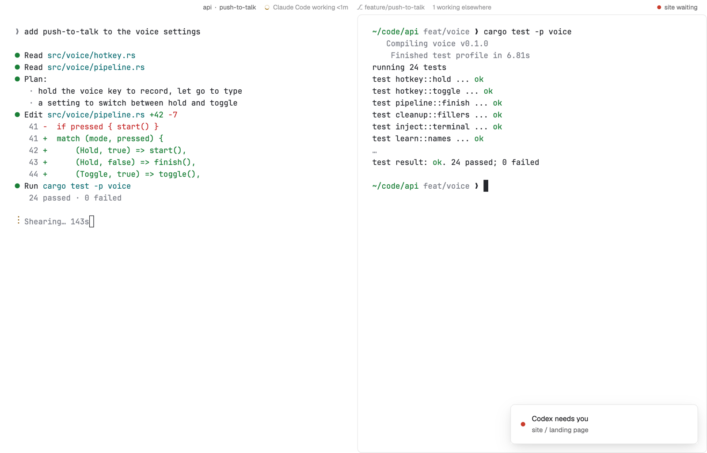

# Zen

Only your terminals, edge to edge, and nothing else. A hairline strip along the top stays blank until you point at it, then says where you are and what the agent is doing; it also shows by itself for a few seconds when you switch tab or space. The one thing that ever appears unasked is a small red dot when another agent waits on you.

## What you see

- Your theme, unchanged (the layout sets no theme), terminal text with 26 px side margins and 12 px top and bottom, on the terminals' `background` everywhere: no sidebar, no tab bar, no status bar.
- **The top strip**, 26 px, no background or border of its own. At rest it is empty. While you point at it (and for 4.5 s after the shown tab or space changes) it fades in, centered, in 11.5 px: "api  ·  push-to-talk" in `muted` (the space, then the tab's name if someone named it, else the focused pane's title or program), then the agent in this tab with a small spinner or dot ("Claude Code working 4m", in `blocked` red when it needs you), "+1 here" when the tab holds more agents, "⎇ main", and "2 working elsewhere".
- **The waiting dot**: at the strip's right end, a 7 px `blocked` dot whenever an agent outside this tab needs you; with the strip shown it adds "site waiting" (or "2 waiting"). macOS leaves 84 px on the left for the window buttons; Linux and Windows get –, □ and ✕ at the right, shown with the strip.
- **The tab**, as it's split, with 14 px between panes and no visible frames. The pane you're typing in gets a faint 1 px `border` outline when the tab is split; a lone pane has none. With no space open, Woolshed's start screen (`new-session`) fills the window.

## How it behaves

- Point at the top edge to read the strip; it fades out (420 ms) when you leave. Switching tabs or spaces flashes it for 4.5 s so you know where you landed.
- Click the waiting dot to go to the agent that has waited longest (`pane.focus`, which opens its tab).
- Agent states: working shows a spinner in `working`, blocked a red dot and "needs you", done a `done` dot and "finished", idle a hollow ring.
- Everything else is your keys: `ctrl-shift-l` (cycle layouts) takes you back out, and tab and space keys, the palette and the picker work as usual.
- The strip redraws only when Woolshed's data changes and once when a flash ends; there is no clock.

## Built from

- `layouts/zen.json`: root column (`titlebar: "none"`, `traffic_lights: [12, 8]`, background `background`, `terminal_padding: [26, 12]`, `preview: "layouts/zen.svg"`). Children: `zen-top` (block, 26 px, `window_drag`, mod `zen`) and `main` (content `{ "tab": "active", "empty": { "mod": "new-session", "props": { "page": true } }, "pane": { "gap": 14, "radius": 8, "background": "background", "border": { "width": 1, "color": "background" }, "focus": { "width": 1, "color": "border" } } }`).
- `mods/zen/main.js`: `agents`, `spaces`, `panes`, `focused`, `run`, `theme`, `window`. Hover with `on_hover` on the strip; the fade is `.opacity()` with `.transition("opacity", ...)`, never a timer. Commands: `pane.focus`, `window.minimize|maximize|close`.
- Shipped mod: `new-session` (the empty state). Art: `mods/zen/spinner.svg`, `layouts/zen.svg` (the Settings picture).

## Watch out

- The strip must not change height on hover: it is a fixed 26 px block and only its opacity changes, so terminals never resize.
- The pane border is drawn in the `background` color on purpose: it keeps panes the same size whether focused or not, and only the focused one shows an outline.
- There is no way to click to another tab here; that is the point. Learn `ctrl-shift-l` before switching in.
- `preview.png` is a screenshot of Woolshed in light mode, running example agents.

## Done when

- `woolshed check` passes on this folder; `woolshed do layout.switch --name zen` shows only the tab, and the strip's text shows for a few seconds and then fades.
- Pointing at the top edge shows the space, the tab and the agent's state; leaving fades it.
- An agent in another space asking for you makes the red dot appear; clicking it opens that agent's tab.
- A split tab shows an outline only around the pane you're typing in.
