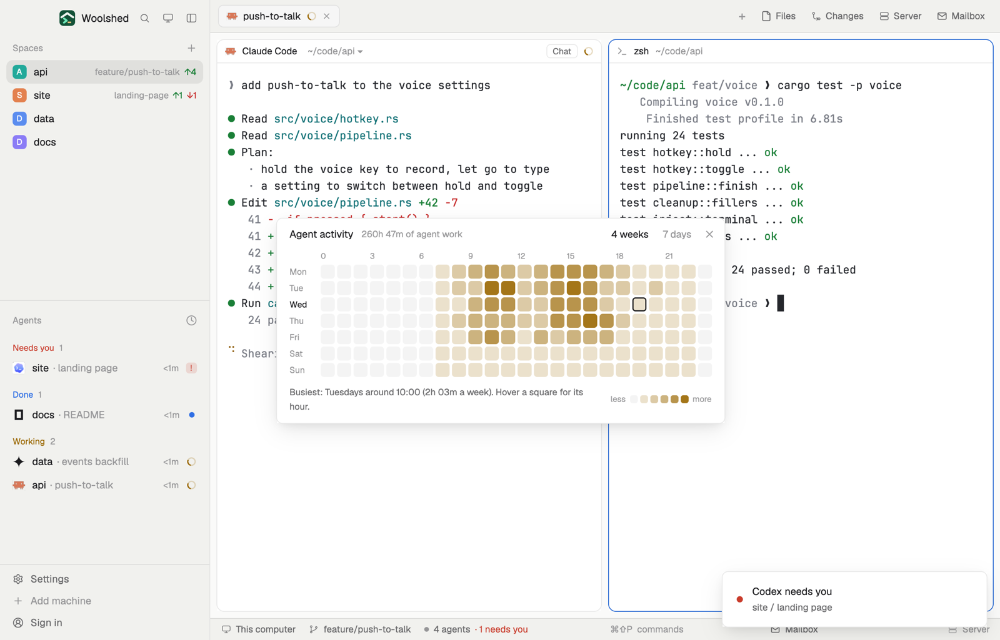

# Agent activity

When do your agents actually work? A grid of the week, day by hour, shaded by how much agent work happened in each hour over the last four weeks. Spot your busy afternoons, the quiet Fridays, and whether those overnight runs ever happen.

## What you see

A window 573 px wide on the `popover` color (`mod.open activity-heatmap`), or a strip in a layout block:

- **Header**, 40 px: "Agent activity" in 13 px semibold, the total ("46h 20m of agent work") in 11.5 px `dim`, the links "4 weeks" and "7 days" (the chosen one in `foreground`), and ✕.
- **The grid**: hour numbers every three hours across the top (0, 3, … 21) in 10 px `dim`, the current hour in `foreground`; then seven rows, Mon to Sun, each a 40 px day name (today's semibold in `foreground`) and 24 squares of 18 px with 4 px corners, 3 px apart. A square is the `working` color in five strengths by its share of the busiest hour, or a faint `foreground` when nothing happened. The current hour has a 1.5 px `foreground` border.
- **Under it**: "Busiest: Wednesdays around 15:00 (2h 10m a week). Hover a square for its hour." in 11.5 px `muted`; hovering a square changes it to "Tuesdays 14:00–15:00 · 6h 12m of agent work, 1h 33m a week". At the right a legend: "less", six 10 px squares, "more".
- With nothing recorded: "No agent work recorded yet. Squares fill in as your agents work, sampled every 30 seconds."
- **The strip**: today as 24 small bars (3 px wide, up to 16 px tall, the current hour stronger) and "Today 3h 10m of agent work"; a click opens the window.

## How it behaves

- Every 30 seconds it counts the agents working and adds that much time to the current hour: two agents working for a minute add two minutes ("agent-minutes"). A gap (Woolshed closed, the machine asleep) adds nothing.
- Squares sum the same weekday and hour over the chosen range: the last 28 days, or the last 7. Times "a week" divide by the number of weeks.
- Hours older than 28 days are dropped.

## Built from

- `mods/activity-heatmap/main.js`: with `props().overlay` the window, else the strip. `woolshed` functions `agents`, `theme`, `props`, `closeOverlay`, `shared`, `setShared`, `readTextFile`, `appHome`, `run`.
- `heat.js`: `sample` (one 30 s sample into hourly buckets, at most one per 24 s across copies), `merge`, `grid` (weekday × hour, Monday first), `level` (strength 0 to 5), `today`.
- Shared state: `activity-heatmap.buckets` (`{ "YYYY-MM-DDTHH": minutes }`) and `activity-heatmap.last` (the last sample's time), so a window and a strip sample once.
- `mod.json`: a kept window (`key: "activity-heatmap"`, `keep: true`). No keys, no programs.

## Watch out

- It samples only while a copy runs: keep the window open (it comes back on the next start) or put the strip in a layout, `{ "type": "block", "size": { "px": 28 }, "content": { "mod": "activity-heatmap" } }`.
- Hours and days follow this computer's clock and time zone.
- If `data/activity-heatmap/example.json` exists (`{ "buckets": { "YYYY-MM-DDTHH": minutes } }`), it's added to your own history. The preview writes it; delete it to see only yours.
- `preview.png` is a screenshot of Woolshed in light mode, running example agents.

## Done when

- `woolshed check` passes on this folder and `mod.open activity-heatmap` opens the grid.
- With an agent working, today's square for this hour fills in within a minute and the total grows.
- Hovering a square says its day, hour and minutes.
- "7 days" shows only the last week.
