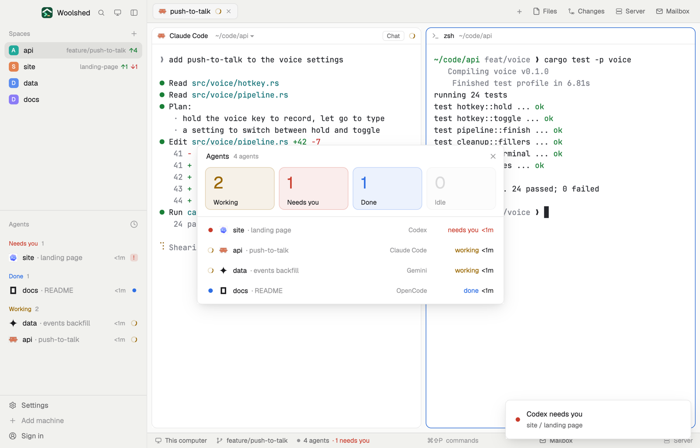

# Agent dashboard

All your agents at a glance: four big counts (working, needs you, done, idle) in the status colors, and under them every agent with its space, tab, program and how long it has been in that state. Click a count to show only those, click an agent to go to it.

## What you see

A window 560 px wide (`ctrl-alt-d`) on the `popover` color, or a panel filling a layout block on `chrome`:

- **Header**, 40 px: "Agents" in 13 px semibold, "5 agents" in 11.5 px `dim` (with "· showing needs you" while a count is picked), and ✕ in a window.
- **Tiles**, one row of four, 78 px tall with 10 px corners and 8 px apart: Working, Needs you, Done, Idle. Each has its count in 30 px semibold in the status color (`working`, `blocked`, `done`, `idle`) and its name in 12 px. The tile is the status color at low strength with a 1 px border in the same color; a count of 0 is fainter. Narrower than 440 px the tiles wrap two by two and shrink to 62 px.
- A 1 px `border` line.
- **Rows**, 36 px, 12.5 px text: a status mark (a spinner while working, a dot for needs you and done, a ring for idle), the program's 15 px icon, the space name (medium; `muted` when idle), "· what it's about" in `dim` (the tab's name if someone named it, else the agent's own title, else the program), the machine for an agent on another computer, the program's name in 11.5 px `dim` (when there's room), then the state in its color and the time in it in semibold ("needs you 4m", "working 23m"). The agent you're on has the `selected` background. The list scrolls past 400 px in the window.
- With no agents: "No agents yet" and how to start one.

## How it behaves

- Order: needs you, working, done, idle; within each the one longest in that state first; pinned agents on top. `agent.next` / `agent.prev` follow this order (`setAgentOrder`).
- Click a tile to show only that state (the tile gets stronger); click it again for everyone. A filter with nobody in it says so.
- Click a row to go to that agent (`agent.focus`), in whichever window shows it.
- Counts and rows follow the agents live; the times move every 30 seconds.

## Built from

- `mods/agent-dashboard/main.js`: `woolshed` functions `agents`, `spaces` (each tab's `working_since`), `run`, `theme`, `props`, `closeOverlay`, `setAgentOrder`. Command: `agent.focus`.
- `words.js` (times, what an agent is about, when each entered its state), `ui.js` (icon, status mark, buttons). When each agent entered its state is kept in the mod's local storage, so times survive a restart; an agent already working when the mod first sees it takes its tab's `working_since`.
- `mod.json`: a kept window (`key: "agent-dashboard"`, `keep: true`). `keys.json`: `"ctrl-alt-d": "mod.open:agent-dashboard"` in `global`.
- Runs no programs and reads nothing from disk. Art: `spinner.svg`.

## Watch out

- Times start when this mod first saw the agent in that state (working: when its tab started working); done and idle count from the moment of the change.
- `setAgentOrder` follows the last list drawn: with the dashboard and the sidebar's agents list both open, the one drawn last sets the order.
- To put it in a layout, give it a block: `{ "type": "block", "content": { "mod": "agent-dashboard" } }`.
- `preview.png` is a screenshot of Woolshed in light mode, running example agents.

## Done when

- `woolshed check` passes on this folder and `ctrl-alt-d` opens the window.
- With agents in several states, each tile's count matches the rows, in the right colors.
- Clicking "Needs you" leaves only waiting agents; clicking it again shows all.
- Clicking a row opens that agent's tab with it focused.
