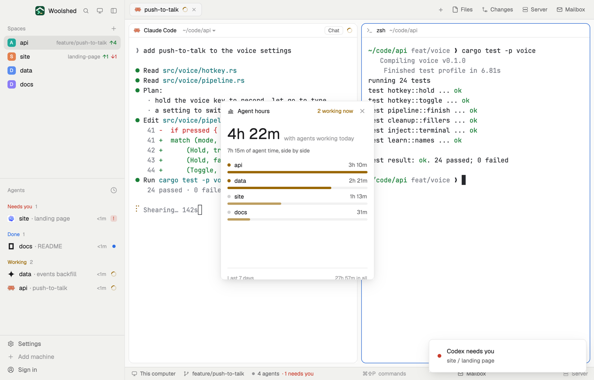

# Agent hours

How long your agents worked today: the time with any agent working, a bar per space, and the last seven days as small bars. It counts while Woolshed runs, from the agents' own status, so you can see where the day's work went and which project kept them busiest.

## What you see

A window 330 px wide on the `popover` color, opened with `mod.open agent-hours` (in a layout block it fills the block on `chrome` and scrolls):

- **Header**: a bar-chart icon, "Agent hours" in semibold, and "2 working now" in the `working` color (or "none working" in `dim`), and ✕.
- **Today's total** in 32 px semibold, "4h 22m", with "with agents working today" in `dim`; when agents worked side by side, "7h 15m of agent time, side by side" under it in 11.5 px `muted`.
- **A row per space**, most time first (at most 220 px, then it scrolls): a dot (`working` while an agent works there now), the space's name, its time in semibold `muted` ("3h 10m"), and under it a 5 px bar against the busiest space, `working` now or a softer `working` otherwise.
- **Empty**: "No agent has worked yet today. Time counts while Woolshed runs."
- **Last 7 days**: "Last 7 days" and the week's sum in 11 px `dim`, then seven columns 64 px tall against the busiest day, today's in the `working` color, other days a faint `foreground`, each with its weekday ("Mo", "Tu") under it; hover one for "2026-11-10: 5h 55m".

## How it behaves

- Every 10 s it looks at `agents()`: the time since the last look goes to each space that had a working agent at that look ("agent time" counts each working agent). A gap of more than 30 s (Woolshed closed, the computer asleep) counts nothing.
- A new day starts at local midnight; a stretch across midnight is split between the two days.
- Only "working" counts: waiting on you, done and idle don't.
- Spaces are counted by name, so a space you close and open again in the same folder keeps adding to the same row.

## Built from

- `mods/agent-hours/main.js`: per-day totals in shared `agent-hours.days` (`{ "2026-11-11": { total, agent, spaces: { name: ms } } }`, the newest 14 days) and the last look in `agent-hours.last` (`{ at, working }`); `woolshed` functions `agents`, `shared`, `setShared`, `theme`, `props`, `closeOverlay`, `appHome`, `readTextFile`.
- `mods/agent-hours/parse.js`: the bookkeeping (spans, midnight splits, the week, durations), tested on its own.
- `mod.json`: a kept window (`key: "agent-hours"`, `keep: true`). Art: `bars.svg`. No keys, programs or network.

## Watch out

- It counts only while a copy runs (the window, or a block). The window is kept, so it comes back on the next start; several copies don't count twice (each span starts at the last look by any of them).
- It writes the shared totals every 10 s only while an agent works.
- Example days for a first look: `data/agent-hours/example.json` under the app folder, `{ "days": [{ "ago": 0, "total": s, "agent": s, "spaces": { "api": s } }] }` (seconds; ago: days before today), are merged in once each time that file changes. The preview uses it; nothing else writes it.
- `preview.png` is a screenshot of Woolshed in light mode, running example agents.

## Done when

- `woolshed check` passes on this folder and `mod.open agent-hours` opens the window.
- With one agent working, today's total and its space's row grow by a minute each minute.
- When it stops working the dot goes grey and the total stops.
- After midnight today's total starts at 0m and yesterday's column keeps its height.
