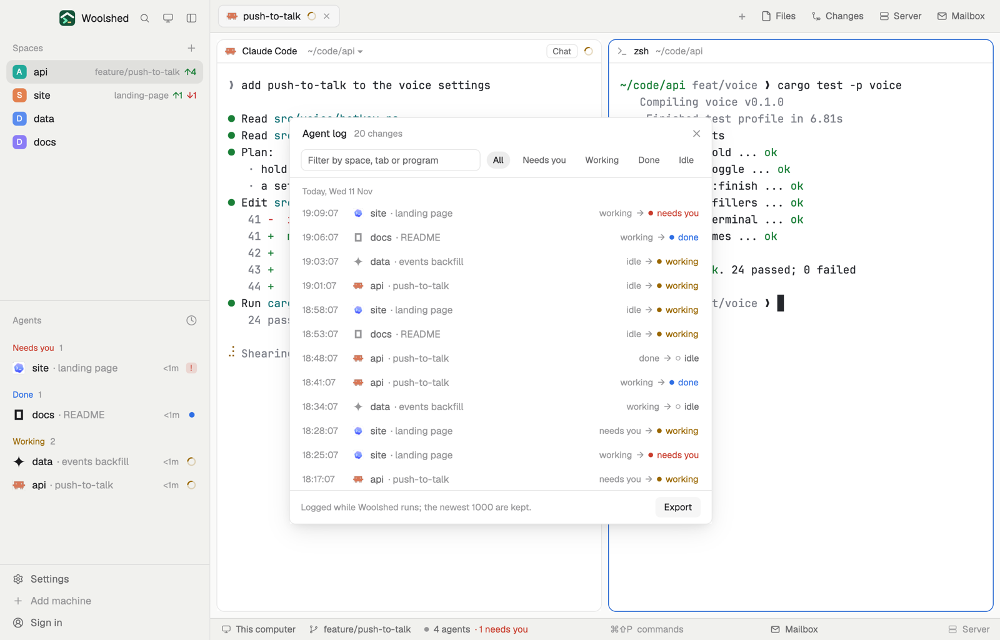

# Agent log

A running log of what your agents did and when: every start, stop, question and finish, with its space and tab. Filter it by name or status, and export it to a markdown file when you want a record of the day.

## What you see

A window 540 px wide on the `popover` color (`mod.open agent-log`), or a strip in a layout block:

- **Header**, 40 px: "Agent log" in 13 px semibold, "214 changes" in 11.5 px `dim`, and ✕.
- **Filters**: a 28 px text field ("Filter by space, tab or program") with 7 px corners on the terminal `background`, then pills: All, Needs you, Working, Done, Idle (the chosen one on its status color at low strength, All on `selected`).
- A 1 px `border` line, then the log, newest first, with a day heading in 11 px `dim` ("Today, Wed 11 Nov", "Yesterday, …") where the day changes. A 30 px row: the time with seconds ("14:32:05") in 11.5 px `dim`, the program's 13 px icon, the space name and "· tab" in `dim`, and on the right "working → " in `dim`, a 6 px dot and the new state in its color, medium ("needs you" in `blocked`, "done" in `done`, "working" in `working`, "idle" in `muted`, "closed" in `dim`). A start reads "started → working". Agents that are gone are drawn in `muted`. Up to 400 px, scrolling; the newest 300 matches are drawn.
- **Footer**: "Logged while Woolshed runs; the newest 1000 are kept." in `dim` (after an export, "Saved 214 entries to data/agent-log/agent-log-2026-11-11-1432.md" in `done`), a Clear link and an Export button, 26 px.
- Nothing yet: "Nothing logged yet. Every time an agent starts, stops, asks you something or finishes, a line lands here."
- **The strip**: the last change, "14:32 site · landing page → needs you"; a click opens the window.

## How it behaves

- A line is added whenever an agent's status changes, a new agent appears ("started") or one goes away ("closed"). The first look after a copy starts logs nothing: it only learns where everyone is.
- Typing filters by space, tab, program or address; a pill keeps only changes into that state. Both together narrow further.
- Click a row whose agent still runs to go to it (`agent.focus`).
- Export writes what's shown (all matches, not only the 300 drawn), oldest first, to `data/agent-log/agent-log-<date>-<hhmm>.md` in the app folder: `# Agent log`, a `## Today, Wed 11 Nov` heading per day and `- 14:32:05 **api** · push-to-talk (Claude Code): working → needs you` per change.
- Clear asks first ("Clear the 214 logged changes? This can't be undone.", Keep or Clear them), then empties the log.

## Built from

- `mods/agent-log/main.js`: with `props().overlay` the window, else the strip. `woolshed` functions `agents`, `run`, `theme`, `props`, `closeOverlay`, `shared`, `setShared`, `readTextFile`, `appHome`; `fs/promises` `mkdir` and `writeFile`; `InputState` and `Input` from `gpui-base`.
- `log.js`: `follow` (changes from what a copy saw last), `append` (each change once, the newest 1000 kept), `matches`, `markdown`.
- Shared state `agent-log.events`: `[{ id, at, address, space, tab, program, from, to }]`. An entry's id is its address, change number and new state, so a window and a strip log a change once.
- `mod.json`: a kept window (`key: "agent-log"`, `keep: true`). No keys, no programs.

## Watch out

- It logs only while a copy runs: keep the window open (it comes back on the next start) or put the strip in a layout, `{ "type": "block", "size": { "px": 28 }, "content": { "mod": "agent-log" } }`. Changes while Woolshed is closed aren't logged.
- "done" turns into "idle" when you look at the agent, so that change shows too.
- If `data/agent-log/example.json` exists (`{ "events": [{ at, address, space, tab, program, from, to }] }`, `at` in ms), its entries are shown with yours and exported with them; Clear doesn't remove them. The preview writes it; delete it to see only yours.
- `preview.png` is a screenshot of Woolshed in light mode, running example agents.

## Done when

- `woolshed check` passes on this folder and `mod.open agent-log` opens the log.
- An agent asking a question adds "working → needs you" at the top within a second.
- Typing a space's name keeps only its lines; the Needs you pill keeps only questions.
- Export writes a markdown file in `data/agent-log/` and says where.
