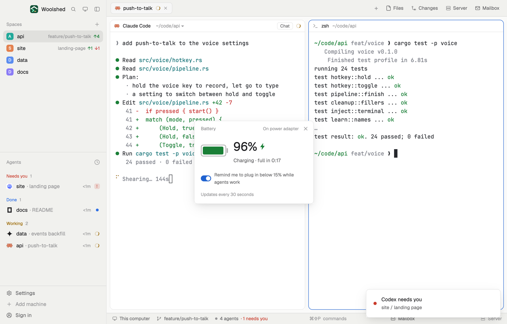

# Battery

Your laptop's charge, whether it's charging and the time left, in a small window or a strip. When the charge drops under 15% on battery while agents are working, a toast tells you to plug in, so a long run doesn't die with the laptop.

## What you see

A window 300 px wide on the `popover` color:

- **Header**, 38 px: "Battery" in 11.5 px `dim`, "On power adapter" or "On battery" at the right, and ✕.
- **The battery**: a drawn battery 64×30 px (an outline in the `foreground` color at 33%, its fill as wide as the charge, a nub at the right) in `ansi2` (green) while charging or above 30%, `working` from 15% to 30%, `blocked` under 15%; beside it "69%" in 30 px semibold with a lightning bolt (`bolt.svg`, `ansi2`) while charging, and below in `muted`: "Charging · full in 2:32", "2:32 left", "Fully charged", "Plugged in, not charging" or "Working out the time left…".
- **The reminder switch**, a row that highlights on hover: a 26×15 px switch (`accent` when on) and "Remind me to plug in below 15% while agents work".
- "Updates every 30 seconds" in 11 px `dim`.
- With no battery: "This computer has no battery: it runs on mains power, so there's nothing to watch."

In a layout block it's a strip: a 22×11 px battery, the bolt while charging, "69%" in semibold and "full in 2:32" or "2:32 left" in `dim` (under 150 px only the percentage); "On power" with no battery. Hovering shows the status.

## How it behaves

- It reads every 30 seconds, never twice at once. macOS: `pmset -g batt`. Linux: one `sh -c` loop over `/sys/class/power_supply/*` printing `type`, `online`, `status`, `capacity`, `scope`, `energy_*`/`charge_*` and `power_now`/`current_now`; the time left is energy over power (or charge over current). Mice and headsets (`scope=Device`) are skipped.
- The toast ("Plug in: battery at 12%", "2 agents are working, about 0:41 left.", warning, 60 seconds) comes once per drop: only while discharging, under 15%, with at least one agent working, and the switch on. It can come again once the laptop has been plugged in or is back at 20% or more.
- pmset's "0:00 remaining" while it's still estimating shows as "Working out the time left…".
- The switch is remembered per copy (`localStorage` `battery.remind`). Windows: "The battery card isn't on Windows yet."

## Built from

- `mods/battery/main.js` and `parse.js` (`parsePmset`, `parsePowerSupply`, `clock`; pure, tested on real `pmset` output, its other states, and Linux samples discharging and charging).
- `woolshed` functions: `exec`, `agents`, `notify`, `theme`, `props`, `closeOverlay`, `window`.
- `mod.json`: a kept window (`key: "battery"`, `keep: true`), opened with `mod.open:battery`. No keys. Art: `bolt.svg`.

## Watch out

- The reminder checks on each 30-second read, so it can come up to 30 seconds after the drop, and only while the window or a strip is open.
- A desktop Mac and most Linux desktops have no battery: the window says so instead of showing an empty gauge.
- `preview.png` is a screenshot of Woolshed in light mode, running example agents.

## Done when

- `woolshed check` passes on this folder and `woolshed do mod.open --name battery` opens the window.
- The percentage matches the menu bar's; unplugging switches the header to "On battery" and the time to "… left" within 30 seconds.
- On battery under 15% with an agent working, one "Plug in" toast appears, and no second one until it's been plugged in.
