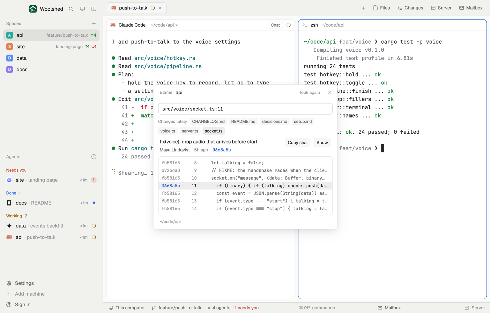

# Blame line

Who last changed a line, and in which commit. Paste `path:line` from an agent's message or a stack trace, or pick one of the files changed lately, and see the commit, its author and age, with the three lines above and below and the commit each came from. Lines nobody committed yet say so.

## What you see

A window 480 px wide on the `popover` color, or a block in a layout (on `chrome`):

- **Header**, 40 px: "Blame" in 11.5 px `dim`, the repository's name in semibold, "look again" and ✕.
- **Input**, 30 px, in the code font on `background` with an `input` border: "path:line, e.g. src/server.ts:12".
- **Changed lately**: up to 8 file-name chips on `raised` (`muted` text; the one shown on `selected`).
- **The commit**: its subject in semibold, then "Maya Lindqvist · 42m ago · 7552ad2" (`muted`, the sha in the code font, `accent`; "· oldest commit" at the start of history), with Copy sha and Show buttons on `raised`. A line not committed yet: "Not committed yet" in the `working` color and "Changed in the working tree: by you or an agent, since the last commit."
- **The lines**, in a card on `background` with a `border`, 20 px each in the code font: the short sha (`accent` when it's the same commit, else `dim`; "·······" for uncommitted), the line number, the text. The asked line sits on `selected`; hovering a line shows its commit and author.
- **Footer**: the folder in 11 px `dim`.

Errors show in `blocked`: "Write it as path:line, e.g. src/server.ts:12", "That file has only 15 lines.", "No such file in this repository (paths are from its top folder)." Outside a repository: "Not a git repository"; without git, "git isn't installed on this machine…".

## How it behaves

- It blames 0.6 seconds after you stop typing, or on Enter. It takes `path:line`, `path:line:col`, `./path:line`, `path#L12` and an absolute path inside the repository.
- A chip fills in that file's first line changed since the commit before last (committed or not) and blames it. The chips are the latest commit's files, then the other files changed since the commit before it.
- On first open it starts at the latest commit's first changed line; after that it remembers the last line you looked at, per repository.
- It follows the focused pane's folder on that space's machine (checked every 2.5 seconds) and blames the line again every 30 seconds, so a commit an agent makes shows up. Show runs `tab.new` with `git show <sha>` in that space.

## Built from

- `mods/blame-line/main.js` and `parse.js` (`parseTarget`, `parseBlame`, `firstChangedLine`, `around`, `since`, `explain`).
- Programs, read-only, with `--no-optional-locks -c core.fsmonitor=false -c diff.autoRefreshIndex=false -c color.ui=false -c core.quotePath=false`: `git rev-parse --show-toplevel`, `git rev-parse --verify --quiet HEAD~1`, `git diff --name-only -z --diff-filter=AMR <HEAD~1>`, `git diff-tree --root --no-commit-id -r --name-only -z --diff-filter=AM HEAD`, `git diff -U0 --no-ext-diff <HEAD~1> -- <file>` (10 seconds each), `git blame --line-porcelain -L <n-3>,<n+3> -- <file>` (15 seconds). With one commit, HEAD~1 is git's empty tree.
- `woolshed` functions: `spaces`, `panes`, `focused`, `exec` (with `on`), `run` (`tab.new`), `home`, `theme`, `settings` (the code font), `props`, `closeOverlay`; `localStorage` for the remembered line. UI: `InputState`, `Input`.
- `mod.json`: a kept window (`key: "blame-line"`), opened with `mod.open:blame-line`; no keys of its own.

## Watch out

- Paths are from the repository's top folder, not the pane's folder.
- Near the end of a file the window is cut at the last line.
- `preview.png` is a screenshot of Woolshed in light mode, running example agents.

## Done when

- `woolshed check` passes on this folder and `mod.open:blame-line` opens it.
- Typing `README.md:1` in a repository shows the commit that last changed that line and the lines after it.
- Editing a line and blaming it says "Not committed yet".
- A chip fills in a changed file's first changed line.
