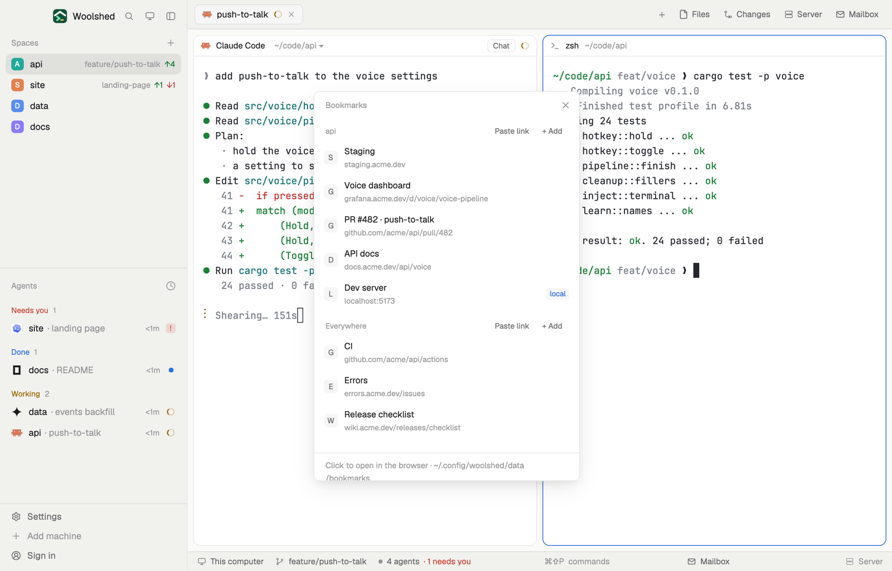

# Bookmarks

The links you keep opening for a project, staging, the dashboard, the pull request, the docs, the dev server, next to the space you're in, plus a list for everywhere. One click opens one in the browser; "Paste link" adds the link you just copied. Each list is a plain markdown file, so an agent can add the preview link it just deployed.

## What you see

A window 380 px wide on the `popover` color, or a block in a layout (on `chrome`):

- **Header**, 38 px: "Bookmarks" in 11.5 px `dim`, and ✕.
- **Two sections**, the shown space's ("api") and "Everywhere", each under an 11 px `dim` label with "Paste link" and "+ Add" in 11 px `muted` at the right.
- **Rows**: a 20 px rounded tile on `raised` with the host's first letter in `muted`, the title in medium `foreground` over the host and path in 11 px `dim` ("github.com/acme/api/pull/482"), and a "local" badge in `accent` on `raised` for localhost, 127.0.0.1, 0.0.0.0, `[::1]`, `*.localhost` and `*.test`. On hover the row turns `hover` and shows Copy and ✕; the tooltip is the full link.
- **The form** (+ Add): a link field, then a Title field (optional) and Save on `solid`. "+ Add" reads "Cancel" while it's open.
- **Footer** in 11.5 px: "Click to open in the browser · …/data/bookmarks" in `dim`; "Added github.com/acme to api" or "Copied the link" in the `done` color and errors in `blocked`, for 6 seconds.
- Empty sections: "No links for api yet." and "No links for everywhere yet."

In the window the list scrolls past 480 px.

## How it behaves

- The first section follows the shown space: one list per folder and machine, so a new space in the same folder finds the same links. With no space open only Everywhere shows.
- Clicking a row opens the link with the system's browser (only `http` and `https`; anything else says "Only http and https links open").
- Paste link reads the clipboard's text once, on that click: an `http(s)` link is added to that section, titled with its host and the first part of its path ("github.com/acme"); anything else says "The clipboard has no link". Nothing reads the clipboard otherwise.
- + Add: Enter in either field (or Save) adds the link after the last one; without a title it takes the host and first path part. Spaces and `)` in the link are encoded so the markdown stays valid.
- Copy puts the link on the clipboard. ✕ deletes it at once.
- Every change reads the file fresh and writes it only if it's still as read; if not, it reads again and retries (three times). Edits to the files elsewhere show up at once. Lines that aren't links are kept where they are.

## Built from

- `mods/bookmarks/main.js` and `mods/bookmarks/parse.js` (parse, add, remove, `isUrl`, `hostOf`, `shortOf`, `isLocal`, `titleFor`; pure functions). `cx.open_url`, `cx.read_from_clipboard` (only on Paste link), `cx.write_to_clipboard`. `woolshed` functions: `spaces`, `appHome`, `home`, `readTextFile`, `writeTextFile` (with the text it expects to replace), `watchFolder`, `theme`, `props`, `closeOverlay`.
- Storage: `data/bookmarks/everywhere.md` and `data/bookmarks/<folder name>-<6-character hash>.md` (the machine's name in front for a remote space) under the app folder, starting with `# Bookmarks · api (~/code/api)`, one `- [Title](https://…)` line per link (`*`, `+` and `<…>` links are read too). No programs and no network: it never fetches the pages.
- `mod.json`: a kept window (`key: "bookmarks"`). No keys: open it with `mod.open bookmarks` or bind one.

## Watch out

- Titles aren't fetched from the page; name a link yourself in + Add, or edit the file.
- The "local" badge only reads the host name; a LAN address like 192.168.1.24 isn't marked.
- Bookmarks for a space on another machine are kept on this computer, and its `localhost` links open on this one.
- `preview.png` is a screenshot of Woolshed in light mode, running example agents.

## Done when

- `woolshed check` passes on this folder and `mod.open bookmarks` shows "api" and "Everywhere".
- With `https://staging.acme.dev/login` copied, Paste link adds "staging.acme.dev/login" to the api section and a line to its file.
- Clicking a row opens it in the browser; `http://localhost:5173` shows the "local" badge.
- A `- [Docs](https://docs.acme.dev)` line added to the file elsewhere shows up within a second; ✕ removes it from the file.
