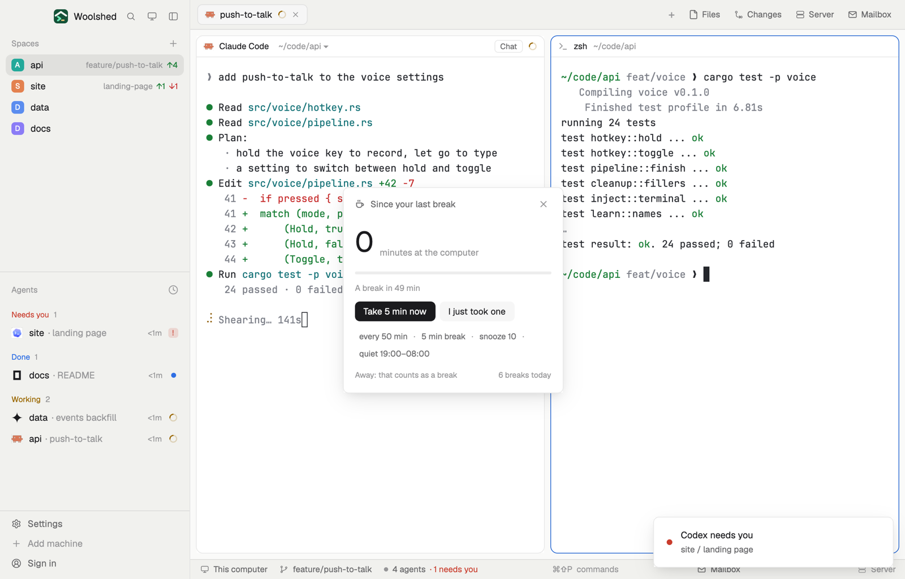

# Break reminder

A gentle nudge to get up: after 50 minutes at the computer since your last break, a toast says to stand up for 5 minutes, and clicking it starts the break. Time away from the keyboard counts as a break by itself, so it won't nag you when you've just been away. Snooze, quiet hours, and your own lengths.

## What you see

A window 310 px wide on the `popover` color, opened with `mod.open break-reminder`:

- **Header**: a cup, "Since your last break" (or "On a break") in `muted`, and ✕.
- **The time**: the minutes since your last break in 40 px semibold, "43", with "minutes at the computer" in `dim`; past the stretch's length it turns the `blocked` color. On a break it's the time left, "3:12", in the `done` color, with "left · stand up, look away, stretch".
- **A 4 px bar** filling toward the stretch's length in the `working` color (`blocked` once over, `done` on a break).
- **One line** in 11.5 px: "A break in 7 min", "Time for a 5-minute break", "Snoozed until 14:20", "Over, but it's quiet hours: no toasts", or on a break "Back at 14:05".
- **Buttons**, 28 px: a solid "Take 5 min now" and "I just took one" (once over: "Snooze 10 min"); on a break, "I'm back".
- **Choices** in 11.5 px `muted`, each a button: "every 50 min · 5 min break · snooze 10 · quiet 19:00–08:00".
- **Footer** in 11 px `dim`: where the time comes from ("Time away counts as a break (the system's idle time)", "Away: that counts as a break", or on a system without idle time "Counting from your last break, or the computer's last sleep"; on Linux without a tool, "Install xprintidle to count time away too"), and "2 breaks today".
- **As a strip** (a layout block): the cup and "43 min" (the `blocked` color once over), "away" while you're away, or the break's time left.

## How it behaves

- The stretch starts at your last break, which is any of: time away from the keyboard and mouse for a break's length (where the system says how long it has been idle), the computer asleep or nothing showing the mod for that long, a break you start here, or "I just took one".
- Every 30 s it looks. Once the stretch reaches its length, you're at the computer (idle under 2 minutes) and it isn't quiet hours, a toast says "Time for a break: stand up for 5 minutes" with "52 min at the computer. Click to start the break."; clicking it starts the break. Ignored, it asks again every snooze length.
- A break you start counts down; at its end a toast says "Break's over" and a new stretch starts.
- Click a choice to cycle it: every 25, 30, 45, 50, 60, 75 or 90 min; break 3, 5, 10 or 15 min (also how long away counts as one); snooze 5, 10, 15 or 30 min; quiet hours off, 18:00–08:00, 19:00–08:00, 20:00–07:00 or 22:00–07:00 (no toasts then).
- Breaks are counted per day, from local midnight.
- Key commands for a shown copy: `break-reminder.break`, `break-reminder.snooze`, `break-reminder.back`, `break-reminder.took`.

## Built from

- `mods/break-reminder/main.js`: state in shared `break-reminder.state` (`since`, `seen`, `away`, `breakUntil`, `snoozeUntil`, `lastRemind`, `breaks`), choices in `break-reminder.settings`; `woolshed` functions `exec`, `shared`, `setShared`, `notify`, `theme`, `props`, `closeOverlay`, `nextCommand`, `window` (the platform), `appHome`, `readTextFile`.
- Idle time, every 30 s with a 5 s timeout: on macOS `ioreg -c IOHIDSystem -d 4 -k HIDIdleTime`; on Linux `xprintidle`, else `gdbus call --session --dest org.gnome.Mutter.IdleMonitor --object-path /org/gnome/Mutter/IdleMonitor/Core --method org.gnome.Mutter.IdleMonitor.GetIdletime`; on Windows nothing (it counts from your last break).
- `mods/break-reminder/parse.js`: the stretch, breaks, reminders, quiet hours and the idle parsers (tested on its own).
- `mod.json`: a kept window (`key: "break-reminder"`, `keep: true`). Art: `cup.svg`. No network.

## Watch out

- It reminds only while a copy runs (the window, or a strip in a block). The window is kept, so it comes back on the next start; closing it for a break's length counts as a break.
- Without idle time (Windows, Linux without xprintidle or GNOME) it can't tell you were away: mark breaks with "I just took one".
- An example for a first look: `data/break-reminder/example.json` under the app folder, `{ "worked": minutes, "breaks": count }`, is taken once each time that file changes. The preview uses it; nothing else writes it.
- `preview.png` is a screenshot of Woolshed in light mode, running example agents.

## Done when

- `woolshed check` passes on this folder and `mod.open break-reminder` opens the window.
- With "every 25 min", 25 minutes of typing brings the toast; clicking it shows a 5:00 break counting down.
- Leaving the keyboard for 5 minutes resets the minutes to 0 and adds one to "breaks today".
- At 19:30 with "quiet 19:00–08:00" no toast comes, and the line says it's quiet hours.
