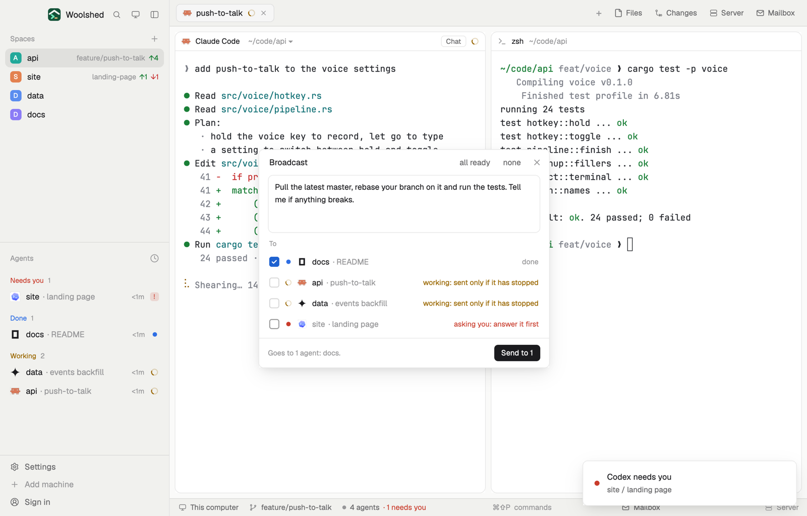

# Broadcast

Tell several agents the same thing at once. Write one message, tick who gets it (every idle or finished agent to start with), and press Send; each row then says whether it arrived. Nothing is typed until you press Send, never into an agent that's asking you something, and never into one in the middle of its work.

## What you see

A window 460 px wide (`ctrl-alt-b`) on the `popover` color, or a panel in a layout block on `chrome`:

- **Header**, 40 px: "Broadcast" in 13 px semibold, the links "all ready" and "none" (with two or more agents), and ✕.
- **Message**: a 92 px text box with 8 px corners, a 1 px `border` and the terminal `background`.
- **To**: in 11 px `dim`, then one 32 px row per agent: a 16 px tick box (filled `accent` with an `accent_foreground` check when ticked), the status mark, the program's 14 px icon, the space name and "· what it's about" in `dim`, and on the right in 11.5 px what will happen: "idle" or "done" in `dim`, "working: sent only if it has stopped" in `working`, "asking you: answer it first" in `blocked` (that row can't be ticked and its name is `dim`). The rows scroll past 300 px.
- **Footer**, under a 1 px `border`: who it goes to ("Goes to 2 agents: docs, api."), and a solid "Send to 2" button, 26 px, which is grey and off with no message or nobody ticked.
- After Send each row says how it went: "sending…", then "sent" in `done`, "busy again: not sent" or "still working: not sent" in `muted`, or the error's first line in `blocked`; the footer says "Sent to 2 of 3 agents."

## How it behaves

- Ready agents (idle, or done: finished while you looked elsewhere) are ticked by default and listed first; then working ones, then those asking you. Click a row to tick or untick it. "all ready" goes back to the default, "none" unticks everything.
- Send reads each agent's status again and, per agent:
  - idle: `hc send --if idle --json <address> <message>`: Woolshed Core types it only if it is still idle;
  - done: `hc send --json <address> <message>` (the core still calls it done, which `--if idle` refuses; `hc send` itself refuses an agent that's asking);
  - working or asking: nothing is typed, and the row says so.
- `hc send` pastes the message and presses Enter. All ticked agents are sent to at once.
- Typing a new message clears the last results.

## Built from

- `mods/broadcast/main.js`: `woolshed` functions `agents`, `hc`, `theme`, `props`, `closeOverlay`, `readTextFile`, `appHome`. `TextareaState` and `Textarea` from `gpui-base`.
- `send.js`: which `hc send` arguments each status gets, and how hc's JSON answer reads (`status_mismatch`, `blocked`, other errors).
- `words.js`, `ui.js`: shared helpers. Art: `check.svg`, `spinner.svg`.
- `mod.json`: a kept window (`key: "broadcast"`). `keys.json`: `"ctrl-alt-b": "mod.open:broadcast"`.
- Program: `hc send`, only when you press Send.

## Watch out

- A finished agent gets the message with plain `hc send`: if it starts working in the instant between the check and the send, the message is queued in its input. Idle ones are guarded by the core itself.
- Ticks you change are kept while the window is open; new agents follow the default.
- If `data/broadcast/example.json` exists (`{ "text": "…" }`), an empty message box starts with that text. The preview uses it; nobody else has the file.
- `preview.png` is a screenshot of Woolshed in light mode, running example agents.

## Done when

- `woolshed check` passes on this folder and `ctrl-alt-b` opens the window with every idle or finished agent ticked.
- An agent that's asking you can't be ticked.
- Writing a message and pressing Send types it into each ticked idle agent, and its row says "sent".
- A ticked agent that's working gets nothing, and its row says "still working: not sent".
