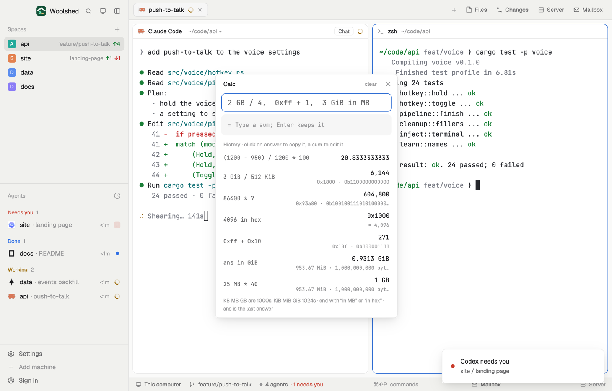

# Calc

A calculator line that speaks developer: sizes like `2 GB / 4` or `3 GiB in MB`, hex and binary (`0xff + 1`, `4096 in hex`), powers, a few functions and `ans` for the last answer. The answer shows as you type, Enter keeps it in a history, and a click copies it.

## What you see

A window 380 px wide (`ctrl-alt-k`) on the `popover` color, or a block in a layout (on `chrome`):

- **Header**, 40 px: "Calc" in semibold, "clear" (when there's a history) and ✕.
- **The line**, a 38 px input in the terminal font at 15 px with an `accent` border (`blocked` after Enter on a mistake): "2 GB / 4,  0xff + 1,  3 GiB in MB".
- **The answer**, a 44 px panel on `raised`: "=" in `dim`, then the answer in the terminal font at 17 px semibold ("500 MB"), with a second line in 11 px `dim` ("476.84 MiB · 500,000,000 bytes", "0x100 · 0b100000000"). While typing a mistake: "Unknown name 'foo'", "Missing ')'" in `blocked`; with nothing typed, "Type a sum; Enter keeps it".
- **History**, newest first: "History · click an answer to copy it, a sum to edit it", then 34 px rows: the sum in the terminal font at 12 px `muted` at the left, the answer at 13 px medium at the right with its second line under it.
- Foot, 10.5 px `dim`: "KB MB GB are 1000s, KiB MiB GiB 1024s · end with “in MB” or “in hex” · ans is the last answer", or "Copied 500 MB".

The history scrolls past 300 px.

## How it behaves

- Numbers: `1_000`, `1.5e3`, `0xff`, `0b1010`, `0o17`. Operators: `+ - * / % ^` (also `**`, `×`, `÷`), with `^` binding tighter than a minus in front (`-2^2` is -4) and right to left (`2^3^2` is 512); parentheses.
- Sizes: a number followed by B, KB, MB, GB, TB, PB (1000s) or KiB, MiB, GiB, TiB, PiB (1024s), any case. A size shows in its best unit, binary if you typed binary units; size ÷ size is a plain number (`10 GB / 512 MB` is 19.53125); a size plus a plain number is an error.
- At the end: `in` (or `to`, `as`) MB, GiB… converts a size; `in hex`, `in bin`, `in oct`, `in dec` converts a whole number.
- Functions: sqrt, abs, round, floor, ceil, log (base 10), log2, ln, sin, cos, tan, min, max. Constants: pi, e, tau. `ans`: the newest answer in the history.
- Whole results of 256 or more, or sums that used hex or binary, also show their hex and binary.
- It never uses `eval`: its own tokenizer and parser read the line, and anything else is an error. Division by zero and results too big are errors, not Infinity.
- Enter keeps a good answer (the line empties); a mistake stays in the line. Click a sum to put it back in the line, an answer to copy it (without thousands separators).
- The last 50 are kept in this mod's `localStorage`. On first open, if `data/calc/example.txt` exists under the app folder (one sum a line, `#` comments), it fills the history.

## Built from

- `mods/calc/main.js` and `parse.js` (`tokenize`, `evaluate` with sizes as a dimension, `present`, `calc`).
- `woolshed` functions: `appHome`, `readTextFile`, `settings` (the terminal font), `theme`, `props`, `closeOverlay`.
- No programs, no network.
- `mod.json`: a kept window (`key: "calc"`). `keys.json`: `"ctrl-alt-k": "mod.open:calc"`.

## Watch out

- Numbers are JavaScript doubles: about 15 significant digits, and whole numbers convert to hex or binary exactly only up to 2^53.
- `b` is bytes, not bits; there are no bit units.
- No implicit multiplication: `2pi` is an error, `2 * pi` works.
- `preview.png` is a screenshot of Woolshed in light mode, running example agents.

## Done when

- `woolshed check` passes on this folder and `ctrl-alt-k` opens it.
- `2 GB / 4` shows 500 MB as you type; Enter adds it to the history.
- `ans in MiB` then shows 476.84 MiB, and `255 in hex` shows 0xff.
- `eval(1)` says "Unknown name 'eval'".
