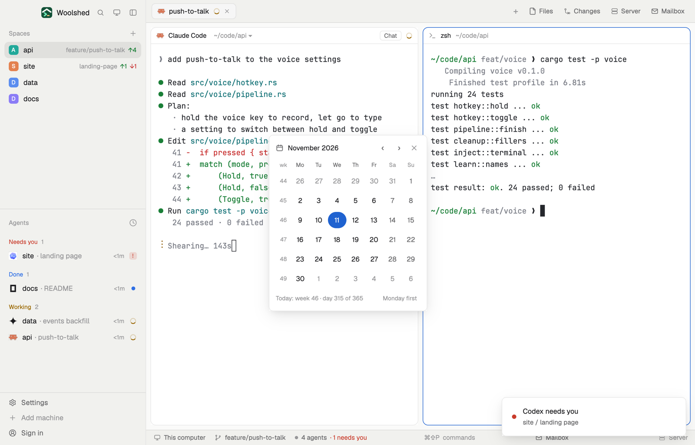

# Calendar

This month at a glance, with ISO week numbers down the side and today marked. Move a month back or forward, and click any day to copy its date as 2026-11-12 (or a week number as 2026-W46), ready to paste into a prompt, a commit or a file name.

## What you see

A window on the `popover` color, opened with `mod.open calendar` (in a layout block it fills the block on `chrome`):

- **Header**: a calendar icon, the month and year ("November 2026") in semibold, "Today" in the `accent` color when another month is shown, ‹ and › (26 px), and ✕.
- **Weekday heads** in 10.5 px ("Mo Tu We Th Fr Sa Su"; weekend heads `dim`) with "wk" over the week column.
- **Rows** of 7 days, 34 × 30 px each, behind a 28 px column of ISO week numbers in 10.5 px `dim`. Days in 12.5 px: weekdays `foreground`, weekends `muted`, days of the months either side `dim`. Today is a round `accent` pill with `accent_foreground` text in semibold; the day just copied is the `selected` color. Hovering a day shows "Thu 12 November 2026 · copy 2026-11-12".
- **Footer** in 11 px: "Today: week 46 · day 315 of 365" in `dim`, or for a moment after a click "Copied 2026-11-12" in the `done` color; at the right "Monday first" (or "Sunday first").

## How it behaves

- Click a day to copy it as YYYY-MM-DD; click a week number to copy it as YYYY-Www.
- ‹ and › move a month; Today comes back to this month.
- "Monday first" switches the rows to start on Sunday and back; the week number stays the ISO week of each row's Monday.
- It redraws at midnight, so today moves on by itself.

## Built from

- `mods/calendar/parse.js`: month grids, ISO weeks (week 1 holds the year's first Thursday, so 1 January 2027 is in 2026-W53), day of the year, all through `Date.UTC` so daylight saving never shifts a day (tested on its own, every day from 2000 to 2040).
- `mods/calendar/main.js`: `woolshed` functions `shared`, `setShared` (`calendar.start`: `"mon"` or `"sun"`), `theme`, `props`, `closeOverlay`; `cx.write_to_clipboard`.
- `mod.json`: a kept window (`key: "calendar"`, `keep: true`). Art: `calendar.svg`. No keys, programs or network.

## Watch out

- The shown month isn't kept: it opens on this month.
- Months take five or six rows (four for a February that starts on the week's first day), so the window's height changes with the month.
- `preview.png` is a screenshot of Woolshed in light mode, running example agents.

## Done when

- `woolshed check` passes on this folder and `mod.open calendar` opens the window.
- Today is the `accent` pill, and the footer's week matches the system's ISO week.
- Clicking the 12th puts 2026-11-12 on the clipboard; the footer says so.
- › on December 2026 shows January 2027, whose first row is week 53.
