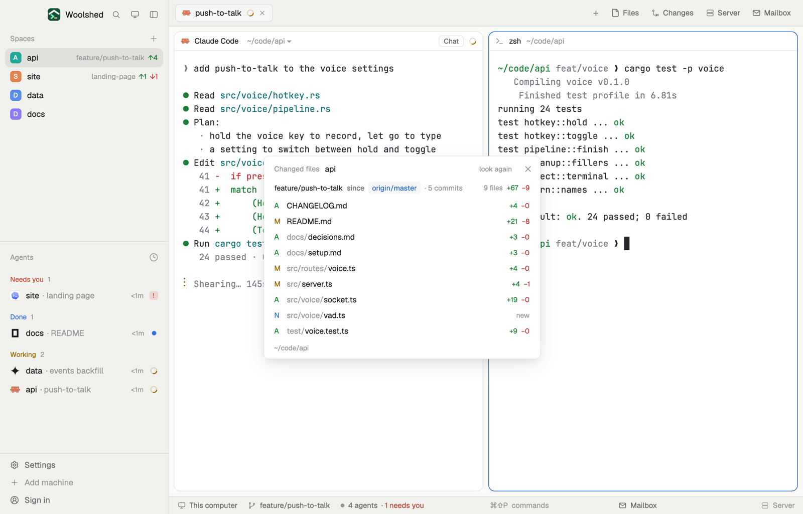

# Changed files

Every file the branch you're in has changed since it left main, committed or not: git's status letter, the path, and lines added and removed. It's the review list for an agent's branch. Click a file to copy its path, or open its diff in a new tab.

## What you see

A window 440 px wide on the `popover` color, or a block in a layout (on `chrome`):

- **Header**, 40 px: "Changed files" in 11.5 px `dim`, the repository's name in semibold, "look again" and ✕.
- **Summary**, 11.5 px: the branch in `foreground`, "since", the base as a small `accent` button on `raised` ("origin/master"), "· 4 commits" in `dim`, and at the right "5 files +40 −1" (green `ansi2`, red `ansi1`). On main itself: "master · uncommitted changes"; with no base at all, "· no main or master: uncommitted only".
- **Rows**, 24 px, by path: the status letter in semibold (M `working`, A `ansi2`, D `blocked`, R `accent`, N `done` for a new file not added yet), the folder in `dim` and the name in `foreground`, and "+23 −0" (or "new", "binary"). On hover a "diff" button. Up to 300 files.
- **Footer**: the folder, or "Copied src/server.ts", in 11 px `dim`.

Nothing changed: "Nothing changed since origin/master." Outside a repository: "Not a git repository"; without git, "git isn't installed on this machine…".

## How it behaves

- The base is the first that exists of origin's default branch (`origin/HEAD`), `origin/main`, `origin/master`, `main`, `master`, `origin/develop`, `develop`, `origin/trunk`, `trunk`, never the branch you're on. Clicking it compares with the next one.
- The files are `git diff <merge-base>` against the working tree (commits on the branch plus staged and unstaged changes) and the new files git doesn't ignore.
- Clicking a row copies its path from the repository's top folder (the Files panel has no command to open a file, so the path goes to the clipboard); the name reads "copied" for 1.4 seconds.
- "diff" runs `tab.new` in that space: `git diff <merge-base> -- <file>` (a new file: `git diff --no-index -- /dev/null <file>`).
- It follows the focused pane's folder on that space's machine; reads every 20 seconds and on "look again"; only ever reads.

## Built from

- `mods/changed-files/main.js` and `parse.js` (`baseCandidates`, `parseNameStatus`, `parseNumstat`, `changedFiles`, `split`, `explain`).
- Programs, read-only, with `--no-optional-locks -c core.fsmonitor=false -c diff.autoRefreshIndex=false -c color.ui=false -c core.quotePath=false` and a 10-second limit: `git rev-parse --show-toplevel`, `git symbolic-ref --quiet --short HEAD`, `git rev-parse --abbrev-ref origin/HEAD`, `git for-each-ref --format=%(refname:short) refs/heads/main … refs/remotes/origin/trunk`, `git merge-base <base> HEAD`, `git rev-list --count <mb>..HEAD`, `git diff --name-status -z -M <mb>`, `git diff --numstat -z -M <mb>`, `git ls-files --others --exclude-standard -z`.
- `woolshed` functions: `spaces`, `panes`, `focused`, `exec` (with `on`), `run` (`tab.new`), `home`, `theme`, `props`, `closeOverlay`.
- `mod.json`: a kept window (`key: "changed-files"`), opened with `mod.open:changed-files`; no keys of its own.

## Watch out

- The base is as of the last fetch: if main moved on and wasn't fetched, the merge base is older, never wrong.
- The diff tab runs git's pager; `q` leaves it.
- `preview.png` is a screenshot of Woolshed in light mode, running example agents.

## Done when

- `woolshed check` passes on this folder and `mod.open:changed-files` opens it.
- On a branch made from main with one commit changing a file and one new untracked file, it lists both ("M" and "N") with "since main · 1 commit".
- Clicking a row copies its path; "diff" opens a tab with that file's diff.
