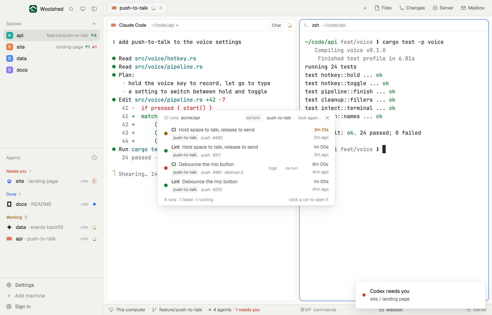

# CI runs

The last 15 GitHub Actions runs of the repo you're in, with a colored dot for each: what ran, on which branch and why, how long it took and when. A failed run has its failed jobs' logs one click away in a new tab, and Re-run failed asks before it re-runs anything. It uses your own GitHub CLI and sign-in.

## What you see

A window 460 px wide (`ctrl-alt-r`) on the `popover` color, or a block in a layout (on `chrome`, filling it):

- **Header**, 38 px: "CI runs" in 11.5 px `dim`, the repo ("acme/api") in `muted`, a "sample" tag in sample mode, the branch scope ("push-to-talk", or "all branches"), "look again" ("…" while looking) and ✕.
- **Rows**, 44 px, newest first: a 9 px dot (`ansi2` passed, `blocked` failed, `working` running, pulsing; a ring in `idle` while queued; `dim` cancelled or skipped); the workflow name in semibold and the run's title in `muted`; under them, in 11 px `dim`, the branch in a small tag on `raised`, the event ("push", "pull request", "scheduled", "manual", …) and "#482" (with "· attempt 2" for a re-run). At the right, the duration ("6m 00s", `working` while running) over the age ("41m ago").
- A failed row also has "logs" and "re-run" (`blocked` under the pointer).
- **Foot**: "10 runs · 2 failed · 1 running" and "click a run to open it", 11 px `dim`.
- Problems are said plainly: "GitHub CLI isn't installed." with "Install gh (brew install gh, or cli.github.com) and run gh auth login.", "Not signed in to GitHub." (both with an "Open Settings → Accounts" button), "… isn't in a git repository.", "This repo has no remote.", "origin is on gitlab.com, not GitHub." (pointing at gitlab-pipelines), "Can't reach GitHub.", and "This space is on <machine>." for a space on another machine.

## How it behaves

- It follows the shown space: the focused terminal's folder in that space, else the space's folder; a new folder or branch is noticed within 2.5 seconds. It asks GitHub again every 60 seconds while the window is open, and on "look again", never twice at once.
- The scope button switches between the branch checked out there and all branches; the choice is remembered (`localStorage`).
- Clicking a row opens the run on github.com.
- "logs" opens a new tab in the repo's folder running `gh run view <id> --log-failed --repo <owner/repo>`.
- "re-run" shows a strip under the row, "Re-run the failed jobs of CI #481?" with Cancel and a red Re-run. Only Re-run runs `gh run rerun <id> --failed`; a toast says it started (or why it couldn't), and the list looks again 4 seconds later.

## Built from

- `mods/ci-runs/main.js`; `parse.js` (gh's runs into rows, the summary); `common.js` (remotes, failure words, times, run states: pure, shared by this batch of GitHub and GitLab mods); `kit.js` (the shown space's repo, running `gh` in your login shell, the sample file, header, buttons, problem view).
- Programs: `git rev-parse --show-toplevel`, `git branch --show-current`, `git remote -v` (read-only, 10 s limit); `gh run list --repo <owner/repo> --limit 15 [--branch <b>] --json databaseId,number,attempt,workflowName,displayTitle,headBranch,event,status,conclusion,createdAt,startedAt,updatedAt,url` (30 s limit); on your click, `gh run rerun <id> --failed --repo …`. gh runs as `"$SHELL" -lic`, after a marker line so your shell's start-up output is ignored, with `command -v gh` to tell a missing tool apart.
- `woolshed` functions: `spaces`, `panes`, `focused`, `exec`, `readTextFile`, `appHome`, `home`, `run` (`tab.new`, `app.settings`), `notify`, `theme`, `props`, `closeOverlay`, `window`.
- `mod.json`: a kept window (`key: "ci-runs"`). `keys.json`: `"ctrl-alt-r": "mod.open:ci-runs"`.

## Watch out

- The remote it reads is the GitHub one among `git remote -v`: origin first, else the first on github.com (an `upstream` on GitHub with origin elsewhere works). GitHub Enterprise hosts aren't recognised.
- Spaces on another machine aren't read; it says so.
- On Windows gh runs directly, without a login shell.
- Sample mode, a demo and preview aid: when `data/ci-runs/sample.json` exists under the app's home (`{ "repo": { "host", "path", "branch" }, "runs": [ …gh run list objects… ] }`), it shows that instead of asking GitHub, with a "sample" tag, and logs and re-run only toast "nothing was run". Delete the file to see your own.
- `preview.png` is a screenshot of Woolshed in light mode, running example agents.

## Done when

- `woolshed check` passes on this folder and `ctrl-alt-r` opens the window.
- In a GitHub repo with Actions it lists up to 15 runs within a few seconds, with the right colors; the scope button changes the list.
- With gh signed out it says "Not signed in to GitHub."; outside git it says the folder isn't in a repository.
- "re-run" on a failed run asks first; Cancel runs nothing; Re-run starts the failed jobs again (visible on github.com).
- "logs" opens a tab that prints the failed jobs' logs.
