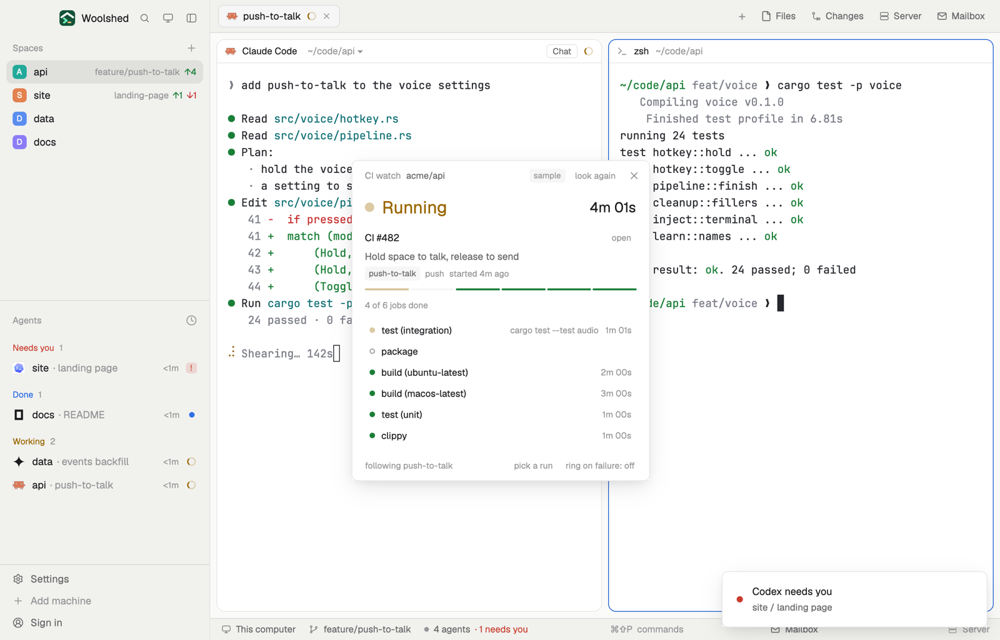

# CI watch

Keep an eye on CI without keeping a browser tab open: a small window follows the newest GitHub Actions run on the branch you're in, shows its jobs filling in, and pops a toast the moment it passes or fails. Turn on "ring on failure" to hear it too, or pick one run to watch.

## What you see

A window 380 px wide on the `popover` color (`mod.open:ci-watch`), or a block in a layout:

- **Header**, 38 px: "CI watch" in 11.5 px `dim`, the repo in `muted`, "sample" in sample mode, "look again", ✕.
- **The run**: a 12 px dot and the state in 22 px semibold ("Running" in `working`, "Passed" in `ansi2`, "Failed" in `blocked`, "Queued", "Cancelled"), the time so far or taken in 18 px at the right.
- "CI #482" in semibold (with an "attempt 2" tag), "open"; the run's title in `muted`; the branch tag, the event and "started 4m ago" in 11 px `dim`.
- A 5 px bar with one segment per job in its color (queued ones on `raised`, running ones pulsing), and "4 of 6 jobs done".
- **Jobs**, 26 px rows (the list scrolls past 180 px): failed first, then running, queued and passed; each with a 7 px dot, its name (`blocked` when it failed), the step it's on while running, and its time.
- **Foot**: "following push-to-talk" (or "run #481"), "pick a run", and "ring on failure: off" / "on".
- "pick a run" opens a list on `raised`: "Follow push-to-talk: its latest run", then the last 8 runs of the repo with dot, name, title and age.
- With no runs on the branch: "No runs on push-to-talk yet. Push to start one; it shows here within a minute." Problems (no gh, signed out, no repo, not GitHub) as in CI runs, with an "Open Settings → Accounts" button where it helps.

## How it behaves

- Following (the default), it reads the branch's last 5 runs every 60 seconds while the window is open and shows the newest one still going, else the newest. A push that starts several workflows is covered: every one of them that finishes while you watch is told.
- A picked run stays watched until you follow the branch again or show a space in another repo.
- When a run you saw unfinished finishes, a toast says "CI #482 passed" (success, 8 s) or "CI #481 failed" (error, 20 s), with its title and time. With "ring on failure" on, a failure also plays the blocked sound. Each run and attempt is told once, even across restarts; a run that was already finished when you opened the window isn't news.
- Clicking a job opens its log page; "open" opens the run.
- It never re-runs, cancels or posts anything.

## Built from

- `mods/ci-watch/main.js`; `parse.js` (runs, a run's jobs, and `tell`, which decides when to toast); `common.js` and `kit.js` (shared with the other GitHub and GitLab mods: remotes, gh in the login shell, sample file, UI pieces).
- Programs, all read-only: the git reads of the space's repo; `gh run list --repo <owner/repo> --limit 5 --branch <b> --json …` (8 for the picker), `gh run view <id> --repo … --json …,jobs`.
- State in `localStorage`: `ci-watch.pin` (a picked run), `ci-watch.ring`, `ci-watch.told` (the last 50 told).
- `woolshed` functions: `spaces`, `panes`, `focused`, `exec`, `readTextFile`, `appHome`, `notify`, `playSound`, `run`, `theme`, `props`, `closeOverlay`.
- `mod.json`: a kept window (`key: "ci-watch"`, `keep: true`), so it comes back after a restart. No keys.

## Watch out

- It only watches while its window is open; closed, nothing polls and nothing is told.
- At most one look a minute, so a toast can come up to a minute after GitHub finishes.
- Sample mode, a demo and preview aid: `data/ci-watch/sample.json` under the app's home (`{ "repo", "runs": [ … ], "views": { "<run id>": { …gh run view with jobs… } } }`) is shown instead of GitHub, tagged "sample". Delete it to watch your own.
- `preview.png` is a screenshot of Woolshed in light mode, running example agents.

## Done when

- `woolshed check` passes on this folder and `mod.open:ci-watch` opens it.
- After a push, the run shows as Running with its jobs, and the bar fills as jobs finish.
- When it finishes, one toast says passed or failed; with ring on, a failure plays the sound.
- "pick a run" lists recent runs; picking one shows it, and "Follow …" goes back.
