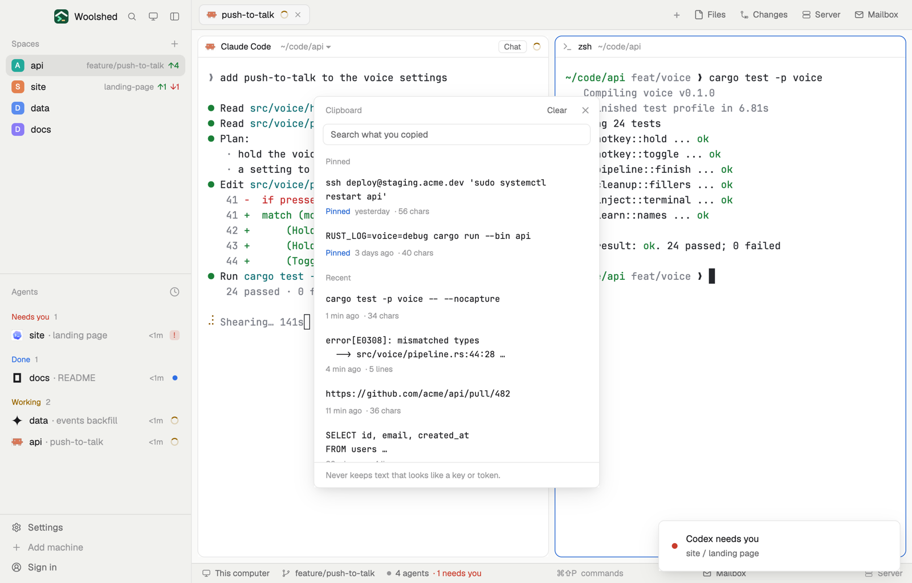

# Clipboard history

The last 30 things you copied while Woolshed was open, so the command from an hour ago or the error you meant to paste to an agent is one click away. Pin the ones you keep reaching for, search them, click one to copy it again. It never keeps text that looks like a key, token or password, and tells you when it skipped one.

## What you see

A window 400 px wide (`ctrl-alt-v`) on the `popover` color, or a block in a layout (on `chrome`):

- **Header**, 38 px: "Clipboard" in 11.5 px `dim`, "Clear" in `muted` (it turns into "Clear 12?" in the `blocked` color on the first click), and ✕.
- **Search**: a 30 px field, "Search what you copied", on `background`.
- **Pinned**, then **Recent · the last 30** (just "Recent" when something is pinned), as 11 px `dim` labels.
- **Rows**: up to two lines of the text in the terminal font at 12 px `foreground` ("…" when there's more), and under it in 11 px `dim` "Pinned" (in `accent`), the age ("just now", "4 min ago", "2 h ago", "yesterday") and "· 38 chars" or "· 6 lines". On hover the row turns `hover` and shows Pin (Unpin) and ✕.
- **Footer** in 11.5 px: "Never keeps text that looks like a key or token." in `dim`, or "Skipped 2 that looked like keys or tokens" once it has skipped some; "Copied" in the `done` color for 3 seconds; errors in `blocked`.
- Empty: "Copy some text while Woolshed runs and it shows up here."; a search with no match: "Nothing matches."

In the window the list scrolls past 440 px.

## How it behaves

- While the window (or a block showing it) is open, it reads the clipboard's text every 2 seconds. Text that changed goes to the top; text already in the list moves up and keeps its pin. Blank text and text over 20,000 characters are left out.
- The first look after opening only notes what's on the clipboard then and doesn't add it: copies from then on are added.
- It keeps every pinned entry and the newest 30 others; older ones drop off.
- Clicking a row copies it back to the clipboard and moves it to the top (it isn't counted as a new copy). Pin keeps it in Pinned; ✕ forgets it at once. Clear forgets everything that isn't pinned, after a second click.
- Never kept: text with `sk-…` keys, GitHub tokens (`ghp_`, `gho_`, `ghu_`, `ghs_`, `ghr_`, `github_pat_`), GitLab `glpat-`, AWS key ids (`AKIA…`, `ASIA…`), Slack `xox…-` tokens, private key blocks, JWTs, `password=` / `token:` / `api_key=` style lines, any 32+ character run of hex (a lone 7–40 character commit hash and `sha256:` digests are fine), and 40+ character runs of base64-like text that mix upper case, lower case and digits. Each skip is counted in the footer for this window.
- Every change reads the file fresh and writes it only if it's still as read; if not, it reads again and retries (three times), so two open copies don't undo each other.

## Built from

- `mods/clipboard-history/main.js` and `mods/clipboard-history/parse.js` (`looksSecret`, the file's shape, record, pin, forget, clear, search, ages; pure functions). `cx.read_from_clipboard` on a 2-second `cx.timer.every`, `cx.write_to_clipboard`. `woolshed` functions: `settings` (`font_family`), `appHome`, `readTextFile`, `writeTextFile` (with the text it expects to replace), `theme`, `props`, `closeOverlay`.
- Storage: `data/clipboard-history/history.json` under the app folder, as `{ "items": [{ "text", "at" (ms since the epoch), "pinned" }] }`, newest first. No programs and no network.
- `mod.json`: a kept window (`key: "clipboard-history"`). `keys.json`: `"ctrl-alt-v": "mod.open:clipboard-history"`.

## Watch out

- It only sees what's copied while a copy of it is open (a kept window comes back on the next start). Text copied and replaced within 2 seconds can be missed.
- The secret check errs on the side of leaving things out: a long hex or base64 string that's harmless (a full git log line with its 40-character hash, an "Invalid token: expired" message) isn't kept either. It can't recognise every secret: a short password copied on its own looks like any other word. Don't rely on it for that.
- The history is a plain file in the app folder, readable by anything that can read that folder, agents included. Clear empties it.
- Only text is kept, not images or copied files.
- `ctrl-alt-v` types a character on some keyboards (AltGr on Windows): bind another key if so.
- `preview.png` is a screenshot of Woolshed in light mode, running example agents.

## Done when

- `woolshed check` passes on this folder and `ctrl-alt-v` opens it.
- Copying `git status` in a terminal shows it at the top within 2 seconds; copying it again later moves it up rather than adding it twice.
- Copying `sk-proj-abcdEFGH1234ijklMNOP5678` adds nothing and the footer says "Skipped 1 that looked like keys or tokens".
- Clicking an older row puts its text on the clipboard; a pinned row stays after Clear.
