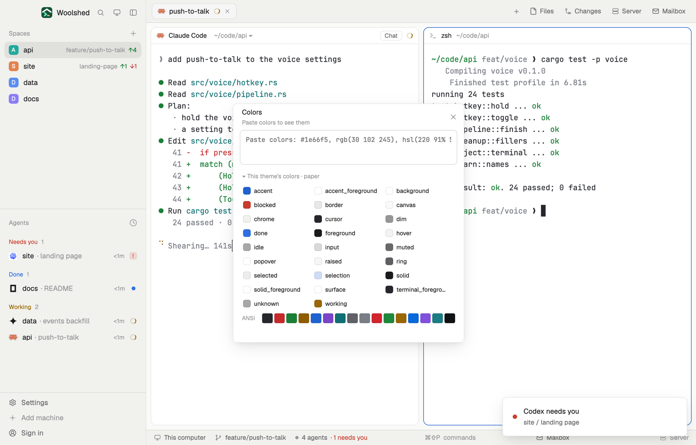

# Color swatch

Paste some colors, from CSS or anywhere, and see them as swatches with their hex, rgb() and hsl() to copy. Pick two for their WCAG contrast ratio and whether text passes AA and AAA, and copy any color of the theme you're using, by name.

## What you see

A window 424 px wide on the `popover` color, or a block in a layout (on `chrome`); its body scrolls past 620 px:

- **Header**, 48 px: "Colors" in semibold; below in 11 px `dim` "6 colors · pick A and B for contrast" (or "Paste colors to see them"); ✕.
- **The box**, 64 px, in the terminal font at 12 px: "Paste colors: #1e66f5, rgb(30 102 245), hsl(220 91% 54%)…".
- **Swatches**, three to a row: 122 px cards on `background` with a 42 px block of the color (a `border` line around and under it), then the hex in `foreground`, the rgb() and hsl() in 10.5 px `dim`, all in the terminal font. Two 18 px chips "A" and "B" pick the pair (`solid` when picked). At most 24.
- **Contrast**, a panel on `background`: a 150 × 56 px sample of "Aa" (18 px semibold) and "The quick brown fox" in color A on color B; the ratio in 22 px semibold ("4.70") with ": 1" in `dim`; "A #1e66f5 on B #fbfaf7"; "⇄ swap"; then 22 px chips AA, AA large, AAA, AAA large, each with ✓ in `done` or ✗ in `blocked` (the threshold on hover).
- **This theme's colors · paper**, folding with ▾/▸: three columns of 24 px rows, a 14 px swatch and the color's name (accent, background, blocked, …), and a strip of the 16 ANSI colors.
- Foot, 10.5 px: "Click a swatch or a value to copy it.", "Copied #1e66f5", "Showing 24 of 30 colors."
- With text but no colors: "No colors found. Try #rrggbb, rgb(r g b) or hsl(h s% l%)." in `working`; with one color: "Add a second color to see their contrast."

## How it behaves

- It finds `#rgb`, `#rgba`, `#rrggbb`, `#rrggbbaa`, `rgb()`/`rgba()` and `hsl()`/`hsla()` (commas or spaces, `/ alpha`, percentages, `deg`/`turn`), as you type, each color once.
- A and B start as the first two colors; picking another moves that letter.
- The ratio is WCAG 2's, cut (not rounded) to two places, so 4.499 shows 4.49 and fails AA. A see-through color is first laid over the other (a see-through background over white). AA needs 4.5 (3 for large text), AAA 7 (4.5 for large).
- Click the swatch or its hex to copy the hex; click the rgb() or hsl() line to copy that. Click a theme color to copy its hex.
- What you pasted is kept in this mod's `localStorage`, and whether the theme list is folded. On first open, if `data/color-swatch/example.txt` exists under the app folder, it fills the box.

## Built from

- `mods/color-swatch/main.js` and `parse.js` (`extractColors`, `toHex`, `toRgb`, `toHsl`, `contrast`, `wcag`, `ratioText`, `themeColors`).
- `woolshed` functions: `theme` (also the list of its colors), `settings` (the theme's name and terminal font), `appHome`, `readTextFile`, `props`, `closeOverlay`.
- The swatches and the sample are drawn in the pasted colors and the theme's own; the mod itself uses only theme colors.
- No programs, no network.
- `mod.json`: a kept window (`key: "color-swatch"`). No keys.

## Watch out

- Named CSS colors (`rebeccapurple`), `oklch()`, `lab()` and `color()` aren't read.
- The theme list shows the colors as they are now; switching themes updates it.
- `preview.png` is a screenshot of Woolshed in light mode, running example agents.

## Done when

- `woolshed check` passes on this folder and `mod.open color-swatch` opens it.
- Pasting `#000 #fff` shows two swatches and 21.00 : 1 with all four ✓.
- `#767676` on `#ffffff` shows 4.54 and passes AA but not AAA.
- Clicking a theme color copies its hex.
