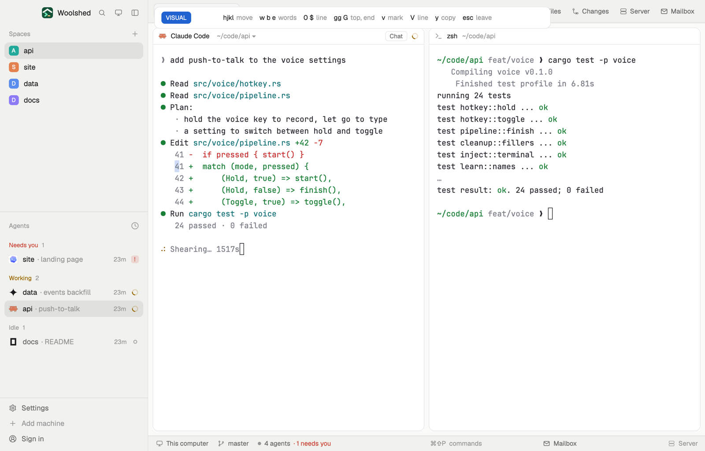

# Copy mode

Select and copy a terminal's text without the mouse, the way vi does: press a key, move with h j k l, words, lines and pages through the screen and its history, mark with v, copy with y. The selection shows in the terminal itself, so you see exactly what you'll get.

## What you see

A bar 720 px wide and 40 px tall at the top of the window (a popup with no frame of its own), on the `popover` color with a 1 px `border` and 10 px corners:

- A mode chip: "COPY" in the `working` color, or "VISUAL" / "BLOCK" in the `accent` color once something is marked, in 11 px semibold `accent_foreground` text.
- The count and pending key you've typed so far ("12", "g"), in semibold `foreground`.
- Key hints in 12 px: the key in `foreground`, what it does in `dim` ("hjkl move", "w b e words", "0 $ line", "gg G top, end", "v mark", "V line", "y copy", "esc leave").

In the terminal, Woolshed draws copy mode's cursor as a one-cell selection, and the marked text in the theme's `selection` color. The view scrolls to follow the cursor through the history.

## How it behaves

- `ctrl-shift-y` (`mod.open:copy-mode`) starts copy mode on the focused terminal, at the program's own cursor (or at the bottom of the view when you've scrolled back).
- Moving: `h` `j` `k` `l` and the arrows; `w` `b` `e` (words) and `W` `B` `E` (words between spaces); `0` / Home, `^`, `$` / End; `gg` (the oldest history), `G` (the bottom); `H` `M` `L` (top, middle, bottom of the view); `ctrl-u` / `ctrl-d` half a page, `ctrl-b` / `ctrl-f` and Page Up / Page Down a page. A number first repeats a move (`5j`, `3w`). Up and down keep their column across short lines; words run across lines the terminal wrapped.
- Selecting: `v` (or Space) marks where the cursor is and the selection follows the cursor; `v` again drops the mark. `ctrl-v` makes it a block (a rectangle). `V` selects the whole line, `i` the word under the cursor. `o` swaps the cursor and the mark.
- `y` or Enter copies the selection to the clipboard and leaves (with nothing marked, it copies the cursor's line). `Y` copies the line. `Esc`, `q` or `ctrl-c` leaves without copying.
- Typing into the terminal or selecting with the mouse also ends copy mode; closing the bar any other way leaves it too.

## Built from

- `mods/copy-mode/main.js`: the bar. It takes the keyboard (`cx.focus_handle()`, `track_focus`, `on_key_down`) and turns each key into one `run("terminal.select", {...})` on the terminal that was focused when it opened (`focused().terminal`). Its `close()` sends `{ exit: true }` unless it already copied or left.
- `mods/copy-mode/keys.js`: the key table. `spell(event)` gives the typed character for plain keys (so `W` and `$` come through), `ctrl-<key>` with Control, and nothing for Command or Alt chords; `step(key, state)` returns the next state and the `terminal.select` arguments (`move` with `count`, `mark`, `block`, `select: "word" | "line"`, `swap`, `copy`, `exit`).
- `mod.json`: a popup at the top, 720×40, `"frame": "none"`. `keys.json`: `"ctrl-shift-y": "mod.open:copy-mode"`.
- Woolshed's `terminal.select` command does the selecting (see `woolshed commands`): it keeps a cursor and a mark per terminal, in screen rows from the top of the history, and installs the selection in the terminal.

## Watch out

- The bar can't read back what `terminal.select` answers (a mod's `run()` returns nothing), so its chip shows the marks it made itself. Agents and scripts get the full answer from `woolshed do terminal.select`.
- A program that redraws its whole screen (a full-screen agent, an editor) may move the text under the cursor; the history above the screen stays put.
- `preview.png` is a screenshot of Woolshed in light mode, running example agents.

## Done when

- `woolshed check` passes on this folder, and `ctrl-shift-y` in a terminal shows the bar with "COPY".
- `k` three times, then `v`, then `$` highlights from that line's cursor column to its end; `y` puts that text on the clipboard and the bar closes.
- `gg` scrolls to the oldest history line and `G` comes back to the bottom.
- `Esc` closes the bar and the highlight goes away.
