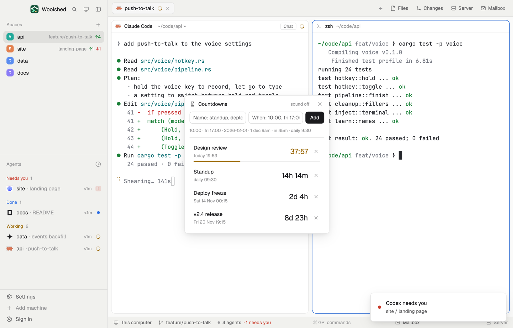

# Countdown

Named countdowns to the moments your day hangs on: "standup" every day at 9:30, "deploy freeze" on Friday at 17:00, "design review" in 38 minutes. Each shows the time left, turns orange in its last hour and red in its last five minutes, and a toast tells you when it's up. Put it in a layout block and it's a strip of the soonest ones.

## What you see

A window 360 px wide (at most 560 px tall) on the `popover` color, opened with `mod.open countdown`:

- **Header**: an hourglass, "Countdowns" in semibold, "sound off" (or "sound on") in 11 px, and ✕.
- **Rows**, soonest first, ended ones last: the name in 13 px semibold and under it when, in 11 px `dim` ("daily 09:30", "today 17:00", "Fri 13 Nov 17:00", "Tue 1 Dec", "1 Dec 2027" in another year). At the right the time left in 18 px semibold: "9d 4h", "2d 5h", "3h 05m", and under an hour minutes and seconds, "37:12". Under an hour the time is the `working` color and a 3 px bar under the row fills through that hour; under five minutes both turn `blocked`. An ended one is `dim`, "ended 3 h ago". Each row has a ✕.
- **Empty**: "No countdowns yet" and "Name one and say when, above."
- **The add row**, under the title and above the list: a name field, a 136 px "When" field and a solid Add button; under it, in 11 px `dim`, the forms it reads ("10:00 · fri 17:00 · 2026-12-01 · 1 dec 9am · in 45m · daily 9:30"), what you typed as it will be read ("→ Fri 13 Nov 17:00"), or what's wrong in the `blocked` color.
- **As a strip** (a layout block): an hourglass and the soonest three, each its name in `dim` and the time left in semibold with the same colors; "No countdowns · click to add" when there are none. Click it to open the window. Props: `{ "count": 1-6 }` (default 3).

## How it behaves

- When reads: a time ("10:00", "2:30 pm", "9am", "noon") is today, or tomorrow once it has passed; a weekday ("fri", "friday 17:00") is the next one; "today", "tomorrow 9:30"; a date ("2026-12-01", "1 dec", "Dec 1st 2027", with a time or not; without a year it's the next one); a span ("in 45m", "1h30m", "3d"); "daily 9:30" or "every day 9:30" repeats. A date without a time counts to its start, 00:00. All in this computer's local time, daylight saving included.
- Enter in the name field moves to When; Enter in When adds. Up to 20 countdowns.
- At the end a toast says "<name>: time's up" (with "sound on", the done sound too), once, whichever copy sees it first. A daily one then counts to tomorrow; a one-off one stays as "ended" until you remove it. An end missed by more than ten minutes (Woolshed closed) passes quietly.
- It checks once a second, and redraws every second only while something is under an hour away; otherwise once a minute.

## Built from

- `mods/countdown/main.js`: the list in shared `countdown.items` (`{ id, name, at, timed }` or `{ id, name, daily: minutes, fired }`), `countdown.sound`; `woolshed` functions `shared`, `setShared`, `notify`, `playSound`, `theme`, `props`, `closeOverlay`, `run` (`mod.open`), `appHome`, `readTextFile`; `InputState`/`Input` from `gpui-base`.
- `mods/countdown/parse.js`: reading what's typed, what's left, which to announce, sorting and labels (no UI, tested on its own).
- `mod.json`: a kept window (`key: "countdown"`, `keep: true`). Art: `hourglass.svg`. No keys, no programs, no network.

## Watch out

- It announces only while a copy runs (the window, or a strip in a block). The window is kept, so it comes back on the next start.
- On a daylight-saving night a time that doesn't exist (02:30 when clocks jump to 03:00) moves forward an hour.
- An example list for a first look: if `data/countdown/example.json` under the app folder holds `{ "items": [{ "name", "when" }] }`, the list is replaced by it once, each time that file changes. The preview uses it; nothing else writes it.
- `preview.png` is a screenshot of Woolshed in light mode, running example agents.

## Done when

- `woolshed check` passes on this folder and `mod.open countdown` opens the window.
- "Lunch" with "in 2m" counts down second by second in the `blocked` color with a filling bar, then a toast says "Lunch: time's up" and the row reads "ended just now".
- "Standup" with "daily 9:30" reads "daily 09:30" and counts to the next 9:30.
- "30 feb" says "There's no such date" and adds nothing.
